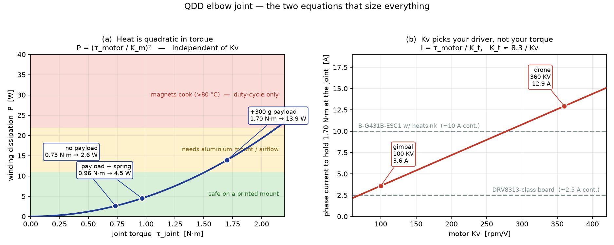

# Torque-Transparent (QDD) Joint — Fundamentals & Worked Elbow Case

**Status:** reference note for the parallel bench project. The *arm* build is
SO-101 (see `proj_hardware_choice` reasoning in §10); this note is for building
**one torque-transparent joint at a time** on the bench, to actually feel
impedance control on real hardware.

**Scope:** the four motor constants, how they chain into torque / current /
heat, and a worked case on the **elbow** joint. Every number here is either
derived (marked ✅) or an estimate to be measured (marked 📏).

---

## 1. Why this note exists

Cartesian impedance control needs the robot to *produce a commanded force*. That
only works if the torque you command actually arrives at the link — which means
low friction, low reflected inertia, and a drivetrain that doesn't swallow small
commands. QDD (quasi-direct drive) gets there with a **big-diameter motor at a
low gear ratio** instead of a small motor behind a big gearbox.

The design question is always the same: *can this motor make the torque I need,
continuously, without cooking itself, through a driver I can afford?*

Four constants answer that. Everything below is bookkeeping on top of them.

---

## 2. The four constants

### Kv — velocity constant [rpm/V]
How fast the motor spins per volt of back-EMF, unloaded. Printed on every drone
motor. **A winding property**: more turns of thinner wire → lower Kv.

### Kt — torque constant [N·m/A]
**The one you actually care about.** Torque per amp:

```
τ_motor = Kt · I
```

Kv and Kt are the same physical fact seen from two sides (back-EMF and torque
are the same electromechanical coupling), so they're reciprocal:

```
Kt = 9.55 / Kv        (ideal, SI-exact)
Kt ≈ 8.3  / Kv        (practical figure — use this, it's conservative)
```

The 9.55 is just `60/2π` converting rpm→rad/s. The 8.3 accounts for
line-to-line vs phase and RMS vs peak conventions that hobby Kv ratings are
sloppy about. **Measure it** (§8) rather than trusting either.

> Intuition: low Kv = "geared down electrically." More turns → more flux linkage
> per amp → more torque per amp, less speed per volt. Same motor, different wire.

### R — phase resistance [Ω]
Where your heat comes from: `P = I²R`. Scales as turns², so **R ∝ Kt²**.
This is the crucial coupling — see §4.

### Km — motor constant [N·m/√W]
The figure of merit that doesn't depend on how you wound it:

```
Km = Kt / √R
```

Because R ∝ Kt², the Kt in the numerator and the √R in the denominator cancel.
**Km is a property of the motor's size, geometry and copper — not its Kv.**
Bigger motor, more copper, bigger air-gap radius → higher Km.

---

## 3. The two equations that size everything

Rearranging, with `τ_m` the torque at the *motor shaft*:

```
   CURRENT:   I = τ_m / Kt          → picks your DRIVER and PSU     (Kv-dependent)
   HEAT:      P = (τ_m / Km)²       → picks your THERMAL design     (Kv-INdependent)
```

That second one is the whole note in one line. Derivation is two steps:

```
P = I²R = (τ_m/Kt)² · R = τ_m² · (R/Kt²) = (τ_m/Km)²
```

**Consequences worth internalising:**

1. **Heat is quadratic in torque.** Doubling payload roughly quadruples the
   heat. This is why static holding under gravity is the design case, not motion.
2. **Kv does not change your heat.** A 360 KV motor at 13 A and a 100 KV motor
   at 3.6 A, same frame, same torque → *identical* winding dissipation. Choosing
   low Kv doesn't make the motor cooler. It makes the **driver, PSU and wiring**
   smaller.
3. **The only way to reduce heat at a given torque is a bigger Km** — i.e. a
   physically bigger motor — **or less torque** (counterbalance spring, §6).



*Generator: `figures/gen_qdd_thermal.py`*

---

## 4. Worked case — the elbow joint

**Configuration:** 5010-class outrunner → 1:6 HTD-3M belt → 25 cm forearm.

### 4.1 Torque requirement (start here, always)

Worst case is **fully extended, horizontal, loaded** — pure gravity, zero speed.
Sum `m · g · r` for everything past the elbow:

| item | mass | radius | torque |
|---|---|---|---|
| forearm structure (PETG) | 120 g | 12.5 cm (COM) | 0.147 N·m |
| wrist / differential assembly | 120 g | 25 cm | 0.294 N·m |
| gripper | 100 g | 30 cm | 0.294 N·m |
| **payload** | 300 g | 32 cm | 0.942 N·m |

```
τ_joint (unloaded) = 0.735 N·m     ✅
τ_joint (loaded)   = 1.677 N·m  →  call it 1.70 N·m     ✅
```

📏 Masses are estimates — weigh the real parts. Note the payload alone is **55%**
of the total. Distal mass is punishingly expensive; every gram at the gripper
costs ~3× what a gram at mid-forearm costs.

### 4.2 Through the transmission

```
τ_motor = τ_joint / (N · η)         N = 6,  η ≈ 0.95 (good toothed belt)

τ_motor (loaded) = 1.70 / 5.70 = 0.298 N·m  →  0.30 N·m     ✅
```

### 4.3 Current — this picks your driver

| motor | Kt = 8.3/Kv | I = τ_m/Kt | verdict |
|---|---|---|---|
| 5010 **360 KV** (drone) | 0.023 N·m/A | **12.9 A** | needs a serious driver + ~600 W PSU |
| 5010 **100 KV** (gimbal) | 0.083 N·m/A | **3.6 A** | fits a modest board, ~250 W PSU |

Same motor frame, same torque, same heat. **3.6× the current for the cheap
winding.** The knock-ons: MOSFET loss scales as I² (13× more heat *in the
driver*), thicker harness down a moving link (a stiff cable is an unmodelled
spring your impedance controller will feel), and a PSU sized for 4 × 13 A.

**No speed penalty for going low-Kv.** At 1:6, 120 °/s at the joint is ~115 rpm
at the motor; at 100 KV that needs ~1.2 V. Nowhere near the limit, ever.

### 4.4 Heat — Kv doesn't help here

📏 Assume `Km ≈ 0.08 N·m/√W` for a 5010 (measure it — §8; 5010-class motors land
roughly 0.06–0.11).

```
P (loaded)   = (0.30 / 0.08)²  = 13.9 W     ✅
P (unloaded) = (0.129 / 0.08)² =  2.6 W     ✅
```

**2.3× the torque → 5.3× the heat.** The quadratic is brutal.

### 4.5 Temperature rise, and what actually fails

```
ΔT = P · Rth
```

📏 `Rth` for a small outrunner: **~5 °C/W** bare on a printed mount in still air;
**~2.5 °C/W** on an aluminium mount with light airflow.

| case | P | Rth | ΔT | winding temp (25 °C amb) |
|---|---|---|---|---|
| unloaded hold, printed mount | 2.6 W | 5.0 | 13 °C | 38 °C ✅ fine |
| loaded hold, printed mount | 13.9 W | 5.0 | 70 °C | **95 °C ⚠️** |
| loaded hold, alu mount + airflow | 13.9 W | 2.5 | 35 °C | 60 °C ✅ fine |

**The failure mode is the magnets, not the wire.** Winding insulation is usually
good to 155 °C, but cheap N42 neodymium starts **irreversibly** losing flux
around 80 °C. Demagnetisation is permanent and shows up as a quietly falling Kt
— your torque calibration drifts and you'll chase it in software for a week.

> **The aluminium mount is worth ~35 °C.** That is the difference between
> "works" and "slowly destroys itself." Recall this only works because BLDC puts
> the windings on the *stator*, bolted to your frame — a brushed motor heats its
> rotor and has no such path.

### 4.6 What a counterbalance spring buys

QDD has **no self-locking**. Unlike a worm or a high-ratio harmonic drive, it
burns current to stand still, forever. Cancel the unloaded gravity torque with a
spring and the loaded case becomes `1.70 − 0.735 = 0.965 N·m`:

```
P = (0.965/5.70 / 0.08)² = 4.5 W     ✅   (was 13.9 W)
```

**3.1× less heat for a few rupees of spring steel.** Because P ∝ τ², removing a
constant offset from the torque pays off superlinearly. This is the single
highest-leverage mechanical addition to any QDD arm.

---

## 5. The transparency check — reflected inertia

The whole point of QDD. A gearbox multiplies the rotor's inertia by **N²** as
seen from the output:

```
J_reflected = N² · J_rotor
```

📏 5010 bell ≈ 50 g of magnets+steel at ~20 mm effective radius:

```
J_rotor     = 0.050 · 0.020²      = 2.0e-5 kg·m²
J_reflected = 36 · 2.0e-5         = 7.2e-4 kg·m²     ✅
```

Link inertia about the elbow (Σ m·r², loaded) ≈ **0.050 kg·m²**.

```
ratio = 7.2e-4 / 0.050 = 1.4 %     ✅  →  transparent
```

Compare an STS3215-class serial servo at ~1:345 — even with a tiny rotor,
345² = 119,000 makes reflected inertia land around **30 %** of link inertia.
**~20× worse.** That number *is* the reason the arm feels dead when you push it,
and no control loop can fix it: it's mechanical, and it acts above your control
bandwidth.

**Rule of thumb: keep reflected inertia under ~10 % of link inertia.** At 1:6
you have enormous margin; you could go to 1:15 before it bites.

---

## 6. The impedance deadband — your real quality metric

The number that decides whether the joint *feels* compliant is the **smallest
torque you can reliably command**. Two contributors:

1. **Friction floor** 📏 — belt + bearings + cogging, maybe 0.02–0.05 N·m at the
   joint. Measure it (§8).
2. **Current-sense resolution** — torque noise `Δτ = Kt · ΔI`. With ~50 mA of
   sense noise at Kt = 0.083: 4.2 mN·m at the motor → **25 mN·m at the joint**.

Combined deadband ≈ **0.05 N·m at the joint** → at 0.25 m that's **~0.2 N at the
fingertip**. You can feel 0.2 N. An STS3215's stiction is more like 0.15–0.3 N·m
at the output — over an order of magnitude worse.

> A subtlety on sensing: fractional torque resolution is roughly Kv-independent
> (the sense range scales with the current you need). But shunt sizing isn't —
> at 13 A you need ~1 mΩ (13 mV signal), at 3.6 A you can afford ~10 mΩ (36 mV).
> Same amplifier noise floor, **~2.7× better SNR** at low current. Second-order,
> but it lands directly on the thing this whole design exists to get right.

**Critical prerequisite:** the driver must do **real current-sense FOC**. Some
SimpleFOC-compatible boards only run *voltage-mode* torque control, where
τ ≈ V/R with no current loop — open-loop, and R drifts ~40 % from cold to hot.
That demolishes the entire transparency argument. Verify before buying.

---

## 7. Belt elasticity — you have built a Series Elastic Actuator

An output encoder lets you *observe* past the belt; it does not make the belt
stiff. Motor inertia + belt stiffness + link inertia is a **two-mass resonance**,
and it sits inside your impedance loop.

📏 Rough estimate: 90T HTD-3M pulley ≈ 43 mm radius, belt axial stiffness a few
hundred N/mm → torsional stiffness ~400–500 N·m/rad. Against 0.05 kg·m²:

```
ω_n = √(450 / 0.05) ≈ 95 rad/s  ≈  15 Hz     📏
```

Impedance bandwidth caps around **⅓ of that, ~5 Hz**, unless actively damped.
This is not a flaw — it's how SEAs work, and the compliance is genuinely useful
for contact. But **measure it** (§8), because the printed structure may well be
softer than the belt, which would put it lower.

---

## 8. Bench measurement protocol

The point of a one-joint testbed. Assume nothing above; measure all of it.

**Kt — the ground truth.** Lock the output, clamp a lever arm of known length
`r`, hang a known mass `m`. Ramp commanded current until it just balances:
```
Kt = (m · g · r) / (N · I)
```
This is better than any datasheet: it captures the real Kt *through* the real
transmission, including efficiency.

**R.** Measure phase-to-phase with a milliohm meter, or force a known DC current
and measure the voltage drop. Do it cold **and** hot — copper is +0.39 %/°C, so
R rises ~40 % from 20 °C to 120 °C.

**Km** = Kt / √R_phase. Compare to the 0.08 assumption; re-run §4.4 with the
real value.

**Rth.** Tape a thermistor to the stator (not the bell). Hold a known stall
current, log temperature to plateau. `Rth = ΔT_final / P`. Then repeat with the
aluminium mount and prove the 2× to yourself.

**Friction floor.** Output free, slowly ramp commanded torque until breakaway.
That value is your impedance deadband. Also measure it *after* running warm —
grease thins and it changes.

**Resonance.** Step the torque command, log the output encoder at full rate, FFT
the ringing. That peak is your bandwidth ceiling from §7.

**Then the real test:** implement `τ = K(θ_d − θ) + D(θ̇_d − θ̇)` at the joint,
and push it with your hand. Sweep K from limp to stiff. *That* is the intuition
this project exists to buy.

---

## 9. Design rules of thumb

| rule | why |
|---|---|
| Size for **static holding**, not motion | gravity at full extension is the continuous worst case |
| **P ∝ τ²** — cut torque before cutting current | counterbalance springs pay superlinearly |
| Low Kv is nearly free — **pick it** | same heat, ~4× less current, cheaper driver + PSU + harness |
| Heat is fixed by **Km** (motor size), not Kv | want cooler? bigger motor or less torque. Nothing else |
| Windings are on the stator → **aluminium mount** | worth ~35 °C; the single cheapest thermal win |
| Watch **magnets (~80 °C)**, not insulation (155 °C) | demagnetisation is permanent and drifts Kt silently |
| Keep **J_reflected < 10 %** of link inertia | above your control bandwidth; unfixable in software |
| **Verify current-sense FOC** before buying a driver | voltage-mode torque control invalidates everything |
| Distal grams cost ~3× mid-link grams | moment arm; move wrist motors proximal |

---

## 10. Why the arm is SO-101 and this is a bench project

Decided 2026-07-18. The bottleneck on the north star (language-conditioned
pick-and-place) is **data, policy and eval** — not actuator compliance. SO-101 is
the LeRobot reference platform: existing URDF, leader-follower teleop, public
datasets and checkpoints on identical hardware to compare against when a policy
fails. Time-to-first-real-rollout is a weekend.

A custom QDD arm would cost 2–3 months and land back at the same policy problems
with a robot nobody else has debugged. Compliance earns its keep on contact-rich
tasks (insertion, wiping, force-referenced grasping) — not on "pick up the cup."

So: **SO-101 on the critical path, one QDD joint on the bench in parallel.** The
joint is a genuine way to *feel* §6 and Ch 11 impedance control on hardware, and
it front-loads the measurements needed if a compliant arm ever becomes the right
build. Revisit the full arm when a task actually demands compliance — with real
measurements in hand.

---

## 11. FAQ (from discussion)

**Q: If I had a 10 A driver, could I just use the cheap 360 KV drone motors?**
Physically yes — same torque, same heat (§3). But the savings don't survive
system-level accounting: 4 × 13 A means a ~600 W PSU (probably costing more than
the motor savings), 13× more heat in the driver, thicker moving harness, and
worse shunt SNR. And a gimbal rewind of the *same* 5010 frame costs only a few
hundred rupees more — same aluminium, same magnets, different wire. **Kv is the
cheapest lever on the build; it's the wrong place to economise.**

**Q: Why not brushed DC?** Three stacking reasons. (1) Windings are on the
**rotor**, so heat is generated in the spinning part with no conduction path out
— fatal for a joint whose worst case is holding still. (2) At stall the same
commutator segment carries current continuously → localised arcing and pitting,
and robot joints stall constantly. (3) The commutator wants a long narrow
cylinder, so you can't build the **wide pancake** geometry that gives QDD its
torque density. Brushed still wins for grippers (simple H-bridge, no commutation
encoder) and for ironless precision drives (Maxon/Faulhaber, zero cogging).

**Q: Doesn't the output encoder "bypass" belt compliance?** No — it lets you
*observe* the load side, but the belt is still a physical spring in the loop.
You've built an SEA (§7). Good for contact, but it puts a ~15 Hz resonance
between motor and link that caps impedance bandwidth.

**Q: Why does the differential need a transpose?** If the position mixer is
`[θ_A; θ_B] = M [θ_pitch; θ_roll]` with `M = [[1,1],[1,−1]]`, then torques map
through `M`ᵀ, so commanding a desired joint torque needs `M⁻ᵀ`:
```
τ_A = (τ_pitch + τ_roll)/2
τ_B = (τ_pitch − τ_roll)/2
```
Note the **½** that a naive position-mixer copy leaves out. Same `Jᵀ` principle
as the arm Jacobian (MR Ch 5), one level down in the transmission — forces and
velocities transform through transposes of each other.

---

## Related

- `notes/modern_robotics/11_*` — impedance / compliance control
- `notes/00_roadmap.md` — where hardware sits relative to the DL path
- `figures/gen_qdd_thermal.py` — regenerates the figure above
