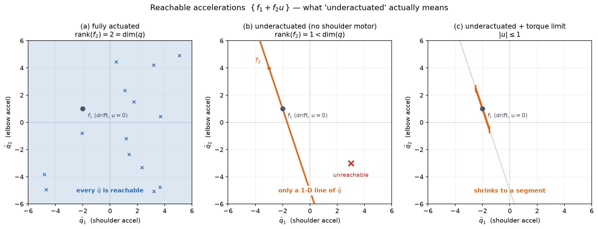

# 01 — Fully-actuated vs Underactuated Systems

*Underactuated Robotics, Ch. 1.* The framing chapter: one definition, one
inequality, and a change of worldview that the rest of the book depends on.

---

## 1. The big picture

Two walking robots, same era, opposite philosophies.

**Honda's ASIMO** walks smoothly but strangely — Tedrake describes it as *"an
astronaut encumbered by a heavy space suit."* Its controller uses high-gain
feedback and large joint torques to **cancel out** the machine's natural dynamics
and force it onto a pre-planned trajectory. The bill: roughly **20× a human's
cost of transport**, and it only works while the stance foot is flat on the
ground — so it can't move fast, and can't handle uneven terrain.

**A passive dynamic walker** (Collins, Wisse & Ruina) has *no motors, no
controller, no computer*. It walks stably down a shallow ramp powered only by
gravity, and its gait looks more natural than ASIMO's. It **is** its dynamics.

> *"The dynamics of walking is beautiful, and should be exploited — not cancelled
> out."*

That is the thesis of the whole course. And this is exactly the boundary we hit
at the end of MR: **computed torque control (MR Ch 11) is the ASIMO philosophy.**
You measure the dynamics, invert them, cancel them, and command whatever you
like. This chapter tells you precisely when that is possible — and that when it
isn't, it *really* isn't, and you need a different toolbox.

The lever Tedrake uses to force the issue is a joke that turns out to be a
definition: *to get a control researcher to respect the dynamics, take away a
motor.*

---

## 2. The core idea

Newton says mechanical systems are second order. State is position `q`
(configuration) plus velocity `q̇`; the thing you actually get to pick is a
**control input** `u` (motor torques). The general second-order control system:

```
q̈ = f(q, q̇, u, t)
```

**Definition (informal but exact):** the system is **fully actuated** at state
`x = (q, q̇)` and time `t` if, *holding the state fixed*, the map from `u` to `q̈`
is **onto** — for **every** acceleration `q̈` you might want, there exists some
`u` that produces it. Otherwise it is **underactuated** at that state.

Read that again, because it's the whole chapter: **underactuation is a statement
about the set of accelerations you can command right now.**

Not about how many motors you have. Not about where you can eventually get to.
About what `q̈` is available *this instant*.

### The control-affine form

For essentially every robot we care about, torque enters *linearly*. Freeze
`q, q̇, t` and the dynamics are a linear function of `u` plus a constant:

```
q̈ = f₁(q, q̇, t)  +  f₂(q, q̇, t) · u          ... (2)
       └─ drift ─┘     └── control ──┘
```

- **`f₁`** — the **drift**. What the robot does if you command nothing (`u = 0`):
  gravity pulls, momentum carries, Coriolis swirls. Free acceleration.
- **`f₂`** — how your input maps into acceleration. A matrix with `dim[q]` rows
  and `dim[u]` columns.

The reachable set of accelerations is then

```
{ f₁ + f₂ u  :  u admissible }
```

— the **column space of `f₂`**, translated so it sits at the point `f₁`. And the
test for underactuation is a rank condition:

```
rank[ f₂(q, q̇, t) ] < dim[q]     ⟹   underactuated at (q, q̇, t)     ... (3)
```

**The implication runs one way only.** Full-rank `f₂` does *not* guarantee full
actuation, because constraints like `|u| ≤ 1` can also shrink the reachable set.
More on that in §6.



*(a)* `f₂` has rank 2 in a 2-D acceleration space: the columns span everything,
every `q̈` is reachable. *(b)* Rank 1: the reachable set collapses to a **line**
through `f₁`. Everything off that line — like the red ✗ — is unreachable *right
now*, no matter what torque you apply. *(c)* Add a torque limit and the line
shrinks to a **segment**.

---

## 3. Linear algebra you need here

Four ideas, all about the same picture.

### Span / column space — "what can this matrix produce?"

`f₂ u` is a **weighted sum of the columns of `f₂`**, with the entries of `u` as
the weights. Concretely, if

```
f₂ = [ a  b ]      then   f₂ [u₁]  =  u₁ · [a]  +  u₂ · [b]
     [ c  d ]                 [u₂]         [c]          [d]
```

So the set of achievable `f₂ u` is exactly **all linear combinations of the
columns** — the *span* of the columns, called the **column space**. Geometrically:
lay the columns down as arrows from the origin and ask what you can sweep out by
scaling and adding them. Two independent arrows in 2-D sweep the whole plane. One
arrow (or two pointing along the same line) sweeps only a line.

### Rank — "how many independent directions do those columns give?"

**Rank = the dimension of the column space.** Not how many columns there are —
how many *genuinely different directions* they point in.

- Two columns pointing in different directions → rank 2 → they span a plane.
- Two columns pointing along the same line → rank 1 → they span only that line,
  and one of them was redundant.
- One column → rank ≤ 1.

This is the same rank you met in **MR Ch 5** when the Jacobian `J` lost rank at a
**singularity** and the arm could no longer move the end-effector in some
direction. Identical idea, different matrix: *a rank-deficient matrix has output
directions it simply cannot produce.* Condition (3) says "the acceleration space
is `dim[q]`-dimensional, but `f₂` only reaches a lower-dimensional slice of it."

### Surjective (onto) — the formal word for "reaches everything"

A map is **surjective** if every point in the target space has *some* input that
produces it. `f₂` is surjective onto `R^dim[q]` exactly when `rank[f₂] = dim[q]`
— i.e. when it has **full row rank**. Full *row* rank, note, not full column
rank: you need the columns to span the whole output space, and you're allowed to
have more columns than rows (more actuators than DOF) as long as they span.

### Right inverse — "undo it"

If `f₂` has full row rank, there exists a matrix `f₂⁻¹` (a **right inverse**)
with `f₂ f₂⁻¹ = I`. It tells you which `u` produces a desired output.

**You already know this object.** When `f₂` is square and invertible it's the
ordinary inverse. When `f₂` is *wider* than it is tall — more actuators than DOF
— the right inverse is **not unique** (many torque combinations give the same
acceleration), and the standard choice is the **pseudoinverse** `f₂†`, exactly
the `J†` you used for redundant-arm IK in **MR Ch 5–6**. Same math, same
"pick the minimum-norm solution among infinitely many" story.

### And one bonus: why `M(q)` is always invertible

The inertia matrix `M(q)` is always **symmetric positive definite**. "Positive
definite" means `vᵀ M v > 0` for every nonzero `v` — and since `½ q̇ᵀ M q̇` is the
kinetic energy, this is just the physical statement that **any motion has
positive kinetic energy**. A positive definite matrix has all eigenvalues > 0,
hence nonzero determinant, hence **is always invertible**. That's why we can
always solve the manipulator equations for `q̈`, and why underactuation can never
come from `M` — it can only come from `B`.

---

## 4. The key result: it all comes down to `B`

From **MR Ch 8**, the manipulator equations:

```
M(q) q̈  +  C(q, q̇) q̇  =  τ_g(q)  +  B u
```

- `M(q)` — inertia matrix (symmetric positive definite, always invertible)
- `C(q, q̇) q̇` — Coriolis / centrifugal terms
- `τ_g(q)` — gravity
- `B` — the **actuation matrix**: which joints have motors, and how input maps to
  generalized force

Solve for `q̈` to put it in the form of (2):

```
q̈ = M⁻¹(q) [ τ_g(q) − C(q, q̇) q̇ ]  +  M⁻¹(q) B u
     └────────── f₁ ──────────────┘     └─── f₂ ───┘
```

So `f₂ = M⁻¹ B`. Since `M⁻¹` is **always full rank**, multiplying by it can't
change the rank. Therefore:

> **A system described by the manipulator equations is fully actuated if and only
> if `B` has full row rank.**

Clean and checkable. For a double pendulum with a motor at each joint,
`B = I₂ₓ₂` → full rank → fully actuated. Remove the shoulder motor and
`B = [0, 1]ᵀ` → rank 1 → underactuated.

---

## 5. Feedback equivalence: why full actuation makes control *easy*

If `f₂` has full row rank, apply this (generally nonlinear) feedback law:

```
u = π(q, q̇, t) = f₂⁻¹(q, q̇, t) [ u′ − f₁(q, q̇, t) ]
```

where `u′` is a **new input** — the input to *your* controller rather than to the
motors. Substitute into (2):

```
q̈ = f₁ + f₂ · f₂⁻¹ [u′ − f₁] = f₁ + u′ − f₁ = u′
```

```
                  q̈ = u′
```

The robot has become a **double integrator**: "acceleration equals whatever I
ask." All the gravity, Coriolis, and inertial coupling is gone — *cancelled by
construction*. The system is said to be **feedback equivalent** to `q̈ = u′`.

Read `f₂⁻¹[u′ − f₁]` as a recipe: **"subtract off the drift, then invert the
input map."**

Three things to notice:

1. **This is computed-torque control from MR Ch 11**, arrived at from a new
   direction. You've already built this.
2. **It doesn't care how big the robot is.** Tedrake: *"the control derivations
   here would not have been any more difficult if the robot had 100 joints."*
   Full actuation makes dimension nearly irrelevant.
3. **You can embed any dynamics you like, not just linear ones.** Want your
   double pendulum to behave like a damped *single* pendulum? Set the bracket to
   those dynamics instead of `u′`. Tedrake calls this **feedback cancellation**
   or **dynamic inversion** — and notes it would have been just as easy to
   *invert gravity*.

**And underactuated systems are not feedback equivalent to `q̈ = u′`.** There is
no `f₂⁻¹` to build the recipe from. So:

> The control designer has no choice but to reason about the actual dynamics of
> the plant.

That sentence is why the remaining 19 chapters exist.

There's an ML-flavored version of the same statement that's worth holding onto:
for fully-actuated systems there's a **change of variables that makes the control
optimization landscape convex**. Underactuated systems have no such trick — which
is precisely why they need optimal control, trajectory optimization, and RL.

---

## 6. Four ways to be underactuated

**(a) Fewer actuators than DOF** — `dim[u] < dim[q]`. `f₂` has more rows than
columns, so it *cannot* have full row rank. The obvious case: a joint with no
motor.

**(b) Enough actuators, but `B` doesn't span** — rank can fail even when
`dim[u] = dim[q]`, if `B(q)` is configuration-dependent and degenerates at
certain `q`. (Exercise 1.3 is exactly this: drive the double pendulum by pushing
on its tip instead of its joints, and `B(q)` goes rank-deficient at particular
configurations.) This is the direct analogue of a **kinematic singularity**.

**(c) Input constraints** — `|u| ≤ 1`. Here `f₂` is full rank, but the reachable
set is a bounded segment rather than the whole line. Tedrake's minimal example:

```
ẍ = u,   |u| ≤ 1      →  there is no u producing ẍ = 2.
```

Underactuated by the definition, with a perfectly good `f₂`. **Every real robot
has torque limits**, so in a strict sense every real robot is underactuated
somewhere; the question is whether the limits bind in the regime you care about.

**(d) Nonholonomic constraints** — a constraint `φ(q, q̇, t) = 0` that **cannot**
be integrated into a constraint `φ(q, t) = 0` on configuration alone. The
canonical case is a wheeled robot, `q = [x, y, θ]ᵀ`, which can't slip sideways:

```
ẏ cos θ − ẋ sin θ = 0
```

The car **can reach any `(x, y, θ)`** — it just can't move directly sideways to
get there. The constraint restricts *how* configurations are reached, not *which*
are reachable, so it does **not** reduce the DOF count. Contrast with a train on
tracks: that constraint *can* be written purely in `q`, it's **holonomic**, and it
genuinely removes a DOF.

You met this in **MR Ch 13** as the nonholonomic wheeled base. The relationship:
**nonholonomic ⟹ underactuated, but not conversely** — the double pendulum
missing a motor is underactuated and nobody calls it nonholonomic.

---

## 7. Worked example: the double pendulum, with and without a shoulder motor

Take `m₁ = m₂ = 1`, `l₁ = l₂ = 1`, and evaluate at **`θ₂ = 90°`** (elbow bent
square), where `cos θ₂ = 0`. The inertia matrix

```
M(q) = [ (m₁+m₂)l₁² + m₂l₂² + 2m₂l₁l₂cos θ₂     m₂l₂² + m₂l₁l₂cos θ₂ ]
       [ m₂l₂² + m₂l₁l₂cos θ₂                    m₂l₂²                ]
```

evaluates to

```
M = [ 3  1 ]        det M = 3·1 − 1·1 = 2       M⁻¹ = [  0.5  −0.5 ]
    [ 1  1 ]                                          [ −0.5   1.5 ]
```

*(Sanity check on "positive definite": eigenvalues are 0.586 and 3.414, both > 0. ✓)*

**Case 1 — both motors.** `B = I`, so `f₂ = M⁻¹ I = M⁻¹`, which is rank 2.
**Fully actuated.** Any `q̈` you want, there's a torque pair that delivers it.

**Case 2 — elbow motor only.** `B = [0, 1]ᵀ`:

```
f₂ = M⁻¹ [0]  =  [  0.5  −0.5 ] [0]  =  [ −0.5 ]
         [1]     [ −0.5   1.5 ] [1]     [  1.5 ]
```

Rank 1 < 2 → **underactuated.** The reachable accelerations are the line
`f₁ + t·[−0.5, 1.5]ᵀ` — panel (b) of the figure, drawn with these exact numbers.

**Now look at what that column actually says.** Command `u = +1` at the *elbow*
and you get

```
q̈₂ = +1.5   (elbow accelerates forward — expected)
q̈₁ = −0.5   (shoulder accelerates BACKWARD — nobody asked for this)
```

The shoulder has **no motor at all**, yet it accelerates — and in the *opposite*
direction. That's Newton's third law showing up as off-diagonal terms in `M⁻¹`:
torquing the elbow throws the forearm one way and kicks the upper arm the other.

**This is the single most important intuition in the chapter.** Underactuated
does *not* mean "the unactuated joints are dead." It means you can only drive
them **indirectly, through coupling**, and only in the one direction that `f₂`
happens to point. Swing-up control, energy shaping, and partial feedback
linearization (Ch 3) are all techniques for **steering that coupling over time**
to get where a single instant can't take you.

---

## 8. Gotchas / intuition checks

**Underactuated ≠ uncontrollable.** The single most common confusion. A rank-1
`f₂` restricts what you can do *in an instant*; it says nothing about where you
can get *over time*. An acrobot can swing itself upright with only an elbow
motor — it just can't do it by commanding the acceleration directly. Instant vs.
trajectory.

**More actuators than DOF can still be underactuated.** Tedrake's example: the
human body has enormous numbers of muscles, often several per joint. But when you
**jump**, no combination of muscle activations can change the ballistic
trajectory of your center of mass. In flight you are underactuated regardless of
your actuator count — because `f₂` cannot produce acceleration in the CoM
directions.

**It's a property of the *model*, not the robot.** Model a two-link arm as rigid
with two motors → fully actuated. Add degrees of freedom for **link flexibility**
→ the same physical robot is now underactuated, because two motors can control
two joint angles but not two joint angles *plus* the flexing modes. Same robot,
different fidelity, different answer.

**It can depend on state and time** — though for every system in this book,
underactuation is a *global* property of the model. Informally we call systems
"fully actuated" if they are so in most states, tolerating joint limits and
kinematic singularities.

**"Feedback linearizable" ≠ "fully actuated."** Related but distinct questions.
Even a controllable *linear* system can be underactuated — Ch 3 makes this
precise.

**Full row rank, not full column rank.** With more actuators than DOF, `f₂` is
wide; it can still be surjective. The right inverse just isn't unique.

---

## 9. Why this matters for the north star

Tedrake's own list of what's still hard, with our annotations:

- **Legged robots are underactuated.** A robot with `N` internal joints and `N`
  actuators, not bolted down, has `q ∈ R^(N+6)` — the internal joints **plus the
  6 DOF of the floating base** (position + orientation in space, an element of
  **SE(3)**, straight out of MR Ch 3). But `u ∈ R^N`. So `dim[u] < dim[q]` and
  condition (3) holds *always*. **Nothing directly actuates the floating base** —
  you move it only by pushing on the ground. This is the formal reason **M4
  (humanoid loco-manipulation) is a different problem** from a wheeled base, and
  why the whole book is the prerequisite for it.

- **Swimming and flying robots are underactuated.** Same story — each control
  surface adds one actuator and one DOF.

- **Manipulation is often underactuated** — and this one lands on the pick-place
  build directly. A fully-actuated arm **becomes underactuated the moment it
  manipulates an object**, because the object brings its own DOF (a brick has 6)
  with no actuators attached. *Unless* **force closure** is achieved and
  maintained — then the object's DOF are rigidly slaved to the hand's, and you can
  treat the system as fully actuated again. That is precisely the
  **force-closure** condition from **MR Ch 12**, now with a control-theoretic
  payoff: *force closure is what buys you the right to pretend you're fully
  actuated.* Lose the grasp, or manipulate something deformable, and you're back
  to underactuated.

The consequence for planning: for a fully-actuated arm you can plan **kinematic**
trajectories and worry about dynamics later — which is exactly what MR Ch 9/10 let
us do. For underactuated systems, **you must plan in the dynamics from the
start.** That's why Tedrake's trajectory-optimization chapter and his
*manipulation* course's trajectory-optimization chapter are formulated completely
differently.

---

## 10. The one-paragraph summary

Write the dynamics as `q̈ = f₁ + f₂u`. The accelerations you can command right now
are the **column space of `f₂`, offset by the drift `f₁`**. If those columns span
the full acceleration space (`rank f₂ = dim q`, equivalently `B` has full row
rank), you can cancel the dynamics with `u = f₂⁻¹[u′ − f₁]` and the robot becomes
`q̈ = u′` — control is easy, and MR's toolbox suffices. If they don't span it,
**no feedback law can make the robot do what you want in an instant**, and you
must instead steer the natural dynamics over time. Legged robots, thrown objects,
grasped objects without force closure, and every torque-limited machine live on
that side of the line.

---

## 11. FAQ

### Q: If I drive a robot with a *task-space force* instead of joint torques, what is `B`?

**It is the transpose of the manipulator Jacobian, `B(q) = J(q)ᵀ`** — and this
collapses Ch 1's rank test into MR Ch 5's singularity analysis.

*Worked out in Exercise 1.3.* Apply a 2-D force `u` directly at the tip of the
double pendulum instead of torques at the joints. The book hands you

```
B(q) = [ l₁c₁ + l₂c₁₊₂     l₁s₁ + l₂s₁₊₂ ]
       [ l₂c₁₊₂            l₂s₁₊₂        ]
```

`B` is square, so full row rank ⟺ `det B ≠ 0`. Expanding, the two `l₂²` terms
cancel and the angle-addition identity `sin a cos b − cos a sin b = sin(a−b)`
collapses the rest:

```
det B(q) = l₁ l₂ sin θ₂
```

so the system is **underactuated exactly when `sin θ₂ = 0`, i.e. `θ₂ = 0` or
`θ₂ = π`** — the arm fully extended, or folded back on itself. Both are the same
geometric fact: **the links are collinear.** Note `θ₁` drops out entirely — only
the elbow angle matters.

**Why:** a force whose line of action passes through a joint axis has zero moment
arm about it. With the links collinear, a push **along the arm** points through
*both* joints at once and produces no torque at either; it is absorbed as
structural load. Perpendicular pushes still work, so a 2-D input yields only a
1-D set of generalized forces.

**The connection.** With `θ` measured from the downward vertical (the pendulum
convention), `B(q) = J(q)ᵀ` *identically* — which is forced, because MR Ch 5's
statics says a tip force maps to joint torques via **`τ = Jᵀ F`**. And
`det J = l₁l₂ sin θ₂` is the textbook 2R planar-arm singularity. Since
`rank Jᵀ = rank J`:

> **Task-space actuation singularities are exactly the kinematic singularities.**

The two failures are one physical fact from opposite sides:

| view | statement | direction |
|---|---|---|
| MR Ch 5, velocity (`J`) | the tip **cannot be moved** in some direction | along the arm |
| here, force (`Jᵀ`) | a force on the tip **produces no joint torque** | along the arm |

Same direction, because the arm is rigid along its length — it can neither extend
that way nor be loaded that way. Formally `Null(Jᵀ) ⊥ Col(J)`, which is why the
unreachable velocity direction and the wasted force direction coincide.

**Habit worth keeping:** when a singularity condition comes out as a trig
function set to zero, solve the *whole family* (`sin θ₂ = 0` ⟹ `θ₂ = kπ`), not
just the obvious root. `θ₂ = π` is easy to drop and is a genuinely different pose.

### Q: Can input limits make a system underactuated even when `B` is full rank?

Yes — see §6(c). The rank condition (3) is **sufficient** for underactuation but
not **necessary**. `ẍ = u` with `|u| ≤ 1` has a perfectly good full-rank `f₂` and
still cannot produce `ẍ = 2`. In the book's exercises `u` is normally taken
unbounded so that the rank test is the operative one, but on real hardware the
limits are always there. This is the route by which the **torque-limited
pendulum** (Ch 2 §6) becomes underactuated despite being a one-DOF, one-motor,
`B = 1` system.
