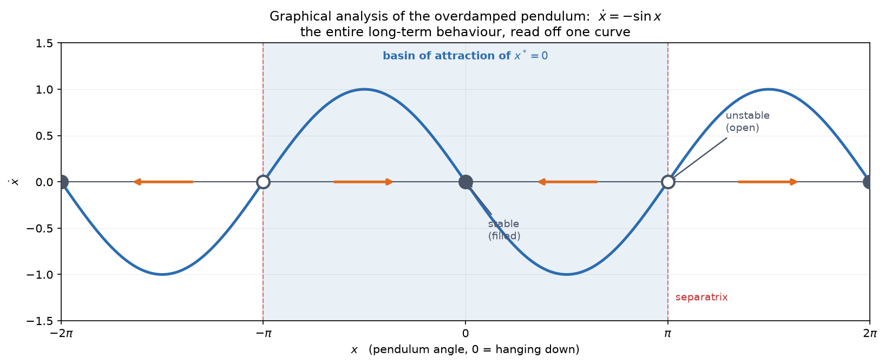
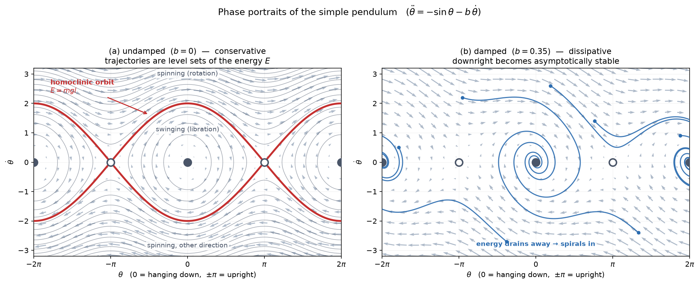
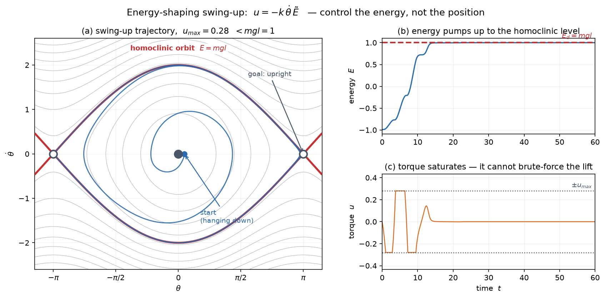

# 02 — The Simple Pendulum

*Underactuated Robotics, Ch. 2.* Tedrake: *"Our goals for this chapter are
modest: we'd like to understand the dynamics of a pendulum."* They are not
modest. This chapter installs the entire visual vocabulary of nonlinear
dynamics — fixed points, stability, phase portraits, basins, energy — on the
smallest system that has all of it.

Two reasons the pendulum earns a whole chapter:

1. **Multi-link robot arms are just coupled pendula.** The dynamics you meet
   here reappear, tangled together, in every manipulator.
2. It is **rich enough to show every concept** and **small enough to actually
   understand.** It stays the book's workhorse — the acrobot, cart-pole, and
   walking models in Ch 3–4 are all pendulum variations.

---

## 1. The system

```
m l² θ̈  +  b θ̇  +  m g l sin θ  =  u
```

- `θ` — angle, with **`θ = 0` hanging straight down**, `θ = ±π` straight up
- `m l²` — the moment of inertia `I` of a point mass on a massless rod
- `b θ̇` — viscous damping (friction)
- `m g l sin θ` — gravity. **The `sin θ` is the whole problem** — it's what makes
  this nonlinear, and everything hard downstream comes from it.
- `u` — our control torque at the pivot

### The shock: you can't solve it

Give me `θ(0)` and `θ̇(0)`; surely I integrate and get `θ(t)`? **No.** Even the
simplest case `b = u = 0` requires **elliptic integrals of the first kind**, and
Tedrake's verdict is that there is *"relatively little intuition to be gained
here."*

Compare a linear system:

```
q̇ = a q    →    q(t) = q(0) e^{at}
```

and you instantly know everything: decays if `a < 0`, blows up if `a > 0`, sits
still if `a = 0`. Our entire intuition for linear systems comes from being able
to write the solution down.

> One of the simplest nonlinear systems imaginable, and we can't solve it.

**This is why the field looks the way it does.** If closed-form solutions are
off the table, you need methods that describe *long-term behaviour* without ever
solving for `θ(t)`. Chapter 2 gives the graphical ones; the rest of the book gives
the computational ones. (The canonical reference for the graphical material is
Strogatz, *Nonlinear Dynamics and Chaos* — Tedrake cites it, and it's the friendly
way in.)

---

## 2. Tool 1 — graphical analysis of a first-order system

Start with a special case that collapses to first order. If damping dominates
(`b θ̇ ≫ m l² θ̈` — imagine the pendulum swinging in molasses), drop the
acceleration term:

```
b ẋ = u₀ − m g l sin x         →   with m = l = g = b = 1, u₀ = 0:   ẋ = −sin x
```

*(Writing `x` instead of `θ` to ignore the wrap-around at `2π` for a moment.)*

Now **plot `ẋ` against `x`** and read the entire long-term behaviour off the
curve:



- **Fixed points** (steady states) are the **zero crossings** — where `ẋ = 0`.
  Start there and you never leave. Here: `x* = {…, −π, 0, π, 2π, …}`.
- **Flow direction** is the **sign of `ẋ`**. Where the curve is above the axis,
  the state moves right; below, it moves left. Those are the orange arrows.
- **Stability is the slope at the crossing.** Negative slope → flow on both sides
  points *inward* → **stable** (filled circle). Positive slope → flow points
  *outward* → **unstable** (open circle). At `x* = 0` the slope of `−sin x` is
  `−cos 0 = −1` → stable. At `x* = π` it's `−cos π = +1` → unstable. ✓ physics.
- **Basin of attraction** (or region of attraction) — the set of initial
  conditions that end up at a given fixed point. Here `x(0) ∈ (−π, π)` all flow
  to `0`; that's the shaded band.
- **Separatrix** — the boundary between basins. Here the unstable fixed points
  `±π` do the separating. Basins can never overlap, and their boundaries are
  themselves trajectories.

**The key limitation:** a first-order system on a line is *extremely* constrained.
It can only **monotonically approach a fixed point** or **run off to ±∞**. There
are no other options. **Oscillation is impossible** — to oscillate you'd have to
turn around, which means passing through `ẋ = 0`, which is a fixed point you'd
then be stuck at.

That is exactly why we need a second dimension, and §4's phase portraits.

> **Careful with the wrap-around.** Back in `θ` coordinates, if `|u₀| > mgl` the
> pendulum turns forever, which *looks* like an oscillation. It isn't. It's an
> instability with `θ → ±∞`, disguised by the fact that angles wrap.

---

## 3. The stability zoo (this vocabulary gets used for the rest of the book)

"Stable" turns out to mean five different things, and Tedrake warns that the
distinctions **actually matter** — *"the code that we will write to stabilize the
systems will be subtly different depending on what type of stability we want."*

Let `x*` be a fixed point.

**Stable in the sense of Lyapunov (i.s.L.)** — *"start close, stay close."*
Formally: for every small `ε > 0` there's a `δ > 0` such that
`‖x(0) − x*‖ < δ` implies `‖x(t) − x*‖ < ε` for all `t`.

Unpack the ε-δ, because it's the one piece of formalism worth decoding here.
Think of it as a game. **You** name a tolerance — a ball of radius `ε` around the
fixed point that I'm not allowed to leave. **I** must answer with a starting ball
of radius `δ`: start anywhere inside it and I promise to stay inside your `ε`
ball *forever*. If I can answer *every* `ε` you name, the point is stable i.s.L.
Note what this does **not** claim: nothing about ever *reaching* `x*`.

**Locally attractive** — *"eventually get there."* Start nearby and
`lim_{t→∞} x(t) = x*`. Note what this does **not** claim: anything about the
journey. You might wander far away first.

**Locally asymptotically stable** — **both**: stable i.s.L. *and* attractive.
Stay close *and* converge.

**Locally exponentially stable** — asymptotically stable *with a rate*:
`‖x(t) − x*‖ < C e^{−αt}`. You converge, and you converge *at least this fast*.
Strongest of the four. You can often see it on the first-order plot: if you can
draw a **negatively-sloped straight line through the fixed point that separates
the curve from the horizontal axis**, the nonlinear system converges at least as
fast as that line's linear system.

**Unstable** — not stable i.s.L.

### The two traps

**Stable i.s.L. does not imply attractive.** The undamped pendulum hanging down
is the example: nudge it and it swings forever on a nearby orbit. It stays close
(stable i.s.L.) but never converges (not attractive). *Nothing is dissipating
energy.*

**Attractive does not imply stable i.s.L.** — genuinely surprising, and it can't
happen in 1-D, which is why Tedrake reaches for a 2-D example in polar
coordinates:

```
ṙ = r(1 − r),      θ̇ = sin²(θ/2)
```

The fixed point at `r* = 1, θ* = 0` **attracts every trajectory** — yet is not
stable. Why: `θ̇ = sin²(θ/2) ≥ 0` is *never negative*, so the angle only ever
increases. A trajectory starting a hair past `θ = 0` cannot go back the short
way; it must travel **all the way around the circle** to return. Start
arbitrarily close, and you're still forced on a grand tour before coming home. It
gets there (attractive), but it does not stay close (not i.s.L.).

**This is not a contrived edge case** — flag it now, because the energy-shaping
swing-up controller in §7 has *exactly this pathology*, and that's why it needs a
second controller to finish the job.

---

## 4. Tool 2 — phase portraits for second-order systems

Drop the heavy-damping assumption and the pendulum is genuinely second order.
The standard move — used constantly from here on:

> **Any second-order system becomes a first-order system with twice as many
> variables.**

```
θ̈ = f(θ, θ̇)        ⟶        x₁ = θ,    ẋ₁ = x₂
                                x₂ = θ̇,    ẋ₂ = f(x₁, x₂)
```

Nothing was solved; we **traded one 2nd-order equation for two 1st-order ones**.
That's a good trade because now the *state* is a **point in the plane** `(θ, θ̇)`,
and the dynamics assigns a **velocity vector to every point** in that plane.

That field of arrows is the **phase portrait**. Trajectories are the curves you
get by starting somewhere and following the arrows.



### Reading panel (a) — undamped, `b = 0`

Fixed points sit where **both** `θ̇ = 0` and `θ̈ = 0`, so on the `θ`-axis at
multiples of `π`. Two distinct flavours:

- **`θ = 0, ±2π` (hanging down): centers.** Trajectories *circulate around* them
  in closed loops. Stable i.s.L., **not** asymptotically stable — nothing decays.
- **`θ = ±π` (upright): saddles.** Two directions flow *in*, two flow *out*. The
  in/out structure is why the red curve makes an ✕ there.

**Closed orbits mean periodic motion** — this is the oscillation that was
impossible in 1-D. Adding the second dimension bought it.

### Why the trajectories are exactly the energy contours

Kinetic and potential energy, with `I = ml²`:

```
T = ½ I θ̇²           U = − m g l cos θ           E(θ, θ̇) = T + U
```

With no damping and no input, the pendulum is **conservative**: `E` is constant
along any trajectory. So each trajectory is confined to a **level set of `E`** —
and the black contours in the figure *are* the trajectories. No integration
needed. Setting `E(θ(t), θ̇(t)) = E₀` and solving:

```
θ̇(t) = ± √( (2/I) [ E₀ + m g l cos θ(t) ] )
```

Tell me `θ`, and I get `θ̇` up to a sign. A real solution needs the bracket
non-negative, which caps the swing at

```
θ_max = arccos( −E₀ / (mgl) )     when E₀ < mgl,        π  otherwise
```

— i.e. *the pendulum cannot swing above the height where its total energy is all
potential.* Obvious physically; nice that it falls out algebraically.

### The homoclinic orbit — the most important curve in the chapter

The special level set `E = mgl` (red) is the energy of the **upright**
equilibrium. It is the trajectory that **leaves the upright fixed point and
returns to it** — a *homoclinic* orbit (Greek: *same inclination*, an orbit
joining a fixed point to itself).

It takes **infinite time** at each end: approaching a saddle, the vector field
vanishes, so you creep in ever more slowly and never quite arrive.

It's also the **separatrix of the 2-D system**, dividing two qualitatively
different regimes:

- **inside** (`E < mgl`): closed orbits — the pendulum **swings** back and forth
  (*libration*)
- **outside** (`E > mgl`): the wavy curves — the pendulum has enough energy to go
  over the top and **spins** forever (*rotation*)

Remember this curve. §7's swing-up controller has exactly one goal: **get onto
it.**

### Reading panel (b) — damped, `b > 0`

Damping dissipates energy, so `E` is no longer conserved and trajectories **cut
across** contours, spiralling inward. The downright fixed points become
**asymptotically** stable (in fact exponentially). The centers became **stable
spirals**.

---

## 5. The math you need here

Lighter on linear algebra than Ch 1, but three things deserve unpacking.

### Vector fields and state space

A **vector field** attaches an arrow to every point of a space. Here the space is
the `(θ, θ̇)` plane and the arrow at each point is `(θ̇, θ̈)` — *where the state
will move next*. A trajectory is what you trace by dropping a particle in and
letting it be carried along, like a leaf on a current.

Crucially the field is **fixed in advance by the dynamics**, not by where you
started. Every possible behaviour of the system is already encoded in that
picture; choosing an initial condition just picks which streamline you ride.

### Level sets (contours)

A **level set** of `E(θ, θ̇)` is the set of points where `E` takes one particular
value — exactly a contour line on a topographic map. The energy landscape here is
a surface over the `(θ, θ̇)` plane; a conservative system is a marble sliding
along a fixed contour, never up or down. Damping tilts the marble downhill across
contours.

### Classifying fixed points — a preview of eigenvalues

*(Ch 3 does this properly; here's the geometry so the pictures make sense.)*

Near a fixed point, zoom in far enough and the curved vector field looks
**linear**: `ẋ ≈ A (x − x*)`, where `A` is the matrix of partial derivatives of
the dynamics — the **Jacobian of the vector field**. The **eigenvalues of `A`**
tell you the local shape:

| eigenvalues of `A` | picture | pendulum example |
|---|---|---|
| both real, opposite signs | **saddle** — in along one direction, out along another | upright, `θ = ±π` |
| purely imaginary | **center** — pure circulation, closed orbits | hanging down, undamped |
| complex with negative real part | **stable spiral** — circulation + decay | hanging down, damped |
| both real negative | **stable node** — straight-in decay | heavily overdamped |

> ⚠️ **Notation collision worth flagging.** This `A` is **not** the Jacobian `J`
> from MR Ch 5. There, `J` was *kinematic*: it mapped **joint velocities → EE
> velocities**, `V = J(θ) θ̇`. Here `A` is the derivative of the **dynamics vector
> field with respect to the state** — it says how the *flow* changes as you move
> around state space. Same word "Jacobian" (any matrix of partial derivatives
> earns the name), completely different object. Don't let the shared vocabulary
> fuse them.

The eigenvalue intuition itself is the familiar one: an eigenvector of `A` is a
direction the flow doesn't rotate, only stretches, and the eigenvalue is the
stretch factor. Negative → shrink toward the point. Positive → grow away.
Complex → the flow rotates as it stretches, hence spirals.

---

## 6. Torque limits make it underactuated

**The simple pendulum is fully actuated.** One DOF, one motor, `B = 1`, full row
rank. With unlimited torque you could invert gravity outright and stabilize the
upright trivially — as Ch 1 §5 promised.

Now impose `|u| ≤ u_max`. **This is Ch 1 §6(c) exactly**: full-rank `f₂`,
underactuated anyway, because the input constraint shrinks the reachable set.

The phase portrait makes the consequence visible. Via feedback you may **change
the vector field at each point, but only by a bounded amount** — you can tilt the
arrows, not replace them. And if `u_max < mgl`, you can't even hold the pendulum
**horizontal**, never mind lift it. Some states simply cannot be driven to the
goal directly; you must **pump energy** over multiple swings.

Tedrake's warning: whether a solution exists at all, and how many pumps it takes,
is *"a non-trivial function of the initial conditions and the torque-limits"* —
and with enough damping and a tight enough limit, **swing-up may be impossible**.

Which is why this toy is the book's workhorse: *"obtaining a solution with
general-purpose algorithms requires much of the same reasoning necessary for
controlling much more complex underactuated systems."*

---

## 7. Energy-shaping control — the payoff

Here's the move that makes the chapter. **Stop trying to control position.
Control energy.**

Differentiate `E = ½ml²θ̇² − mgl cos θ` along the trajectory, substituting the
equations of motion (three lines, worth seeing):

```
Ė = m l² θ̇ θ̈ + θ̇ m g l sin θ
   = θ̇ [ u − m g l sin θ ] + θ̇ m g l sin θ
   = u θ̇
```

```
                         Ė = u θ̇
```

**Everything cancels but the input.** Gravity does no net work over a cycle; the
*only* way energy enters or leaves is through your torque. And the rule is
beautifully simple:

> **To add energy, push in the direction you're already moving. To remove it,
> push against.** (Which is what damping does — hence "negative damping" for
> pumping.)

This is what a child on a swing discovers without any equations.

### The controller

Target the homoclinic orbit, `E_d = mgl` — get onto it and the natural dynamics
carry you to the top for free. Define the error `Ẽ = E − E_d`, note `Ẽ̇ = Ė = uθ̇`,
and choose

```
u = −k θ̇ Ẽ,        k > 0
```

It looks odd until you substitute it:

```
Ẽ̇ = −k θ̇² Ẽ
```

Since `θ̇² ≥ 0` always, this is `Ẽ̇ = −(something ≥ 0) · Ẽ` — **exponential decay
of the energy error**, for any `θ̇ ≠ 0`. Apply §2's graphical test: plot `Ẽ̇` vs
`Ẽ` at fixed `θ̇` and you get a straight line of negative slope through the
origin. Converges. ✓

The logic in words: **too much energy → brake; too little → pump.** Sign handled
automatically by `θ̇`.



Simulated with `m = l = g = 1` and `u_max = 0.28`, far below `mgl = 1` — it
**cannot** lift the pendulum directly. Panel (a): the trajectory spirals outward,
gaining amplitude each pass, and converges onto the homoclinic orbit (blue lands
exactly on red). Panel (b): energy climbing in **steps** — one step per swing,
each a pump — flattening at `E_d = 1`. Panel (c): torque **saturating** at
`±u_max` during the pumping, then falling to nearly zero once on the orbit, since
no energy needs adding.

### Three things to notice

**It fails from exactly `θ̇ = 0`.** With `θ̇ = 0` the control is `u = −kθ̇Ẽ = 0`,
and the pendulum hanging perfectly still stays there. Nudge it and it swings all
the way up. A measure-zero blind spot, but a real one.

**Attractive but not stable — this is the §3 trap, in the wild.** The controller
drives all trajectories to the upright, but the upright doesn't become *stable*.
A small perturbation can send the system **all the way around the circle** before
returning — precisely the polar-coordinate pathology from §3, now with a concrete
cause. So the practical recipe is a **switching controller**: energy-shape to
swing up, then **hand off to a balancing controller** (LQR, Ch 3) near the top.
Tedrake notes the switching threshold is *"somewhat arbitrary"* here and gets a
principled answer in Ch 9 (Lyapunov).

**It is astonishingly robust to model error — and this one deserves attention.**
The model enters only through `Ẽ`, and the only property that matters for
stability is *where the orbit `Ẽ = 0` sits*:

```
½ l θ̇² = g (cos θ + 1)
```

**The mass has vanished entirely.** You could use `(E − E_d)/m` and get identical
behaviour — so the controller works with **no knowledge of `m` whatsoever**, and
depends only *linearly* on `l` and `g`. (Tedrake, dryly: if you can't measure the
length of your pendulum, *"a proper measuring device would make an excellent
investment."*) Damping can be cancelled too: `u = −kθ̇Ẽ + bθ̇`, again robustly.

Sit with his closing remark, because it is a warning aimed straight at the
learning-based approach:

> *"We will develop many optimization-based algorithms capable of swinging up the
> pendulum, but it will take a lot of work to find one that is as insensitive to
> the model parameters."*

A little physical insight bought parameter-robustness that heavy machinery
struggles to match. Worth remembering when a learned policy overfits to its
simulator.

---

## 8. Bifurcations, and an unexpected ML connection

Add a **constant** torque `u₀` and the fixed points **move**: the stable and
unstable points slide toward each other, meet, and **annihilate**. A qualitative
change in the *structure* of the dynamics caused by smoothly varying a parameter
is a **bifurcation** (the pendulum's is a *saddle-node*). A **bifurcation
diagram** plots fixed-point locations against the parameter, solid for stable and
dashed for unstable.

Tedrake's other example is worth flagging for the north star. The **nonlinear
autapse**:

```
ẋ + x = tanh(w x)
```

For `w ≤ 1`: one fixed point. For `w > 1`: **three** — two stable, one unstable, a
*pitchfork* bifurcation. And this is **a model of a single neuron with a feedback
connection to itself** — `x` is the firing rate, `tanh` the activation, `w` the
synaptic weight. The two stable fixed points are **one bit of persistent memory**,
implemented as bistable dynamics.

The chapter's exercises push further into **Hopfield networks**
(`ẋ = Aᵀ softmax(βAx) − x`), where stable fixed points are *stored patterns* and
the basin of attraction is what makes **associative recall from a corrupted input
work** — you initialize at a noisy image and flow downhill to the clean one.
Tedrake even notes that **transformers can be read as dynamical systems**
(autoregressive maps), deferred to later notes.

That's a real bridge, not a cute analogy: *fixed points, basins of attraction, and
stability are the same mathematics whether the state is a pendulum angle or a
network activation.*

---

## 9. The forward hook: from "look at the picture" to "compute the answer"

Tedrake plants the next several chapters with one question. Since feedback lets
you pick a `u` at each state — i.e. choose from a *stack* of phase portraits:

> *"How would you shape the natural dynamics — at each point pick a `u` from the
> stack of phase plots — to stabilize the vertical fixed point **with minimal
> torque effort**? This is exactly the way that I would like you to think about
> control system design."*

That sentence is the whole book in miniature:

- **a choice at every state** → a **policy** `u = π(x)`
- **"minimal torque effort"** → a **cost function** to minimize
- **the computational answer** → **dynamic programming** (Ch 7), then **LQR**
  (Ch 8), then **trajectory optimization** (Ch 10)

And for the north star: *a policy is a vector field you get to choose.* When a
diffusion policy or a VLA emits actions, it is selecting from that same stack of
phase portraits — just parameterized by a neural network and fit from data rather
than solved for. The value function that RL estimates is the "cost-to-go" of this
exact problem. **Ch 7 makes that precise**, which is why `00b_sota_augmentation.md`
puts the RL-bridge note there.

---

## 10. The one-paragraph summary

The pendulum can't be solved in closed form, so we describe it **geometrically**
instead. In 1-D, plot `ẋ` vs `x`: zero crossings are fixed points, the sign of `ẋ`
is the flow, the slope is stability — but 1-D flows can't oscillate. In 2-D,
rewrite the second-order dynamics as a **vector field on the `(θ, θ̇)` plane**;
now closed orbits exist. Undamped, the system is conservative and trajectories
**are the level sets of energy**, with the **homoclinic orbit `E = mgl`**
separating swinging from spinning. Damping makes the downright point
asymptotically stable. Add a **torque limit** and the fully-actuated pendulum
becomes underactuated: you can no longer lift directly, so you **pump energy**
using `Ė = uθ̇` — push with the motion to add energy, against to remove it. The
controller `u = −kθ̇Ẽ` drives the system onto the homoclinic orbit exponentially,
is remarkably insensitive to model parameters, and is **attractive but not
stable** — so it must hand off to a balancing controller at the top.

---

## 11. FAQ

### Q: Is swing-up like getting a rocket to the Moon — swinging in a gravity field, gaining energy each pass, until you cross onto a trajectory that puts you in orbit where you slow down?

Mostly yes, and one part of it is a **literal identity** rather than an analogy.

**What transfers exactly.**

*Pump where you're fastest.* Raising an orbit is done with repeated burns **at
perigee**, because a given `ΔV` buys more energy when you're already moving fast
— the **Oberth effect**. That is the same equation as `Ė = u θ̇`. Both are just

```
power = force × velocity
```

Energy enters in proportion to the speed you already have, so you spend effort
where you're moving fastest. In the §7 simulation the pendulum swings out to
~3.06 rad, but energy goes in **within 0.28 rad of the bottom** — the fast part
of the arc. Burning at perigee.

*The separatrix structure is genuinely shared.* The two-body problem has the same
three regimes as the pendulum:

| two-body orbit | pendulum |
|---|---|
| `E < 0`, bound ellipse | swinging (libration) |
| `E = 0`, parabolic escape — coasts to infinity arriving at zero velocity | **homoclinic orbit** `E = mgl` |
| `E > 0`, hyperbolic escape | spinning (rotation) |

**Escape velocity is a separatrix.** Same mathematics, different system.

*"Where you slow down" is the balancing controller.* A transfer trajectory
reaching the Moon is **not** captured on its own — without a **lunar orbit
insertion burn** you swing past and come home. That is exactly §7's point:
energy-shaping delivers you onto the homoclinic orbit, which is **attractive but
not stable**, so you must hand off to a balancing controller (LQR, Ch 3). One
caveat: that controller isn't mainly *removing* energy. You arrive with the right
energy; upright is a **saddle**, and LQR is rejecting perturbations along its
unstable direction.

**What to fix: gravity supplies none of the energy.** Look again at the
derivation —

```
Ė = θ̇[u − mgl sin θ] + θ̇ mgl sin θ = u θ̇
```

the gravity term **cancels exactly**. Gravity is conservative: it stores energy
going up and returns it coming down, **zero net work per cycle**. Every joule
comes from the motor. Gravity only *shapes* the trajectory — setting where you're
fast and where you're slow, hence where your torque is efficient. A true gravity
assist is different: a slingshot steals energy from the *planet's orbital
motion*, a three-body effect with no pendulum analogue. **No free lunch here,
only well-timed spending.**

**The tightened analogy.** Drop the Moon — the exact match is a rocket **escaping
a single body**: bound orbit ↔ swinging; repeated perigee burns raising apoapsis
↔ pumping one step per swing; Oberth ↔ `Ė = uθ̇`; escape velocity ↔ homoclinic
orbit; hyperbolic escape ↔ spinning; insertion burn ↔ switching to LQR. The Moon
was an imported second body the pendulum doesn't have, but everything built
around it transfers.
