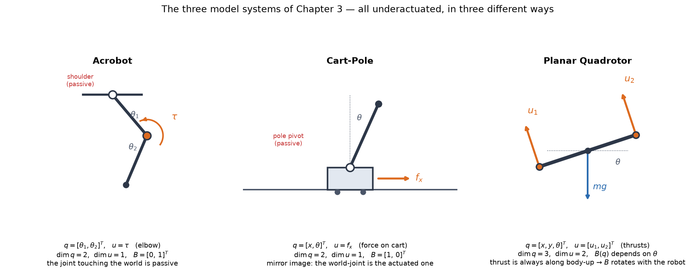
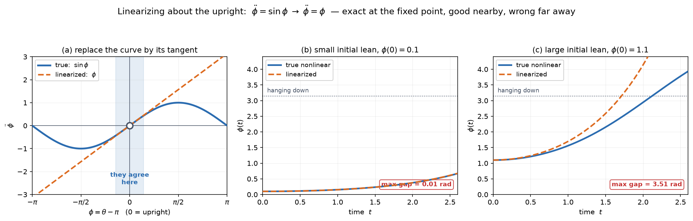

# 03a — Acrobots, Cart-Poles, Quadrotors, and Linearization

*Underactuated Robotics, Ch. 3, §3.1–3.4.1.* First of three passes at Ch 3:

- **3a (this note)** — the three model systems, and how to linearize the
  manipulator equations about a fixed point.
- **3b** — controllability, and **LQR balancing**.
- **3c** — partial feedback linearization, and **swing-up**.

---

## 1. Why model systems

> *"A great deal of work in the control of underactuated systems has been done in
> the context of low-dimensional model systems. These model systems capture the
> essence of the problem without introducing all of the complexity that is often
> involved in more real-world examples."*

Ch 2 gave us one system with one DOF. Real underactuation needs **at least two
DOF**, because the interesting thing — steering an unactuated joint *through its
coupling* to an actuated one — cannot happen with a single joint.

These three are the standard benchmarks in the field. When you read a paper
claiming a new nonlinear control or RL method, it will almost certainly show a
cart-pole. Knowing them cold is table stakes.

They are all **trivially underactuated** (`dim u < dim q`), but they fail in
three *different* ways, which is why the book carries all three.



---

## 2. The Acrobot

A planar two-link arm in the vertical plane, **actuated at the elbow, passive at
the shoulder**. Named for its resemblance to a **gymnast on a high bar**, who
controls their motion mostly by effort at the waist — not by gripping harder with
the wrists. (Its mirror image, actuated at the shoulder and passive at the elbow,
is the **Pendubot**.)

- `q = [θ₁, θ₂]ᵀ` — `θ₁` shoulder, `θ₂` elbow **relative to link 1**
- `x = [q, q̇]ᵀ` ∈ R⁴, `u = τ` (elbow torque)
- **Zero configuration is both links pointing straight down**, matching the
  pendulum convention from Ch 2
- **Task: stabilize `x* = [π, 0, 0, 0]ᵀ`** — fully extended, straight up

In manipulator form `M(q)q̈ + C(q,q̇)q̇ = τ_g(q) + Bu`:

```
M(q) = [ I₁ + I₂ + m₂l₁² + 2m₂l₁l_c2 c₂     I₂ + m₂l₁l_c2 c₂ ]
       [ I₂ + m₂l₁l_c2 c₂                   I₂               ]

B = [0]
    [1]
```

**`B = [0, 1]ᵀ`, rank 1 < 2 → underactuated** — the same `B` we computed by hand
in note 01 §7. The Acrobot *is* that example, given a name and a task.

Two things to notice:

**The unactuated joint is the one attached to the world.** Nothing you do reaches
the shoulder directly. You can only drive it through `M`'s off-diagonal
coupling — which is exactly the `q̈₁ = −0.5` we computed in note 01 §7 when
commanding elbow torque.

**Tedrake flags it as *"closely resembl[ing] one of the simplest models of a
walking robot."*** A leg swinging about a passive ground contact, driven by a hip
torque, is structurally an Acrobot. **This is the Ch 4 hook** — and given M4, the
reason this system deserves real attention.

---

## 3. The Cart-Pole

A pendulum on a cart, controlled by **horizontal force on the cart**. The task is
to balance the pole upright.

- `q = [x, θ]ᵀ` — cart position, pole angle (**`θ = 0` hanging down**, CCW positive)
- `u = f_x` (horizontal force on the cart)
- **Task: stabilize `x* = [0, π, 0, 0]ᵀ`**

```
M(q) = [ m_c + m_p        m_p l cos θ ]        C(q,q̇) = [ 0   −m_p l θ̇ sin θ ]
       [ m_p l cos θ      m_p l²      ]                 [ 0    0             ]

τ_g(q) = [ 0             ]        B = [1]
         [ −m_p g l sin θ]             [0]
```

**`B = [1, 0]ᵀ`** — the exact mirror of the Acrobot. Here **the joint touching
the world is the actuated one**, and the *pole* is passive. Same rank deficiency,
opposite arrangement. Between them, the two systems cover both ways a two-DOF
chain can be under-actuated.

Unusually, you can solve for the accelerations in closed form:

```
ẍ = 1/(m_c + m_p sin²θ) · [ f_x + m_p sin θ (l θ̇² + g cos θ) ]

θ̈ = 1/(l(m_c + m_p sin²θ)) · [ −f_x cos θ − m_p l θ̇² cos θ sin θ − (m_c+m_p) g sin θ ]
```

And Tedrake's simplification, used constantly from here on — **set every constant
to 1**:

```
2ẍ + θ̈ cos θ − θ̇² sin θ = f_x
ẍ cos θ + θ̈ + sin θ     = 0
```

Keep these two lines; §3c's partial feedback linearization starts from them
verbatim.

> **Why the cart-pole is *everywhere* in courses:** balancing alone can be done
> with elementary linear control (pole placement), so it appears in intro courses.
> The **full swing-up and balance** problem needs genuine nonlinear treatment —
> which is what we're building toward.

---

## 4. The Planar Quadrotor

A single rigid body in the vertical plane with two propellers. (Strictly a
"birotor," but Tedrake notes that *"doesn't have the same ring to it."*)

- `q = [x, y, θ]ᵀ` — position and pitch. `u = [u₁, u₂]ᵀ` — the two thrusts.
- `dim q = 3`, `dim u = 2` → underactuated.

```
m ẍ = −(u₁ + u₂) sin θ
m ÿ =  (u₁ + u₂) cos θ − m g
I θ̈ =  r (u₁ − u₂)
```

**This one earns its place by being different in a way that matters.** Look at
where `θ` appears: the thrust always points **along the body's "up" axis**, so as
the robot pitches, the direction its inputs push **rotates with it**. In
manipulator form that means

> **`B(q)` is configuration-dependent** — unlike the Acrobot and Cart-Pole, whose
> `B` is a constant matrix.

That single fact makes the quadrotor keep a term in the linearization that the
other two drop (§6). It's also the reason the physical intuition is *"to move
sideways, first tilt"* — you cannot produce horizontal force without rotating,
which is underactuation you can feel.

Two asides from the text worth keeping:

- The **3D** quadrotor's linearization about hover is **uncontrollable** if you
  omit the moments produced by the spinning propellers. A modelling detail with a
  hard consequence.
- If you represent the floating-base orientation with a **unit quaternion** and
  linearize without accounting for the unit-norm constraint, the linearization is
  **also uncontrollable**. Tedrake sidesteps it with roll-pitch-yaw, accepting a
  **gimbal-lock singularity**. This is MR Ch 3's rotation-representation tradeoff
  showing up with real teeth — and it will matter again for floating-base
  humanoids (M4).

---

## 5. Balancing: the plan

For both the Acrobot and Cart-Pole the strategy is the same three steps:

1. **Linearize** the nonlinear equations about the unstable fixed point *(this note)*
2. **Check controllability** of that linear system *(3b)*
3. **Design LQR feedback** on it *(3b)*

The chapter's punchline arrives in step 2 and it is genuinely surprising — but
first we need step 1.

---

## 6. Linearizing the manipulator equations

### The idea

A nonlinear system `ẋ = f(x, u)` is a **curved vector field**. Near a point, replace
it with the **flat field that best matches it there** — a first-order Taylor
expansion:

```
ẋ = f(x,u) ≈ f(x*,u*) + [∂f/∂x]|_{x*,u*} (x − x*) + [∂f/∂u]|_{x*,u*} (u − u*)
```

At a **fixed point**, `f(x*, u*) = 0` by definition — the constant term vanishes.
Defining the **error coordinates** `x̄ = x − x*` and `ū = u − u*`, we land in
standard linear state-space form:

```
ẋ̄ = A_lin x̄ + B_lin ū
```

The change of variables matters: `x̄` measures **displacement from the fixed
point**, so "stabilize the upright" becomes the cleaner "drive `x̄ → 0`."



Panel (a): near the upright, the true gravity term `sin φ` is replaced by its
tangent line `φ`. Panel (b): from a small lean the two are indistinguishable —
**max gap 0.01 rad**. Panel (c): from a large lean they part company — **max gap
3.51 rad**. That's the whole story of linearization, and exactly why LQR will
*balance* but cannot *swing up*.

> Note the **sign**: about the upright the pendulum linearizes to `φ̈ = +φ`, not
> `−φ`. **Positive** feedback — lean further and gravity pulls you further. That's
> the saddle from note 02 §4, and it's why balancing is an active job.

### The result, and why it's shaped that way

Doing the expansion on the manipulator equations gives something remarkably
clean, in block form:

```
A_lin = [ 0                                              I ]
        [ M⁻¹ ∂τ_g/∂q + Σⱼ M⁻¹ (∂Bⱼ/∂q) uⱼ              0 ]|_{x*,u*}

B_lin = [ 0     ]
        [ M⁻¹B  ]|_{x*,u*}
```

where `Bⱼ` is the `j`-th column of `B`. Read it block by block:

**Top row `[0  I]` is free, and exact.** The state is `x = [q; q̇]`, so
`ẋ = [q̇; q̈]`. The top half of `ẋ` is just `q̇` — which doesn't depend on `q` at
all (hence `0`) and depends on `q̇` as the identity (hence `I`). *This row isn't
an approximation.* All the modelling lives in the bottom row.

**Bottom-left is "how does displacement create acceleration."** This is the
**stiffness-like** term — for a pendulum, how far you lean determines how hard
gravity pulls you over.

**Bottom-right is `0`** — no damping-like term, because these models have none.

**`B_lin = [0; M⁻¹B]`** — input can't change position instantly, only
acceleration, and it does so through `M⁻¹B`. That is exactly the `f₂` from Ch 1.

### Why so many terms vanish

The full expansion has more terms; they die at a fixed point for four separate
reasons, and each is worth understanding:

| dropped term | why |
|---|---|
| `∂M⁻¹/∂qᵢ` | by the product rule it multiplies `[τ_g + Bu − Cq̇]`, which **is zero at a fixed point** (that's what "fixed point" means — no acceleration) |
| derivatives of `C q̇` | `q̇* = 0` at a fixed point, so anything with a leftover `q̇` factor vanishes |
| `C` itself | Coriolis and centrifugal forces are **zero at zero velocity** — they're velocity-dependent by nature |
| `∂B/∂q` | only when `B` is **constant** — true for the Acrobot and Cart-Pole, **false for the quadrotor** |

**A fixed point is a very forgiving place to linearize.** Everything
velocity-dependent switches off, because the velocity is zero. The quadrotor is
the exception that proves the rule: its `B(q)` is genuinely configuration-
dependent, so the `Σⱼ M⁻¹ (∂Bⱼ/∂q) uⱼ` term survives — and note it's weighted by
`uⱼ`, the **nonzero hover thrust** balancing gravity.

### The gravity gradient for each system

The only piece you actually have to compute is `∂τ_g/∂q`:

```
Acrobot, at upright:     [ g(m₁l_c1 + m₂l₁ + m₂l_c2)   m₂ g l_c2 ]
                         [ m₂ g l_c2                   m₂ g l_c2 ]

Cart-Pole, at upright:   [ 0    0     ]
                         [ 0    m_p g l ]
```

The cart-pole's is nearly empty, and that sparsity has meaning: **the gravity
torque on the pole doesn't care where the cart is** (translational invariance —
push the whole system sideways and physics is unchanged), and **gravity exerts no
direct horizontal force on the cart.** The single nonzero entry is the pole
toppling under its own weight.

---

## 7. The math you need here

### Taylor expansion, geometrically

For a scalar function, `f(x) ≈ f(a) + f′(a)(x−a)` is "replace the curve by its
tangent line at `a`." Panel (a) of the figure is literally this.

For a **vector-valued** function of a **vector**, the derivative isn't a number
but a **matrix** — one row per output, one column per input:

```
[∂f/∂x]ᵢⱼ = ∂fᵢ/∂xⱼ     "how much does output i change when input j wiggles?"
```

This is the **Jacobian**. Geometrically it's the **linear map that best
approximates `f` near the point** — a tangent *plane* instead of a tangent line.

> **Same collision flagged in note 02 §5.** This Jacobian is `∂f/∂x` where `f` is
> the **dynamics**, so it says how the *flow* changes across state space. MR Ch 5's
> `J` was **kinematic**: joint velocities → EE velocities. Both are "matrices of
> partial derivatives," which is all the word "Jacobian" means. Don't fuse them.

### Block matrices

Writing `A_lin` as a 2×2 grid of blocks is just bookkeeping: the state splits
naturally into `[q; q̇]`, so the `4×4` matrix (for these systems) is more
readable as four `2×2` blocks. Block multiplication works exactly like scalar
multiplication, as long as the shapes line up. The payoff is that
`[[0, I], [∗, 0]]` **shows the structure at a glance** — the top row is
kinematics, the bottom row is dynamics.

### "Linear" here means linear in the *error*

`A_lin x̄` is linear in `x̄ = x − x*`, not in `x`. The system is linear in
**displacement from the operating point**, which is why every statement is local.

---

## 8. Worked example: linearizing the cart-pole

All constants set to 1, at the upright fixed point `x* = [0, π, 0, 0]ᵀ`, `u* = 0`.

**Step 1 — the inertia matrix at the fixed point.** `M(q) = [[2, cos θ], [cos θ, 1]]`,
and `cos π = −1`:

```
M = [  2  −1 ]        det M = 2·1 − (−1)(−1) = 1        M⁻¹ = [ 1  1 ]
    [ −1   1 ]                                                [ 1  2 ]
```

**Step 2 — the gravity gradient.** `τ_g = [0, −m_p g l sin θ]ᵀ`, so
`∂τ_g/∂q = [[0,0],[0, −cos θ]]`, and at `θ = π` that's `+1`:

```
∂τ_g/∂q = [ 0  0 ]
          [ 0  1 ]
```

**Step 3 — the two blocks.**

```
M⁻¹ ∂τ_g/∂q = [ 1  1 ] [ 0  0 ]  =  [ 0  1 ]         M⁻¹B = [ 1  1 ] [1]  =  [1]
              [ 1  2 ] [ 0  1 ]     [ 0  2 ]                 [ 1  2 ] [0]     [1]
```

**Step 4 — assemble.**

```
        [ 0  0  1  0 ]              [ 0 ]
A_lin = [ 0  0  0  1 ]      B_lin = [ 0 ]
        [ 0  1  0  0 ]              [ 1 ]
        [ 0  2  0  0 ]              [ 1 ]
```

*Verified against a numerical Jacobian of the exact nonlinear dynamics — exact
agreement.*

**Now read it physically.** The state is `x̄ = [x̄, θ̄, ẋ̄, θ̇̄]ᵀ` (cart position,
pole angle, cart velocity, pole angular velocity), and `ẋ̄ = A_lin x̄ + B_lin f̄ₓ`
is **four scalar equations stacked, one per row**. Rows 1–2 are the trivial
kinematic block (`ẋ̄` of position = velocity). The dynamics are rows 3–4, and
because `B_lin = [0,0,1,1]ᵀ`, the force enters **both**:

```
row 3 (cart accel):  ẍ̄ = θ̄ + f̄ₓ
row 4 (pole accel):  θ̈̄ = 2θ̄ + f̄ₓ
```

Row 3: two things push the cart — your force `f̄ₓ`, **and** the pole's lean `θ̄`.
When the pole tips, its weight presses sideways on the pivot, so *a leaning pole
shoves the cart even with the motor off*. That coupling is how you will eventually
control the pole **through** the cart (3c). Row 4: the pole topples in proportion
to how far it already leans (the `+2` — the instability), and your cart force
torques it too, because pulling the pivot sideways rotates the pole about its
center of mass.

**A row vs. a column ask different questions:** row `i` = "what drives the change
in state `i`?"; column `j` = "what does state `j` affect?" Read **column 1** (the
one multiplying `x̄`, cart *position*) down: `[0,0,0,0]ᵀ` — `x̄` appears in none of
the four equations. **Nothing depends on where the cart sits on the rail**, only
on its velocity and the pole's lean; slide the whole apparatus sideways and every
acceleration is identical. That's **translational invariance**, and in 3b it
shows up as the reason a particular mode needs care.

---

## 9. What linearization does and doesn't tell you

Tedrake is careful here, and it's worth being precise:

- **Strictly stable linearization ⟹ the nonlinear system is locally
  exponentially stable.** Good news transfers.
- **Unstable linearization ⟹ the nonlinear system is locally unstable.** Bad news
  transfers too.
- **Marginally stable linearization ⟹ you learn almost nothing.** The nonlinear
  system could be asymptotically stable, stable i.s.L., or unstable — all you know
  is that it is *not* exponentially stable. The higher-order terms you threw away
  decide it.

That middle case is why the undamped pendulum's center (note 02 §4) is genuinely
delicate: purely imaginary eigenvalues put you exactly in the "can't tell" regime.

---

## 10. Gotchas

**Linearization is about a point, not about a system.** "The linearization of the
cart-pole" is meaningless without saying *where*. Linearize the same system about
`θ = 0` (hanging down) and you get a **stable** linear system; about `θ = π` an
**unstable** one. Same equations.

**The fixed point may require nonzero `u*`.** For the Acrobot and Cart-Pole the
upright needs no torque (gravity is balanced by geometry), so `u* = 0`. For the
**quadrotor**, hovering requires thrust to cancel gravity, so `u* ≠ 0` — which is
why its `∂B/∂q` term survives with `uⱼ` as a weight. Always ask what `u*` is.

**`B` constant vs `B(q)` is the real dividing line** among the three systems, and
it's easy to skim past. It's the difference between a linearization with three
terms and one with four.

**Don't confuse `B` (actuation matrix) with `B_lin` (linearized input matrix).**
`B_lin = [0; M⁻¹B]` — related, different shapes, both called "B."

---

## 11. Where this is going

The immediate payoff is 3b: with `A_lin` and `B_lin` in hand, we ask whether the
linear system is **controllable**, and the answer for both the Acrobot and the
Cart-Pole is **yes** — which is startling, because they're underactuated. *The
Acrobot can balance itself upright with no shoulder motor.* That's the
resolution of the "underactuated ≠ uncontrollable" thread we opened in note 01 §8
and hit again in the quadrotor question.

For the north star: **linearizing about an operating point is the single most
common way classical control meets learned control.** A learned policy that
outputs EE deltas is, near any operating point, doing something a local linear
model could describe — and the "linearize, then LQR" pattern is what
model-predictive control does at every timestep along a trajectory (Ch 10). It's
also the substrate under **iLQR/DDP**, which is just this operation repeated along
a whole trajectory instead of at one point.

---

## 12. FAQ

### Q: What is `τ_g` in `M q̈ + C q̇ = τ_g + Bu`?

**Gravity, expressed as joint torques** — the `g` subscript is for gravity. It's
the vector of generalized forces gravity produces at each joint, **as a function
of configuration only** (how hard gravity twists your joints depends on your pose,
not your speed or your input).

*"Generalized" force* means one component per DOF, and the components **need not
share units.** For the cart-pole `q = [x, θ]ᵀ`, so `τ_g`'s first component is a
**force** (pairs with `x`) and its second is a **torque** (pairs with `θ`). The
unifying rule: **generalized force × generalized velocity = power** (`F·ẋ` and
`τ·θ̇` are both watts). Same idea as MR Ch 3c's wrench, and it's the pairing that
made note 02's `Ė = u θ̇` come out as power.

**Recipe:** `τ_g(q) = −∂U/∂q`, the negative gradient of potential energy.
*(Verified against the book's stated `τ_g` for both the acrobot and cart-pole —
exact match.)* You never look up a gravity vector; you differentiate `U`.

**⚠️ Sign convention differs from MR.** MR Ch 8 puts gravity on the **left**:
`Mθ̈ + c + g(θ) = τ`. Tedrake puts it on the **right**, grouped with the other
things applying force to the robot: so **`τ_g = −g_MR`**. Same physics, opposite
sign, because of which side of the equals sign gravity lives on.

**The payoff — this explains §6.** Since `τ_g = −∂U/∂q`, the gravity gradient in
the linearization is `∂τ_g/∂q = −∂²U/∂q²`, the **negative Hessian of potential
energy** — i.e. a **stiffness** (second derivative of PE *is* stiffness, exactly
as `k` for a spring `U = ½kx²`). Its sign is the stability:

| pose | `U` at a… | `∂²U/∂q²` | `∂τ_g/∂q` | behaviour |
|---|---|---|---|---|
| hanging down | minimum | + | − | restoring |
| upright | maximum | − | + | toppling |

For the cart-pole (constants 1), `U = −cos θ`, so `∂τ_g/∂θ = −cos θ`: **+1** at
upright — the exact entry from §8, and the matrix-level reason the linearization
came out `φ̈ = +φ`. So note 02's energy landscape and this note's linearization are
**the same object**: the curvature of the potential well at the fixed point is the
stiffness block of `A_lin`, and its sign is the stability.

### Q: Do these linearizations only work at equilibria?

**No — the technique works anywhere; equilibria are just where it's cleanest.**
Three cases:

**1. At an equilibrium** *(what §6 did).* `f(x*,u*) = 0` kills the constant term,
and `q̇* = 0` kills the Coriolis/`∂M⁻¹` terms. You get the tidy
`ẋ̄ = A_lin x̄ + B_lin ū` with the `[[0,I],[∗,0]]` block structure.

**2. At a non-equilibrium point** `(x₀,u₀)`. You can still Taylor expand, but now
`f(x₀,u₀) ≠ 0`, leaving a **constant drift term**:

```
ẋ̄ = A x̄ + B ū + c,     c = f(x₀,u₀)
```

An **affine** system, not linear. Valid, just messier — the clean block form is
gone because the velocity-dependent terms survive.

**3. Along a trajectory** `(x₀(t), u₀(t))` that *solves* the dynamics — **the
important case.** Define `x̄ = x − x₀(t)`. The drift cancels, because the nominal
trajectory is itself a solution and absorbs it:

```
ẋ̄ = ẋ − ẋ₀(t) = f(x,u) − f(x₀,u₀) ≈ A(t) x̄ + B(t) ū
```

Clean form recovered, **no constant term** — the price is that `A(t), B(t)` are
now **time-varying** (you re-linearize at each instant). A fixed point is just the
special case where this trajectory is one stationary point.

**Why it matters:** that `ẋ̄ = A(t)x̄ + B(t)ū` is the object under **time-varying
LQR** (Ch 8, stabilizing a swing-up trajectory — note 02's promised handoff,
generalized), **iLQR/DDP** (Ch 10 — linearize about the current trajectory, solve
LQR, improve, repeat = §6 in a loop), and **MPC** (re-linearize every timestep).
It's also the scaffold learned/residual-physics corrections bolt onto.

### Q: What does "a trajectory that *solves* the dynamics" mean?

It means the trajectory is **physically real** — something the robot would
actually do — not just a curve you sketched.

A trajectory is a **pair**: a state path `x₀(t)` *and* the input path `u₀(t)` that
would produce it. It **solves the dynamics** if the two are consistent — feed
`u₀(t)` to the robot from `x₀(0)` and it really traces `x₀(t)`:

```
ẋ₀(t) = f(x₀(t), u₀(t))      at every instant
        ↑                      ↑
   how your path is         how physics says it
   changing                 must change
```

**Consistent** (e.g. anything you get by *simulating* — apply a force schedule,
record where it goes): `ẋ₀ = f(x₀,u₀)` holds by construction. **Inconsistent**
(e.g. "the pole rises at constant speed from down to up in 2 s" — a nice curve,
but maybe **no input produces it**): `ẋ₀ ≠ f(x₀,u₀)`, it violates `F = ma`, it's a
wish not a trajectory. In note 02's phase portrait, the real trajectories are the
streamlines of the vector field — the only curves the dynamics permit; you can't
draw an arbitrary path and call it one.

**Why the drift cancels only for consistent references.** With `x̄ = x − x₀(t)`,

```
ẋ̄ = ẋ − ẋ₀(t) = f(x,u) − ẋ₀(t).
```

If `x₀` solves the dynamics, `ẋ₀(t) = f(x₀,u₀)`, so the `f(x₀,u₀)` is **absorbed**
and you get the clean `ẋ̄ ≈ A(t)x̄ + B(t)ū`. If `x₀` is just a drawing, a leftover
`[f(x₀,u₀) − ẋ₀(t)]` term — exactly its violation of physics — never goes away.
**The cancellation is a reward for using a physically real reference.** This is
also why trajectory optimization (Ch 10) can't just *draw* the swing-up it wants:
it must search for an `(x₀(t), u₀(t))` pair satisfying `ẋ₀ = f(x₀,u₀)` as a **hard
constraint** — that constraint *is* "solve the dynamics."
