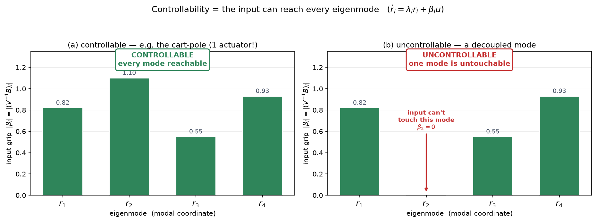
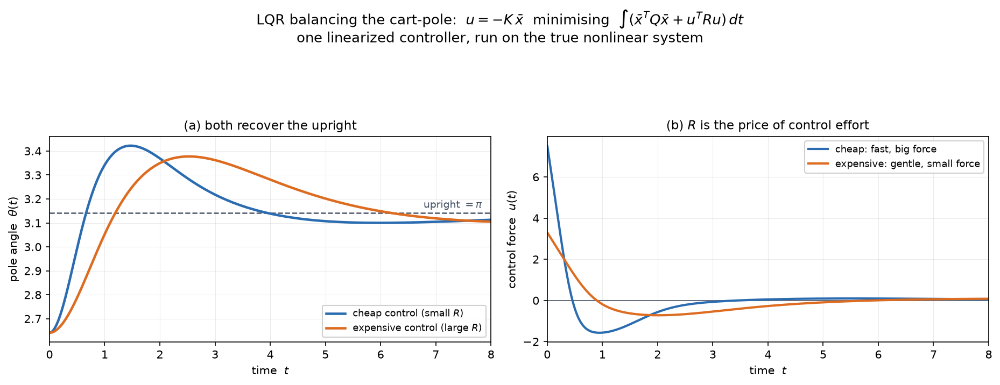
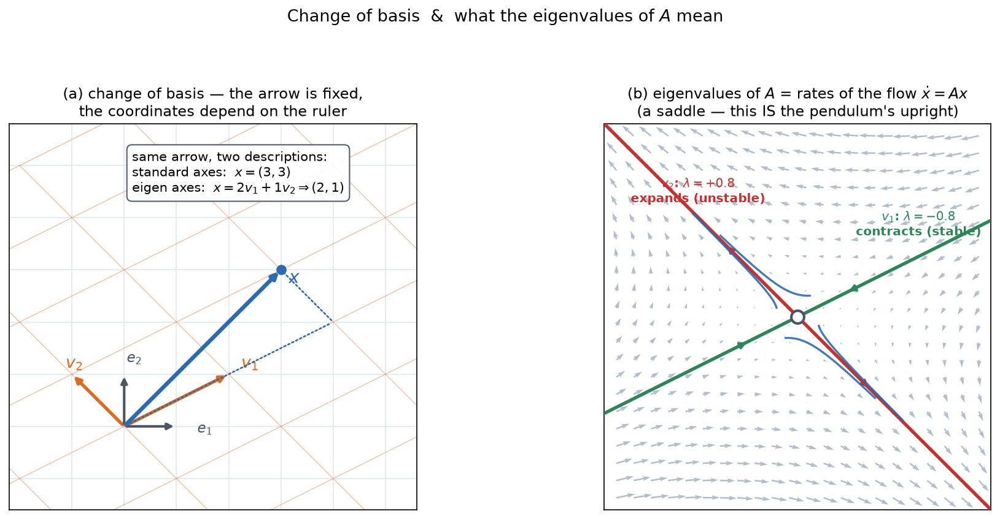

# 03b — Controllability and LQR Balancing

*Underactuated Robotics, Ch. 3, §3.4.2–3.4.3.* Second pass at Ch 3. We have the
linearization `ẋ̄ = A x̄ + B ū` from 3a. Two questions:

1. **Controllability** — *can* any input steer this system where we want? The
   answer for the Acrobot and Cart-Pole is a genuine surprise.
2. **LQR** — *which* input should we pick? The single most reused controller in
   robotics.

This is the heaviest linear algebra in the chapter — eigenvalues, the matrix
exponential, and rank all show up. We go slow.

---

## 1. The surprise, stated first

Both the Acrobot and the Cart-Pole, linearized about the upright, are
**controllable**. Spelled out:

> **The Acrobot can balance itself upright using only the elbow motor — no
> shoulder motor at all.**

This resolves the thread from note 01 §8 and the quadrotor question: **an
underactuated system is not necessarily an uncontrollable system.** Underactuated
means you can't command an arbitrary *acceleration in an instant* (note 01);
controllable means you *can* reach an arbitrary *state, given time*. Instant vs.
trajectory, one more time — and this is where it stops being a slogan and becomes
a theorem.

> *"Underactuated systems cannot follow arbitrary trajectories, but that does not
> imply that they cannot arrive at arbitrary points in state space. However, the
> trajectory required to place the system into a particular state may be
> arbitrarily complex."*

---

## 2. What controllability means

**Definition.** The system `ẋ = Ax + Bu` is **controllable** if there exists an
input `u(t)` on some finite interval `[0, t_f]` that drives the system from *any*
initial state to *any* final state.

Two simplifications make this tractable for linear systems:

- Because the system is linear, it's enough to check that you can drive **any
  initial state to the origin** (`0`). Reaching any *other* target is the same
  problem shifted.
- "Given enough time" — controllability says nothing about *how fast*. It's a
  yes/no reachability question, not a performance one.

The whole difficulty is that `u` enters only through `B`, a low-rank channel
(rank 1 for a single actuator). Controllability asks whether that narrow channel,
**stirred through the dynamics `A` over time**, eventually reaches everywhere.

---

## 3. The intuition: modal decomposition

*(Tedrake's cleanest picture — the special case of distinct eigenvalues. Skip the
general proof; this is the understanding.)*

### Eigen-decomposition, geometrically

Recall the eigenvalue idea (note 02 §5). An **eigenvector** `v` of `A` is a
special direction: `A v = λ v` means `A` acts on `v` by pure **scaling** (by `λ`),
no rotation. Along an eigenvector, the tangled coupled dynamics become a single
scalar: *"this combination of states just grows/decays at rate `λ`."* These are
the **natural modes** of the system.

If `A` (which is `n × n`) has `n` **distinct** eigenvalues, its `n` eigenvectors
are linearly independent and form a **basis** — a complete set of axes for state
space. Stack them as columns into `V`, put the eigenvalues on the diagonal of `Λ`,
and `AV = VΛ`, so:

```
A = V Λ V⁻¹
```

`V` is a **change of basis**: it re-expresses any state in terms of "how much of
each natural mode" it contains, rather than raw coordinates.

> **Linear-algebra aside — change of basis.** `V⁻¹ x` answers "to build the vector
> `x` out of the eigenvector axes, how much of each do I need?" It's the same
> operation as writing a color as (R,G,B) amounts instead of a wavelength: the
> physical thing is unchanged, you've just chosen more convenient axes. `V` goes
> from mode-amounts back to raw coordinates; `V⁻¹` goes the other way. The
> eigenvectors being independent is exactly what guarantees `V⁻¹` exists — the
> axes aren't redundant.

### The dynamics diagonalize

Define **modal coordinates** `r = V⁻¹ x` ("how much of each mode is present").
Substituting into `ẋ = Ax + Bu`:

```
ṙ = V⁻¹AV r + V⁻¹B u = Λ r + β u,     where β = V⁻¹B
```

Since `Λ` is diagonal, the coupled system **falls apart into `n` independent
scalar equations** — one per mode:

```
ṙ_i = λ_i r_i + β_i u
```

Each mode evolves on its own, feeling the input only through its own gain `β_i`.
**This is the payoff of diagonalization:** an `n`-dimensional tangle becomes `n`
one-dimensional problems you can read at a glance.

### And now controllability is obvious

Input `u` can influence mode `i` **if and only if `β_i ≠ 0`**. If some `β_i = 0`,
that mode is deaf to the input — it evolves as `ṙ_i = λ_i r_i` forever, untouchable.
If `λ_i > 0` (unstable), the system is unrecoverable. So:

> **The system is controllable ⟺ every mode has `β_i ≠ 0`** — the input can reach
> every eigenmode.



The bars are the "grip" `|β_i|` the single input has on each mode. **Left:** every
bar nonzero → controllable, even with **one actuator on a 4-state system**. That's
the Acrobot/Cart-Pole situation — the narrow input channel, spread through the
coupling, touches all four modes. **Right:** one mode has `β = 0` → it drifts
untouchably → uncontrollable.

> **Why underactuation and controllability don't conflict:** `B` being low-rank
> limits the input in *raw* coordinates. But `β = V⁻¹B` is `B` viewed in *modal*
> coordinates, and the change of basis `V⁻¹` can spread a single input's influence
> across *all* the modes. The coupling in `A` is what does the spreading. One
> actuator is enough — as long as no mode happens to be orthogonal to it.

---

## 4. The general test: the controllability matrix

Distinct eigenvalues aren't guaranteed (the cart-pole has a repeated eigenvalue
at 0 — see §6), so we need a test that always works. It comes from the exact
solution of the linear ODE, and it introduces an object worth knowing well.

### The matrix exponential

The scalar linear system `ẋ = ax` has solution `x(t) = e^{at} x(0)`. The vector
system `ẋ = Ax` has the *identical-looking* solution

```
x(t) = e^{At} x(0)
```

but now `e^{At}` is a **matrix**. What does "e to a matrix" mean? Exactly what it
means for scalars — the **same power series**:

```
scalar:   e^z   = I + z  + ½z²    + ⅙z³    + ...
matrix:   e^{At} = I + At + ½(At)² + ⅙(At)³ + ...
```

Every term is a matrix (powers of `A` times powers of `t`), the sum converges, and
the result is an `n × n` matrix that **propagates the state forward in time**:
hand it `x(0)`, it returns `x(t)`. Geometrically it's the "flow map" of the linear
vector field — note 02's streamlines, written in closed form.

> **Useful fact:** if `A = VΛV⁻¹` (diagonalizable), then `e^{At} = V e^{Λt} V⁻¹`,
> and `e^{Λt}` is just `diag(e^{λ₁t}, …, e^{λₙt})`. So each mode flows as `e^{λᵢt}`
> — decaying if `Re λᵢ < 0`, growing if `> 0`. The matrix exponential is "let each
> mode run at its own exponential rate, in the mode basis." This is the same
> stability story as note 02, now exact and multi-dimensional.

### The controllability matrix

Feeding the forced solution through and asking "can we hit any `x(0)`" (details in
the book; they hinge on the matrix exponential being a finite polynomial in `A` by
the Cayley–Hamilton theorem), the condition collapses to a **rank test** on a
single matrix:

```
                    𝒞 = [ B   AB   A²B   …   Aⁿ⁻¹B ]
```

```
       controllable   ⟺   rank 𝒞 = n   (full rank)
```

For an `n`-state, `m`-input system, `𝒞` is `n × (nm)`. Full **row** rank means its
`n` rows are linearly independent.

**Read the columns physically — this is the whole intuition:**

- `B` — directions the input pushes **directly**, right now.
- `AB` — where those pushes **drift to** after passing once through the dynamics.
- `A²B` — drift of the drift. And so on.

So `𝒞` collects **every direction the input can eventually influence**, by pushing
and letting the coupling carry the effect around. If those directions span all of
state space (`rank = n`), you can reach anywhere. If they collapse into a subspace,
whatever's outside it is forever beyond reach.

> **This is exactly the modal story in coordinate-free form.** "Does `[B, AB, …]`
> span everything?" and "does the input touch every mode?" are the same question.
> The matrix version just doesn't require the eigenvalues to be distinct.

You now have a concrete recipe: build `𝒞`, check its rank. In Drake:
`ControllabilityMatrix(sys)` or `IsControllable(sys)`.

---

## 5. Stabilizability — the weaker cousin

**Controllability** wants the origin reached in **finite time**.
**Stabilizability** only asks for **asymptotic convergence** (`x(t) → 0` as
`t → ∞`).

The gap between them: a system can be **stabilizable but not controllable** if its
uncontrollable modes are *already stable on their own*. You can't actively steer
them, but you don't need to — they decay by themselves. You only *need*
controllability over the unstable part.

> Controllable ⟹ stabilizable, never the reverse. For balancing, stabilizability
> is all we truly require: we want `x̄ → 0`, we don't insist it happen in a fixed
> time.

*(Caveat Tedrake flags: for **nonlinear** systems this relationship gets subtle —
Brockett's theorem shows nonlinear controllability need not imply stabilizability
by any smooth controller. The nonholonomic wheeled robot from note 01 §6 is the
classic victim: controllable, but no smooth time-invariant feedback stabilizes it.
File under "linear intuition doesn't fully transfer.")*

---

## 6. Worked example: is the cart-pole controllable?

The 3a linearization (constants = 1):

```
    [ 0  0  1  0 ]        [ 0 ]
A = [ 0  0  0  1 ]    B = [ 0 ]
    [ 0  1  0  0 ]        [ 1 ]
    [ 0  2  0  0 ]        [ 1 ]
```

Build `𝒞 = [B, AB, A²B, A³B]`. Multiplying out (each `Aᵏ B` is one matrix-vector
product from the previous):

```
        [ 0  1  0  1 ]
    𝒞 = [ 0  1  0  2 ]        rank 𝒞 = 4 = n   →   CONTROLLABLE
        [ 1  0  1  0 ]        det 𝒞 = −1 ≠ 0
        [ 1  0  2  0 ]
```

*(Verified numerically.)* **The cart-pole is controllable from the single cart
force**, despite being underactuated. Note this happened *even though* `A` has a
**repeated eigenvalue** — its eigenvalues are `{0, 0, +√2, −√2}` (the `±√2` is the
unstable/stable pair of the inverted pole; the double `0` is the free cart
position + its drift, the translational invariance we spotted in 3a §8). The
modal picture of §3 would have stumbled on that repeat; the rank test doesn't care.

*(The Acrobot works out the same way — controllable about the upright from the
elbow alone. Its `A` has eigenvalues near `±12.2, ±2.8`, all real, and `det 𝒞 ≠ 0`.
That's the "balances with no shoulder motor" result made concrete.)*

---

## 7. LQR: which input to pick

Controllability says a stabilizing input **exists**. It doesn't say **which** —
there are infinitely many. We need a principle to choose. LQR's principle:
**minimize a cost that trades off error against effort.**

### The setup

Define a quadratic cost over the whole future:

```
J = ∫₀^∞ [ x̄ᵀ Q x̄  +  ūᵀ R ū ] dt
       └── error ──┘  └─ effort ─┘
```

- **`Q ⪰ 0`** (symmetric, positive semidefinite) — penalizes **state error**.
  `x̄ᵀQx̄` is large when you're far from the fixed point.
- **`R ≻ 0`** (symmetric, positive definite) — penalizes **control effort**.
  `ūᵀRū` is large when you push hard.

> **Quadratic forms, geometrically.** `x̄ᵀQx̄` is the multi-dimensional version of
> `q·x²` — a bowl-shaped penalty, zero at the origin, growing as you leave. `Q`'s
> diagonal entries set how steeply each state error is punished; the shape is an
> ellipsoid whose axes are `Q`'s eigenvectors. "Positive definite" (note 01 §3) is
> exactly what makes it a bowl that opens *upward* everywhere — so the cost has a
> genuine minimum to steer toward, not a saddle.

### The remarkable result

For a **linear** system with a **quadratic** cost, the optimal controller is
**linear state feedback**:

```
                      ū = −K x̄
```

and `K` is computed from `A, B, Q, R` by solving a matrix equation (the algebraic
Riccati equation — Ch 8 derives it; here we use it). Drake:
`K = LinearQuadraticRegulator(A, B, Q, R)`.

Why this is worth pausing on:

- **You don't design the controller — you design the *cost*.** You state what you
  care about via `Q` and `R`; LQR returns the optimal `K`. That's a completely
  different design surface from tuning gains by hand.
- **It always works when it can.** If the system is stabilizable, LQR returns a
  stabilizing `K` for *any* valid `Q, R`. If it's not stabilizable, LQR tells you
  no linear controller exists. It cannot fail silently.
- The optimal policy for the "infinite" problem is a **constant** matrix `K` — one
  gain matrix, applied at every state. Cheap to run.

### Q vs. R is the whole knob

The *ratio* `Q/R` sets the personality of the controller:

- **Small `R`** (control is cheap): aggressive — spend big forces to kill error
  fast.
- **Large `R`** (control is expensive): gentle — tolerate slower recovery to save
  effort.



One `K` per design, computed on the *linearized* system, then run on the **true
nonlinear** cart-pole from a 0.5 rad initial lean. Panel (a): both drive the pole
back to upright (`π`). Panel (b): the cheap-control design (small `R`) uses a
larger, faster force; the expensive design (large `R`) is gentler and slower.
**Same task, same system — the cost weights alone shape the behaviour.**

---

## 8. Reality checks Tedrake flags

**It works, but it can look violent.** *"Oftentimes the state of the system has to
move violently away from the origin in order to ultimately reach the origin."*
This is the **non-minimum-phase** character of these systems: to bring the pole
left, the cart must first jog the "wrong" way (right) to kick the pole's base.
Formally, the closed-loop cart-pole has a right-half-plane zero (the Acrobot has
three). Don't be alarmed when the optimal move starts by going backwards — it's
optimal, not broken.

**LQR is optimal for the linear system, not the nonlinear one.** `K` is exactly
optimal for `ẋ̄ = Ax̄ + Bū`. On the real nonlinear robot it's only a good *local*
controller — and its **basin of attraction** (how far you can lean and still
recover) is *not* what LQR optimizes. **Robust control** (which accounts for the
model mismatch) can enlarge that basin. This is the seam where "linearize + LQR"
stops sufficing and Ch 8–10 (and, for the north star, learned policies) take over.

**Balancing ≠ swing-up.** Everything here lives near the fixed point, where the
linear model is honest (3a figure: 0.01 rad gap up close). Getting *to* the
neighborhood from hanging down is a global, nonlinear problem the linearization
can't see — that's 3c's swing-up, and the reason note 02's energy-shaping
controller had to **hand off** to a balancer. Now you know exactly what that
balancer is: **LQR on the linearization.**

---

## 9. The math you need here — recap

| tool | one-line geometric meaning | where it bit |
|---|---|---|
| eigenvector / eigenvalue | direction `A` only scales; the scale factor | natural modes (§3) |
| change of basis `V⁻¹` | re-express a state as "amount of each mode" | modal coords (§3) |
| diagonalization `A=VΛV⁻¹` | pick axes where the dynamics decouple | ṙᵢ = λᵢrᵢ + βᵢu (§3) |
| matrix exponential `e^{At}` | the flow map; each mode runs at `e^{λt}` | ODE solution (§4) |
| rank | # of independent directions a matrix reaches | controllability test (§4) |
| quadratic form `xᵀQx` | an upward bowl / ellipsoid penalty | LQR cost (§7) |
| positive definiteness | the bowl opens upward everywhere → has a min | valid `Q, R` (§7) |

Every one of these is a note-01/note-02 idea reused. Nothing here is new algebra —
it's the same handful of geometric operations, composed.

---

## 10. Where this is going

- **3c** — the global problem: **partial feedback linearization** and
  **swing-up**, which delivers the system into LQR's basin. Closes the note-02 loop.
- **Ch 8 (LQR proper)** — *derives* the `K` we black-boxed, and generalizes to
  **time-varying LQR** along a trajectory (using 3a's Case-3 linearization). That's
  how you stabilize a whole swing-up, not just the balance point.
- **Ch 7 (Dynamic Programming)** — LQR is the one case where the optimal
  cost-to-go is computable in closed form. It's the gateway drug to value
  functions and RL.

**North-star hooks:**

- **LQR is the atom of model-based RL.** The value function LQR computes (`x̄ᵀPx̄`,
  the cost-to-go) is the exact object RL estimates by sampling. Understanding it
  here, in closed form, demystifies "what is a critic learning."
- **"Design the cost, not the controller"** is the reward-design mindset of RL,
  arrived at from optimal control. `Q` and `R` are a hand-specified reward; a
  learned policy fits the same `x → u` map from data instead of solving Riccati.
- **Controllability = "is this task physically achievable by this embodiment?"**
  A useful sanity question before you throw a policy at a robot: if a mode is
  uncontrollable, no amount of learning will fix it. It's a property of the
  mechanism, not the controller.

---

## 11. FAQ

### Q: What are the eigenvalues of `A` intuitively, and what is a change of basis?



**Change of basis = same arrow, different ruler.** A vector `x = (3,3)` isn't
really "the numbers 3 and 3" — it's an **arrow in space**. The numbers are a
*description* against chosen axes. Measure the same arrow against the eigenvector
axes `v₁, v₂` and it reads `(2,1)` (`x = 2v₁ + 1v₂`). The arrow never moved; the
ruler changed. `r = V⁻¹x` is the machine that re-describes: *"how much of each new
axis do I need to build `x`?"*; `x = Vr` rebuilds it. (Analogues: a place as
lat/long vs street address; a color as wavelength vs RGB.)

**Eigenvalues of `A` are rates of the flow `ẋ = Ax`.** Sit on an eigenvector,
`x = v`; then `ẋ = Av = λv` — velocity points *along* `v`, scaled by `λ`, so you
slide along the line as `x(t) = e^{λt}v`. Thus `λ` is an exponential rate, and its
**sign is the story**: `λ < 0` the direction **contracts** (stable), `λ > 0` it
**expands** (unstable), `λ` complex → **spiral**. Panel (b) is a saddle
(`λ = ±0.8`) — one contracting, one expanding — which **is** the pendulum's upright
from note 02. The eigen-lines are the only straight-line trajectories; every other
path is a blend of the two exponentials.

**The two ideas are one:** change to the eigenvector basis and `A` becomes
diagonal (`Λ = V⁻¹AV`), so `ẋ = Ax` splits into independent 1-D exponentials
`ṙᵢ = λᵢrᵢ`. Picking the right ruler rotates your axes onto the grain of the flow,
where each mode acts alone — which is exactly why the modal picture in §3 worked.

### Q: Does "controllable" mean I can drive the cart-pole to the equilibrium — or to any state?

For the **linear** system, **both — and they're equivalent.** Any state → any
state in finite time, *and* any state → equilibrium; equivalent by **concatenation
through the origin** (the rank condition guarantees both "any → 0" and "0 → any",
so run one then the other: any → 0 → any).

**What "the origin" is:** we linearized in error coordinates `x̄ = x − x*`, so
`x̄ = 0` **is the equilibrium `x*`** (the upright), not the world origin. Hence
"drive any state to the origin" means literally "drive any nearby state to the
balance point" — that's balancing, and the 3b LQR figure is a picture of it.

**The caveat — it's all *local*.** This is a property of the *linearized* system,
valid only where the linear model is honest (3a figure: 0.01 rad gap up close,
3.51 rad far away). It certifies **local maneuverability near the upright**, incl.
returning to balance. It does **not** say you can drive the real cart-pole from
**hanging down** to the top — that's a global, nonlinear problem (**swing-up**, 3c)
the linearization can't see. (Reassuring theorem: local controllability of the
linearization ⟹ local controllability of the nonlinear system, so the balancing
result is real — it just has a radius.)

### Q: So LQR only operates near the equilibrium — before that we pump energy up, like the inverted pendulum?

**Yes — that's the switching architecture the chapter builds toward:**

```
hanging down  ──── energy-shaping swing-up ────►  near top  ──── LQR ────►  upright
              (note 02: global, nonlinear,                  (3b: local,
               pumps energy up)                              linear, precise)
```

Swing-up is **global but crude** (reaches the top but is "attractive, not stable"
— can't *hold* it); LQR is **local but precise** (holds beautifully, only inside
its basin). Chain them: energy-shaping delivers you to the doorstep, LQR catches
and holds. Neither alone solves the task.

**One precision:** the handoff condition is **proximity in state space, not energy
match.** Energy is one number; the state is two (`θ, θ̇`). You can have exactly
`E = mgl` while whipping through the *bottom* — right energy, wrong state. So the
switch fires when the **full state** enters LQR's basin, which getting the energy
right makes the trajectory *pass through* (necessary, not sufficient). That's why
note 02's switch threshold was "somewhat arbitrary"; Ch 9 (Lyapunov) makes it
principled. For the cart-pole/acrobot, swing-up is energy-shaping *plus* keeping
the cart near the origin (3c), but the skeleton is identical to the pendulum.

**North-star pattern:** "global-crude planner + local-precise stabilizer" recurs
everywhere — motion planner + tracking controller (MR Ch 11, Ch 10); swing-up +
balance here; and in learned settings either one policy end-to-end or an explicit
hierarchy (cf. the parked LLM-planner-over-skill-policies idea).

### Q: Are `Q` and `R` matrices? How are their values chosen?

**Yes.** For an `n`-state, `m`-input system, **`Q` is `n×n`** (one row/col per
state) and **`R` is `m×m`** (one per actuator). Cart-pole: `Q` is `4×4`, `R` is
`1×1` (a scalar). In practice both are **diagonal**, and then the entries read
directly:

```
Q = diag(q₁,…,qₙ)   qᵢ = "how much do I care about error in state i?"
R = diag(r₁,…,rₘ)   rⱼ = "how much do I care about effort in actuator j?"
```

because `x̄ᵀQx̄ = q₁x̄₁² + q₂x̄₂² + …` is just a **weighted sum of squared errors**.
Constraint: `Q ⪰ 0`, `R ≻ 0` — diagonal with nonnegative `Q` / positive `R`
entries satisfies it automatically (the bowl from §7; `R ≻ 0` so `R⁻¹` exists).

**Why not the identity — the units trap.** With `Q = I`, `x̄ᵀQx̄ = x² + θ² + ẋ² + θ̇²`
adds **metres² + radians² + (m/s)² + …** — physically meaningless, and it weights a
0.1 rad tilt the same as a 0.1 m shift. States have different units and scales, so
`I` is almost never right.

**Bryson's rule** — the standard starting recipe: set each weight to
`1 / (largest tolerable value)²`:

```
qᵢ = 1/(xᵢ,max)²        rⱼ = 1/(uⱼ,max)²
```

This **normalizes units** (each term becomes dimensionless — "fraction of
tolerance, squared") *and* **encodes priorities** (tighter tolerance → bigger
weight). Cart-pole example: tolerate `θ ±0.1` rad, `x ±0.5` m, `ẋ,θ̇ ±1`, force
`±10` N → `Q = diag(4, 100, 1, 1)`, `R = [0.01]`. Big angle weight because holding
the pole is the point.

**Then hand-tune the ratio:** pole drifts → raise `q₂`; too aggressive / force
saturates → raise `R`; cart wanders → raise `q₁`. And **only the ratio `Q/R`
matters** (§7) — scaling both by the same factor gives the identical `K` — so with
scalar `R` you can pin `R = 1` and tune `Q` alone.

**North-star:** this *is* reward shaping. `Q, R` are a hand-specified reward, and
Bryson's rule is the reward normalization RL practitioners do so differently-scaled
terms are comparable. Hand-tuning them is exactly the pain **inverse RL** (learn
the cost) and **end-to-end policy learning** (skip the explicit cost) try to avoid.

### Q: The LQR law `u = −Kx̄` for the cart-pole looks like PD control — is it?

**It is PD control, exactly.** Write out the gain (here `K = [−1.00, 11.23,
−4.41, 9.25]` on `x̄ = [x, θ, ẋ, θ̇]`):

```
u = −Kx̄ = ( +1.00·x̄ + 4.41·ẋ̄ )  +  ( −11.23·θ̄ − 9.25·θ̇̄ )
           └─── PD on the cart ──┘     └─── PD on the pole ───┘
              Kp       Kd                  Kp        Kd
```

**Why it must be PD:** the state is `[positions; velocities]`, so full-state
feedback splits into feedback on **position error** (the P term) plus feedback on
**velocity error** (the D term). For *any* mechanical system, LQR full-state
feedback is exactly **one PD loop per DOF, summed**. (No **I** term — LQR has no
integral action; unneeded here since the fixed point wants `u* = 0`, so no
steady-state offset. It's PD, not PID.)

**What LQR adds over hand-tuned PD** — and this is the point:

1. **One input, two DOF.** You have one cart force but must stabilize cart *and*
   pole. Independent PD loops would fight over the single actuator; LQR **blends**
   them into one command with the right relative authority. The `−11.23·θ̄` term =
   "push the cart based on how the pole leans" — the coupling that lets a single
   input stabilize an underactuated system.
2. **Cross-coupled gains with counterintuitive signs.** `+1.00·x̄` pushes *toward*
   the cart's error — the **non-minimum-phase** move (§8). Getting four coupled
   gains and their signs right by hand on an unstable system is brutal; LQR
   computes them from `Q, R`.

**One-liner:** *LQR = PD control with optimally-chosen, cross-coupled gains.*

**The through-line (MR → here):** PD is the atom. A **fully-actuated** system with
diagonal `Q, R` and no coupling makes LQR reduce to **independent PD-per-joint** =
MR Ch 11. **Computed torque + PD** (MR Ch 11) is the same from the other side.
**Impedance control** (the pick-place controller) is PD in *task space* — `Kp`
stiffness, `Kd` damping on EE-pose error. All three are "PD on an error, gains
chosen by a different principle": hand-set, physically-set, or optimally-set.
