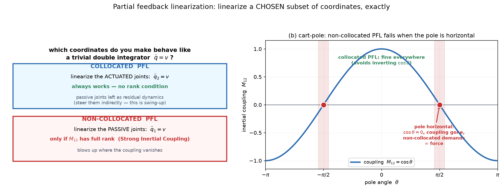
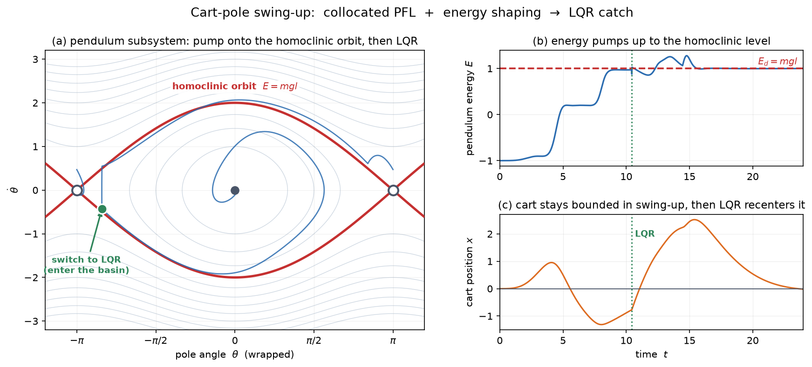

# 03c — Partial Feedback Linearization and Swing-Up

*Underactuated Robotics, Ch. 3, §3.5–3.6.* Final pass at Ch 3. This closes the
loop opened all the way back in note 02: how do you get an underactuated system
**from hanging down into LQR's basin at the top**? Two ideas:

- **Partial feedback linearization (PFL)** — you can't cancel *all* the dynamics
  (note 01), but you can cancel a *chosen subset* exactly.
- **Swing-up** — energy shaping (note 02), now generalized to two-link systems,
  using PFL to make it tractable.

---

## 1. The setup: the consolation prize for underactuation

Note 01 §5 delivered bad news: an underactuated system is **not** feedback
equivalent to `q̈ = u`. There's no `f₂⁻¹` to build the cancel-everything
controller, because `f₂` doesn't have full row rank. Computed torque is off the
table.

PFL is the consolation prize, and it's a good one:

> You can't linearize the *whole* system. But you can pick a **subset** of the
> coordinates and linearize **those** exactly, globally — making them behave like
> a trivial `q̈ = v` — while the rest becomes residual dynamics you reason about
> separately.

The question is *which* subset. That's the whole content of PFL.



---

## 2. Reorganizing into passive and actuated coordinates

For a "trivially underactuated" system (motors on some joints, none on others),
reorder the coordinates so the passive ones come first:

```
q = [q₁]     q₁ ∈ Rˡ   passive joints (no motor)
    [q₂]     q₂ ∈ Rᵐ   actuated joints (motors)
```

The manipulator equations split into two blocks of rows:

```
M₁₁ q̈₁ + M₁₂ q̈₂ = τ₁            ← passive rows: NO input term
M₂₁ q̈₁ + M₂₂ q̈₂ = τ₂ + u        ← actuated rows: input u lives here
```

(where `τ = τ_g − Cq̇` collects gravity and Coriolis). The asymmetry is the whole
story: **`u` appears only in the bottom block.** The passive rows are a *constraint*
you don't drive directly — you can only influence `q̈₁` through the **inertial
coupling** `M₁₂`, exactly the off-diagonal term we've been circling since note 01.

> **Why `M₁₁` and `M₂₂` are invertible.** `M` is positive definite (note 01 §3,
> kinetic energy is positive), and any principal submatrix of a positive-definite
> matrix is also positive definite (Schur complement). So both diagonal blocks are
> individually invertible — which is what lets the algebra below go through.

---

## 3. Collocated PFL — linearize the actuated joints

**Goal:** command `u` so the *actuated* joints do whatever you ask, `q̈₂ = v`.

Solve the passive block for `q̈₁` and substitute into the actuated block. The
result (details in the book; it's one substitution):

```
(M₂₂ − M₂₁M₁₁⁻¹M₁₂) q̈₂ − τ₂ + M₂₁M₁₁⁻¹τ₁ = u
```

The matrix `(M₂₂ − M₂₁M₁₁⁻¹M₁₂)` is the **Schur complement** of `M₁₁`, and it's
**always invertible** (it's symmetric positive definite for the same energy
reason). So you can always solve for the `u` that produces any desired `q̈₂ = v`.

> **Collocated PFL always works — no rank condition, valid globally.** "Collocated"
> = you're linearizing the joints *where the sensors and actuators are* (the
> actuated ones).

**What you get:** the actuated joints become trivial (`q̈₂ = v`), and the passive
joints are left as **residual dynamics** — still there, still coupled, but now
driven by your *choice* of `v` instead of raw torque. You steer them *indirectly*,
through `M₁₂`. That indirection is exactly what swing-up will exploit.

### The cart-pole, concretely

With all constants 1, the collocated PFL of the cart-pole reduces the equations to
a startlingly clean form (§3.6.2, verified to machine precision):

```
ẍ  = v                    ← the cart does exactly what you command
θ̈  = −v cos θ − sin θ     ← the pole: a simple pendulum, torqued by v·cos θ
```

Look at the second line. It is **the simple pendulum from note 02** —
`θ̈ = (torque) − sin θ` — where the "torque" is your commanded cart acceleration,
**modulated by `cos θ`.** You've turned the cart force into a pendulum torque. The
`cos θ` is physical: **when the pole is horizontal (`θ = ±π/2`), no cart motion can
torque it** — pushing the pivot sideways does nothing to a horizontal pole's
rotation. Control authority vanishes there, and no clever algebra removes it.

---

## 4. Non-collocated PFL — linearize the passive joints (when you can)

The surprising option: command `u` so the *passive* joints obey `q̈₁ = v` —
linearize the joints that **don't have motors.** More useful (you often care about
the passive DOF), but it comes with a catch.

Doing the analogous substitution requires inverting `M₁₂`, giving a condition:

```
non-collocated PFL works  ⟺  rank(M₁₂) = l   ("Strong Inertial Coupling")
```

This is the formal name for *"the actuated joints have enough inertial grip on the
passive ones to command them."* And it's **state-dependent** — it can fail at
particular configurations.

For the cart-pole, `M₁₂ = cos θ`, which **drops rank exactly at `θ = ±π/2`**
(figure, panel b). There, the non-collocated controller demands **infinite cart
force** — it's trying to torque a horizontal pole by pushing the cart, which is
physically impossible, so the math blows up. On hardware you'd **saturate** the
command; in the derivation you just avoid this branch.

> Small mercy Tedrake notes: the collocated controller keeps a factor `(c − 2/c)`,
> and `|c − 2/c| ≥ 1` always — it **never** hits zero. That's the second reason
> swing-up uses collocated PFL: it avoids inverting `cos θ` entirely.

### The general "task-space" view (skim)

Both are special cases of choosing an **output** `y = h(q)` — some combination of
joints you want to control — and commanding `u` so `ÿ = ÿ_d`. Collocated is
`y = q₂`; non-collocated is `y = q₁`. The general rank condition is on
`H̄ = H₂ − H₁M₁₁⁻¹M₁₂`. You don't need the machinery now; just know **PFL
generalizes to "linearize any output you can express," subject to a rank
condition on the coupling.** This idea returns as **differential flatness** in
trajectory optimization (Ch 10) — famously used for aggressive quadrotor flight.

---

## 5. Swing-up: energy shaping, generalized

Now the payoff. Note 02 swung up the *simple* pendulum with `u = −kθ̇Ẽ`. The
cart-pole and acrobot get the **same treatment**, made possible by PFL.

### The recipe (cart-pole)

**Step 1 — collocated PFL** to get the clean decoupled form:

```
ẍ = v,      θ̈ = −v cos θ − sin θ
```

Now the pole is a decoupled pendulum whose "torque" is your commanded cart accel
`v`. Control its **energy**, exactly as in note 02.

**Step 2 — energy shaping** on that pendulum. With `E = ½θ̇² − cos θ` and desired
energy `E_d = 1` (the homoclinic / upright level), `Ẽ = E − E_d`, differentiate:

```
Ẽ̇ = −v θ̇ cos θ
```

Same structure as note 02's `Ė = uθ̇` — energy changes only through your input.
So command

```
v = k_E · θ̇ · cos θ · Ẽ
```

giving `Ẽ̇ = −k_E θ̇² cos²θ Ẽ` — energy error non-increasing, driven to zero for
all but the trivial fixed-point trajectories (a LaSalle argument, Ch 9). **Pump
when short on energy, brake when over — identical intuition to note 02**, now
routed through the cart.

**Step 3 — keep the cart home.** Energy shaping ignores where the cart is, so it
would happily drift off to infinity. Add a PD term on the cart:

```
v = k_E θ̇ cos θ Ẽ  −  k_p x  −  k_d ẋ
```

The PD term gently regulates the cart while the energy term does the swing-up.
(This extra term is why a clean convergence *proof* is hard — but it works
robustly in practice.)

**Step 4 — LQR catch.** Once the full state enters the basin near
`[0, π, 0, 0]`, **switch to the LQR balancer from 3b.** This is the switching
architecture from the 3b FAQ, now fully assembled.



Simulated end-to-end on the true nonlinear cart-pole. **(a)** the pendulum
subsystem spirals outward, gaining energy each swing, converges onto the
homoclinic orbit (blue tracks red), then the green dot marks the switch to LQR,
which holds it at the top. **(b)** energy climbs in steps — one per swing — to
`E_d = 1`. **(c)** the cart stays bounded during swing-up (the PD term working),
then LQR recenters it after the catch. Everything from Ch 3 in one trajectory.

### The acrobot

Same skeleton, and this is the M4-relevant one — **the acrobot is the walking-model
cousin.** Collocated PFL (`q̈₂ = q̈₂ᵈ` on the elbow), then pump energy with the
general form `Ẽ = E − U(x*)`, `v̄ = q̇₁Ẽ`, plus PD terms. Tedrake's summary:
*"pump energy. Clean and simple. No proof."* It swings the two-link arm up and an
LQR catches it — with **no shoulder motor**, the result promised in 3b §1.

---

## 6. The math you need here

### Schur complement (the one new object)

When you have a block matrix `[[M₁₁, M₁₂],[M₂₁, M₂₂]]` and eliminate one block by
substitution, the leftover is the **Schur complement**, e.g.
`M₂₂ − M₂₁M₁₁⁻¹M₁₂`. Geometrically it's *"the effective inertia of block 2 after
accounting for how block 1 responds."* Two facts we used:

- If `M` is positive definite, both the diagonal blocks **and** the Schur
  complement are positive definite → invertible. That's what makes collocated PFL
  always solvable.
- The other Schur complement, involving `M₁₂` directly, is what non-collocated PFL
  must invert — and `M₁₂` losing rank is where it fails.

You don't need to compute these by hand; you need to know **"eliminate a block,
the effective inertia of the rest is the Schur complement, and its invertibility
is a rank condition."**

### Rank, one more time

`rank(M₁₂) = l` is the Strong-Inertial-Coupling condition — the *same* rank idea
as note 01's `rank f₂` and 3b's controllability, in a third costume. Every "can I
control this?" question in the chapter is ultimately "does this matrix have full
rank?"

---

## 7. Gotchas

**Collocated vs non-collocated is about *which joints*, not *which is better*.**
Collocated = linearize the actuated joints (always works). Non-collocated =
linearize the passive joints (needs coupling). Swing-up uses **collocated** even
though we care about the *pole* (passive) — because it's globally valid and the
pole falls out as clean residual dynamics anyway.

**PFL doesn't make the system fully actuated.** It exactly linearizes a *subset*.
The underactuation is still there — it just moved into the residual dynamics you
now steer indirectly. You never escaped note 01; you organized it.

**Swing-up is `attractive, not stable` — the note-02 caveat, still true.** Energy
shaping delivers you *to* the top but can't *hold* you there, which is the entire
reason for the LQR handoff. The switch condition is **state proximity, not energy
match** (3b FAQ).

**The `cos θ` singularity is physical, not a math artifact.** A horizontal pole
cannot be torqued by cart motion, full stop. Collocated PFL sidesteps it;
non-collocated hits it head-on. No coordinate change removes a real loss of
control authority.

---

## 8. Zooming out — what Ch 3 actually taught

Tedrake's own reflection (§3.6.4) is worth internalizing:

> *"The energy shaping controller... is a pretty faithful representative from the
> field of nonlinear underactuated control. Typically these control derivations
> require some clever tricks for simplifying or canceling out terms in the
> nonlinear equations, then some clever Lyapunov function to prove stability."*

That's the **honest limitation** of the classical approach, and the reason the
rest of the book (and the north star) exists. Swing-up is *beautiful* — one
hand-designed controller, robust to model error, provably driving energy to
target. But it took: a coordinate reorganization (PFL), a clever energy function,
a modulation trick (`cos θ`), a separate cart regulator, and a switch to a
*different* controller at the top. **Every new system needs its own clever
tricks.** It doesn't scale to a 30-DOF humanoid.

That's exactly what optimization-based control (Ch 7–10) and learning promise to
replace: instead of hand-designing the energy function and the tricks, **specify a
cost and let an optimizer / a learned policy find the controller.** The pendulum,
acrobot, and cart-pole become *benchmarks* those general methods must reproduce —
and now you know what "solving swing-up" means well enough to judge whether a
learned policy actually did it.

---

## 9. Ch 3 recap — the whole arc

| note | question | answer |
|---|---|---|
| 3a | how do I get a linear model near the top? | linearize the manipulator equations at the fixed point |
| 3b | can I balance an underactuated system? | yes — it's *controllable*; LQR on the linearization |
| 3c | how do I get from the bottom to the top? | PFL + energy shaping, then hand off to LQR |

**The complete swing-up-and-balance controller** is: collocated PFL → energy
shaping (+ cart PD) → switch to LQR in the basin. It's the canonical solution to
the canonical underactuated task, and every technique in it — linearization,
controllability, LQR, energy shaping, the global/local split — recurs for the rest
of the book.

**North-star close:** this hybrid controller *is* the template for a manipulation
skill. A learned pick policy has the same shape — a global phase (approach,
coarse) handing to a local phase (contact, precise) — whether that's two explicit
policies or one network that learned the switch. And Ch 3's real lesson, that
hand-designed nonlinear controllers are brilliant but don't scale, is the entire
motivation for learning them instead. **On to Ch 4 (walking) or the Ch 7–10
optimal-control block** — where "specify a cost, get a controller" begins.

---

## 10. FAQ

### Q: So the input pumps energy and reduces cart error until it reaches target energy, then shifts to LQR?

Right structure — with one correction on the trigger. The swing-up input has two
jobs, of unequal priority:

```
v = k_E · θ̇ cos θ · Ẽ   −   k_p·x  −  k_d·ẋ
    └── pump energy ──┘      └─ keep cart home ─┘
        (the mission)          (housekeeping)
```

The energy term is the actual goal (pump toward `E_d = mgl`, brake when over); the
cart PD is secondary — it just stops the cart running off the rail while the energy
term works.

**The fix: the switch is *not* triggered by reaching target energy.** It fires when
the **full state** `(θ, θ̇)` enters the basin near `[0, π, 0, 0]` — *not* when
`E = E_d`. Energy is one number, the state is two: you can hit `E = E_d` exactly
while whipping through the *bottom* at high speed — right energy, wrong place.
Reaching `E_d` is the **means** (it carries the trajectory near the top);
state-proximity is the **trigger**. So:

> pump energy toward `E_d` (PD keeps the cart home) → this carries the state near
> upright → switch to LQR once the *state* is close enough → LQR holds it.
