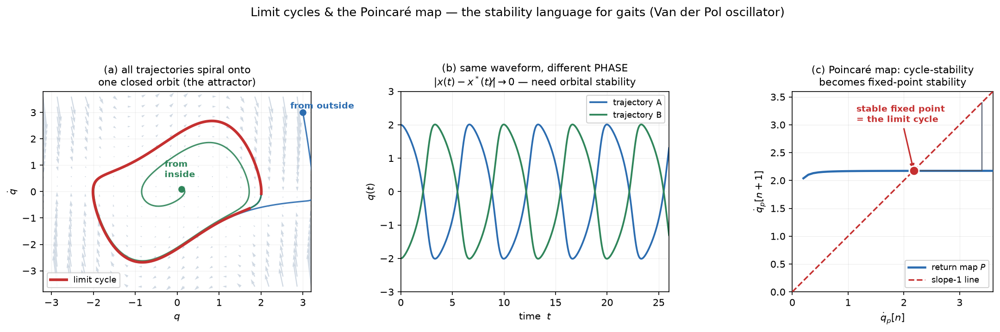
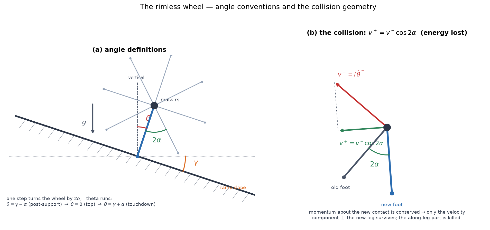
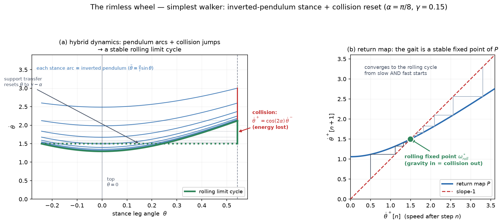
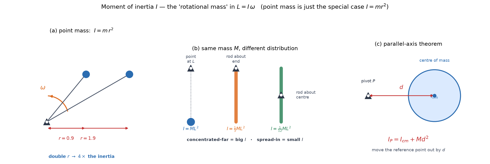

# 04a — Limit Cycles, Poincaré Maps, and the Rimless Wheel

*Underactuated Robotics, Ch. 4, §4.1–4.2.1.* First pass at the walking chapter,
and the conceptual pivot of the whole legged story. Two big ideas and one worked
example:

- **Limit cycles + orbital stability** — the right way to talk about the stability
  of a *gait* (a cycle), not a *setpoint* (a fixed point).
- **Poincaré maps** — the tool that turns "is this cycle stable?" back into "is
  this fixed point stable?", which we already know how to answer.
- **The rimless wheel** — the simplest possible walker; a **hybrid system**
  (smooth flow + instantaneous collisions) that walks stably with *no motors, no
  control.*

This chapter is where **"a gait is a stable limit cycle, not a trajectory"** — the
single most important reframing for legged robots — first bites. It's Tier 1 for
the M4 humanoid goal.

---

## 1. Why walking needs a new idea

Everything so far stabilized a **fixed point** — balance the pole at `x* = [0,π,0,0]`,
hold the arm at a pose. "Stable" meant "trajectories converge to a *point* and
stay."

But a walking robot never settles to a point. A gait is **periodic** — the same
motion, over and over. Its "steady state" is a **closed loop in state space**, not
a dot. So we need to lift our stability language from *fixed points* to *cycles*.

And there's a second complication unique to legs: **contact**. A walker is
*sometimes touching the ground and sometimes not*, and the touchdown is an abrupt
event. Tedrake:

> *"No matter how powerful my actuators are, there is nothing we can do to
> accelerate the center of mass toward the ground faster than gravity"* —
> underactuated, as always — *"but beyond that, walking faces controlling through
> contact."*

Contact adds a **discrete, combinatorial** element: forces exist *if and only if*
two bodies touch. That makes a walker a **hybrid system** — continuous dynamics
punctuated by discrete jumps. Ch 4's genius is that both complications — cycles
and contact — get handled cleanly by one idea (the Poincaré map), on models
simple enough to understand fully.

---

## 2. Limit cycles and orbital stability

### What a limit cycle is

A **limit cycle** is an *isolated closed orbit* that neighboring trajectories
spiral onto (stable) or off of (unstable). "Isolated" is the key word — it's not
one of a continuous family of orbits (like the undamped pendulum's nested loops,
note 02); it's *the* orbit that attracts everything nearby.

The textbook example is the **Van der Pol oscillator**:

```
q̈ + μ(q² − 1) q̇ + q = 0,     μ > 0
```

Read it as a spring-mass with **nonlinear damping** `μ(q²−1)`:

- when `|q| > 1`: damping is **positive** → energy **removed** → big swings shrink
- when `|q| < 1`: damping is **negative** → energy **added** → small swings grow

The two effects balance on exactly one orbit. Every initial condition (except the
origin) spirals onto it.



**Panel (a):** trajectories from *inside* (green) and *outside* (blue) both wind
onto the same red closed orbit. The attractor is a **loop**, not a point.

### Why "trajectory stability" is the wrong definition

Here's the subtlety, and it's the reason we need a new word. **Panel (b)** shows
two trajectories in the time domain. They converge to the *same waveform* — same
amplitude, same period — but they stay **phase-shifted**: one leads the other,
forever. So the naive stability test

```
|x(t) − x*(t)| → 0        ← trajectory stability, FAILS here
```

is *never* satisfied — at any instant the two are at different points of the cycle,
so their difference keeps oscillating. Yet clearly the system *is* stable in the
way we care about.

The fix: measure distance to the **nearest point on the orbit**, not to a
particular point *at time t*:

```
min_τ ‖x(t) − x*(τ)‖ → 0        ← ORBITAL stability, the right idea
```

> **Orbital stability** asks "am I staying close to the *loop*?", not "am I staying
> in lockstep with a reference?" A gait can be rock-solid orbitally stable while
> its *timing* drifts freely — and that's fine, because what matters is the shape
> of the motion, not the clock. The phase along the cycle is **neutrally stable**:
> nothing pushes you back to a particular phase, and nothing needs to.

The whole hierarchy (asymptotic / exponential / unstable orbital stability)
carries over from note 02, just with "distance to the orbit" replacing "distance
to the point."

*(Aside worth filing: a Lyapunov function with `V̇ < 0` — the note-02/Ch-9 tool —
**cannot** have a closed orbit inside it, since `V` would have to return to its
start while strictly decreasing. So limit cycles need a *modified* Lyapunov
analysis. Ch 9.)*

---

## 3. The Poincaré map — the key tool

How do you analyze the stability of a *loop*? Tedrake's answer is beautiful:
**catch the trajectory once per lap and watch a single number.**

### The construction

Pick an `(n−1)`-dimensional **surface of section** `S` — a "tripwire" cutting
across the flow, transverse to it (trajectories pass *through*, not along). Every
lap, the trajectory crosses `S` once. Record the state at each crossing:

```
x_p[n+1] = P(x_p[n])          the Poincaré (return) map
```

`P` maps the surface to itself: "given where I crossed this lap, where do I cross
next lap?"

**Panel (c)** of the figure: for Van der Pol, take `S` = the `q̇`-axis (crossings
of `q = 0` going upward). The state on `S` is one number, `q̇`, so `P` is a
**1-D map** `q̇[n] → q̇[n+1]`.

### The magic

> **A closed orbit is a fixed point of `P`.** If the trajectory returns to exactly
> where it crossed last time (`x_p* = P(x_p*)`), it's retracing the same loop —
> that's a periodic orbit. And the *stability of the cycle* becomes the *stability
> of that fixed point*.

We just **traded a hard problem for one we already solved.** Cycle stability in
continuous time (`n` dimensions, involving time) → fixed-point stability of a
discrete map (`n−1` dimensions, time dropped out). And a discrete-map fixed point
is checked exactly like note-02's flows, with one change of criterion:

```
continuous flow ẋ = Ax:   stable if eigenvalues have Re λ < 0
discrete map x[n+1]=P:     stable if eigenvalues have |λ| < 1
```

For a 1-D map that's just the **slope**: `|P'(x*)| < 1` at the fixed point →
stable. The slope tells you how much a perturbation shrinks each lap.

### The staircase

Panel (c) shows the **staircase method** for iterating a 1-D map by hand: from
`x_p[n]` on the horizontal axis, go **up** to the curve (that's `x_p[n+1]`), then
**across** to the diagonal (to reset it as the new input), repeat. The steps march
into the fixed point where `P` crosses the slope-1 line. Shallow slope there →
fast convergence → strongly stable cycle. (One quirk vs. continuous flows: a
discrete map can *overshoot* — if the slope is negative, iterates alternate sides
of the fixed point as they close in.)

> **One bookkeeping note:** if you do the eigen-analysis in the full `n`
> coordinates instead of on `S`, you always get **one extra zero eigenvalue** —
> it corresponds to perturbations *along* the orbit, which don't change where you
> next cross. That's the neutral phase direction from §2, showing up in the
> algebra. Ignore it; the *other* eigenvalues decide stability.

---

## 4. The rimless wheel — the simplest walker

Now the payoff model. Strip a walker down as far as it goes: a hub with a point
mass and rigid spokes, rolling down a shallow ramp. No motors, no controller, no
knees. Just gravity and geometry. Parameters: spoke half-angle `α`, ramp slope
`γ`, leg length `l`.



**The three angles (panel a).** `γ` is the ramp slope from horizontal; `α` is the
half-angle between adjacent spokes (so spokes are `2α` apart); and **`θ` — the
state — is the stance-leg angle from the true (gravity) vertical.** The mass
vaults over the planted foot, so `θ` runs from `γ−α` (just after support
transfers, leg behind vertical) through `θ = 0` (mass directly above the foot, the
top) to `γ+α` (leg ahead, the next spoke strikes). **Every step rotates the wheel
by exactly `2α`**, and the ramp slope `γ` shifts that swing so it's asymmetric
about vertical — which is how gravity nets energy in.

It is a **hybrid system** with two ingredients:

### (a) Stance — you already know this one

While one spoke is planted, the mass **vaults over the stance foot** like an
inverted pendulum:

```
θ̈ = (g/l) sin θ
```

> **This is the undamped simple pendulum from note 02, exactly** — centered on the
> *unstable* (upright) fixed point. The whole first half of Ch 2 was secretly
> preparation for this. You recognize the phase portrait: the mass climbs toward
> the top (`θ = 0`, decelerating), passes over, and speeds down the far side.

There's a **threshold** to get over the top: the mass needs enough speed,
`θ̇ > ω₁ = √(2(g/l)[1 − cos(γ−α)])`. Below it, the wheel rocks back — it can't
take the step.

### (b) Collision — the new, discrete piece

When the next spoke strikes the ground, the foot instantaneously comes to rest.
Angular momentum about the *new* contact point is conserved through the impact,
and the result is a sudden **loss of speed**:

```
θ̇⁺ = cos(2α) · θ̇⁻          the reset map
```

(`⁻` just before impact, `⁺` just after.) Since `cos(2α) < 1`, **every step throws
away energy** — the crisp velocity drop you can see in the phase portrait. This is
the "controlling through contact" made concrete: an instantaneous jump in the
state, a *reset map* stitched onto the smooth flow.



**Panel (a):** each blue arc is one inverted-pendulum stance phase (note the dip
in `θ̇` at the top, `θ=0`); the **red vertical drop** is the collision energy loss
at foot strike (`θ = γ+α`); the grey dotted line is the instantaneous support
transfer resetting the angle to `γ−α`. Successive arcs march **down** to the green
**rolling limit cycle.**

### Why it walks: the energy balance

Here's the whole mechanism in one sentence:

> **Gravity feeds energy in on the downslope; each collision takes energy out.
> Where they balance, you get a stable rolling gait.**

- Too slow → collision losses exceed gravity's input → the wheel decelerates each
  step → converges *up* to the cycle... or stalls at `ω*_stand = 0` if it can't
  clear the threshold.
- Too fast → gravity can't keep up with collision losses → decelerates → converges
  *down* to the cycle.

Both ends funnel to the same speed. That balance speed is the **rolling fixed
point:**

```
ω*_roll = cot(2α) · √(4(g/l) sin α sin γ)
```

### The return map closes the loop

Chain "stance dynamics + collision" into one step-to-step map — speed after step
`n` → speed after step `n+1`:

```
θ̇⁺[n+1] = cos(2α) · √( (θ̇⁺[n])² + 4(g/l) sin α sin γ )
```

**Panel (b)** is exactly the Poincaré machinery from §3, now for a walker: the
return map crosses the slope-1 line at `ω*_roll = 1.497` (for these parameters),
and the staircase converges there from **both** slow (0.5) and fast (3.3) starts.
Its shallow slope → strongly stable. *A robot that walks stably, analyzed as a
single stable fixed point of a 1-D map.* That's the chapter's thesis, realized.

### Bifurcations in the slope `γ` (nice to notice)

The *number* of fixed points changes with ramp steepness — a bifurcation (note 02
§8), now with a physical meaning:

- **small `γ`**: gravity too weak to offset collisions → only `ω*_stand = 0`
  (stands still).
- **moderate `γ`**: a stable **rolling** solution appears alongside standing.
- **`γ > α`**: the center of mass is always ahead of the stance foot — standing
  becomes impossible, and the wheel *must* roll.

---

## 5. The math you need here

### Hybrid systems / reset maps

A **hybrid system** alternates **continuous flow** (`ẋ = f(x)`, the stance ODE)
with **discrete jumps** (`x⁺ = Δ(x⁻)`, the collision reset) triggered by a
**guard** condition (here `θ = γ + α`, foot strike). You met a *homemade* version
of this in note-02's swing-up controller **switch** — but there the jump was in
the *controller*; here the jump is in the **physics** (the state velocity itself
leaps). Every legged robot, and every contact-rich manipulation, is a hybrid
system. This is the formalism for "controlling through contact," and it's why
Ch 17 (contact) and Appendix B (contact solvers, what MuJoCo runs) exist.

### Discrete-time stability: `|λ| < 1` vs `Re λ < 0`

Same eigenvalue idea as note 02, different threshold, and it's worth knowing *why*
they differ. A **continuous** mode evolves as `e^{λt}` — decays iff `Re λ < 0`. A
**discrete** mode evolves as `λⁿ` (multiply by `λ` each step) — decays iff
`|λ| < 1`. So the stability boundary moves from "left half-plane" (continuous) to
"inside the unit circle" (discrete). The Poincaré map is discrete, hence `|λ| < 1`.

### Conservation of angular momentum through impact

The collision law `θ̇⁺ = cos(2α)θ̇⁻` comes from: during an instantaneous impact,
the impulsive contact force acts *at the new foot*, so it exerts **no torque about
that point** → angular momentum about the new contact is **conserved**. Before
impact the velocity is "seen" by the new pivot at an angle `2α` off; after, it's
aligned — projecting gives the `cos(2α)` factor. You don't need the derivation;
you need "**momentum about the impact point is conserved, and geometry turns that
into a `cos(2α)` speed loss.**" (The compass gait in 4b generalizes this to a
matrix reset `q̇⁺ = [I − M⁻¹Jᵀ(JM⁻¹Jᵀ)⁻¹J] q̇⁻` — same principle, `J` = the contact
Jacobian, straight from MR Ch 5.)

---

## 6. Gotchas

**Orbital ≠ trajectory stability.** The single most important distinction in the
chapter. A gait can be perfectly stable while its *timing* drifts — phase along
the cycle is neutrally stable, and that's not a defect. Don't try to stabilize the
clock.

**The Poincaré map trades dimensions and time for discreteness.** You go from an
`n`-D continuous cycle to an `(n−1)`-D discrete fixed point. Cheaper to analyze,
but now you're iterating a map (`|λ|<1`), not flowing (`Re λ<0`).

**The rimless wheel is passive but *stable* — that's the shock.** No control, no
motors, yet a stable gait from a huge range of initial speeds. Stability came from
**mechanics** (the energy balance), not from a controller. This is the passive-
dynamic-walker thesis from Ch 1, now proven on the simplest model: *the dynamics
of walking are beautiful and should be exploited, not cancelled.*

**Contact makes it hybrid, and hybrid is genuinely harder.** The velocity *jumps*;
the vector field is discontinuous. You can smooth the collision, but Tedrake's
point stands — you still have to *decide* whether the foot is on the ground, and
that decision is combinatorial. No amount of smoothing removes it.

---

## 7. North-star connections

- **This is the vocabulary layer for M4 (humanoids).** Every legged controller —
  classical or learned — lives in this language: gait = limit cycle, stability =
  Poincaré return map, footfall = hybrid reset. When a paper says a learned
  walking policy is "robust," it means its return map has a wide basin. You now
  read that natively.
- **Passive dynamics = the prior a learned policy should exploit.** The rimless
  wheel says a good mechanism does most of the work for free. Modern locomotion RL
  succeeds partly because it *discovers* energy-efficient limit cycles rather than
  fighting the dynamics (the ASIMO mistake). Reward-shaping for cost-of-transport
  is, in effect, asking the policy to find the passive gait.
- **Hybrid/contact dynamics is the shared hard core of legs *and* manipulation.**
  The reset-map formalism here is the same math as making/breaking contact with an
  object in a grasp. Ch 17 and Appendix B build it out; your pick-place contact
  debugging lives in this world. "Controlling through contact" is the one sentence
  that unifies the wheeled-manipulator *and* humanoid halves of the roadmap.

---

## 8. Where this is going

- **4b** — richer passive walkers: the **compass gait** (two legs + a hip, swing
  dynamics = an Acrobot — the 3c connection pays off) and the **kneed walker**;
  then **running** (the SLIP model), where the "contact" is a springy stance
  phase. Same limit-cycle + Poincaré toolkit, more anthropomorphic gaits.
- **Ch 9 (Lyapunov)** — the modified Lyapunov analysis limit cycles need, and the
  principled version of note-02's "somewhat arbitrary" switch.
- **Ch 17 (contact)** — hybrid trajectory optimization; designing gaits instead of
  discovering passive ones.

---

## 9. Recap in one paragraph

A gait is a **limit cycle** — an isolated closed orbit — so its stability is
**orbital** (distance to the *loop*), not trajectory-based (distance to a moving
reference), because the phase along the cycle drifts freely and harmlessly. The
**Poincaré map** catches the trajectory once per lap on a surface of section,
turning "is the cycle stable?" into "is this fixed point of a discrete map
stable?" — checked by `|λ| < 1` (the slope, for a 1-D map). The **rimless wheel**
makes it concrete: a passive hybrid system whose **inverted-pendulum stance**
(note 02, exactly) is punctuated by **collision resets** (`θ̇⁺ = cos(2α)θ̇⁻`,
energy lost), and whose **energy balance** — gravity in on the downslope,
collisions out — produces a **stable rolling limit cycle** with no control at all.
That balance point is a stable fixed point of the step-to-step return map: *a
walking robot, understood as a dot on a 1-D graph.*

---

## 10. FAQ

### Q: Write the angular momentum before and after the collision, about the point of impact.

We take angular momentum about the **new contact `C_new`** because the impulsive
collision force acts *there* — zero moment arm about that point → **zero angular
impulse → angular momentum about `C_new` is conserved through the impact** (even
though linear momentum is not: the ground shoves the wheel). For a point mass,
`L_P = m(r × v)`, which picks out only the component of `v` perpendicular to `r`.

**Before** — still rotating about the *old* foot: `r =` the new leg (length `l`);
`v⁻ ⊥` the old leg, magnitude `l θ̇⁻`. The component of `v⁻` perpendicular to the
new leg is `l θ̇⁻ cos 2α` (the legs are `2α` apart), so

```
L⁻ = m · l · (l θ̇⁻ cos 2α) = m l² θ̇⁻ cos 2α
```

**After** — rotating about the *new* foot: `v⁺ ⊥` the new leg `= r`, so the full
magnitude counts:

```
L⁺ = m l² θ̇⁺
```

**Conserve** (`L⁻ = L⁺`), `m l²` cancels → the purely geometric reset:

```
θ̇⁺ = θ̇⁻ cos 2α
```

Energy: `KE⁺/KE⁻ = cos²2α`, so each step **keeps `cos²2α`, loses `sin²2α`** (half,
for `2α = 45°`). Physically the impact **kills the velocity component *along* the
rigid new leg** (it can't stretch); only the perpendicular part survives — that
projection *is* the `cos 2α`. *(Verified numerically: `L⁻ = L⁺` exactly.)*

### Q: What if it weren't a point mass — how does the angular-momentum calc change?



The one equation: **`L = I ω`** — angular momentum = **moment of inertia** ×
angular velocity, the rotational twin of `p = m v`. `I` is the **"rotational
mass": how hard the body is to spin about *this* axis**, and it depends on how far
the mass sits from the axis:

```
I = Σ mᵢ rᵢ²  = ∫ r² dm
```

- **Point mass at radius `r`: `I = m r²`** — the simplest case, and *exactly* the
  `m l²` the rimless wheel used (that's why the wheel used a point mass — to make
  `I` trivial). The `r²` means **double the radius → 4× the inertia**.
- **Extended shapes:** same mass `M`, different distribution → different `I`. Rod
  about its end `⅓ML²`, rod about center `1/12 ML²`, disk `½MR²`. You integrate
  `∫r²dm` once per shape or look it up.
- **Parallel-axis theorem** — shift the reference point: `I_P = I_cm + M d²`
  (`d` = distance from center of mass to `P`). Needed to get `I` about a *contact
  point* rather than the cm.

**General angular momentum about a point** (body spinning *and* translating):

```
L_about_P = I_cm ω  +  M (r_cm × v_cm)
            └ spin ┘    └── orbital ──┘
```

For a **point mass** `I_cm = 0` (nothing to spin about itself), so only the
orbital term survives → `L = m(r×v)` → the wheel's `m l² θ̇`. The collision reset
generalizes by replacing `m l²` with the real `I` (via parallel axis for the
after-state); the *logic* — conserve `L` about the impact point — is unchanged.
For a point mass the ratio collapses back to `cos 2α`.

**Forward hook:** this is why the compass gait (4b) is harder — masses on the legs
mean `I ≠ ml²`, and for a *multi-link* body "moment of inertia" becomes a
**matrix**, the mass matrix `M(q)`. The book's scary collision reset
`q̇⁺ = [I − M⁻¹Jᵀ(JM⁻¹Jᵀ)⁻¹J]q̇⁻` is *this same* "conserve `L` through the impact,"
generalized to matrix `M` (multi-DOF rotational mass) and Jacobian `J` (contact
geometry, MR Ch 5). See the next FAQ for how `M` is built.

### Q: How is the mass matrix `M(q)` compiled, in general?

`M(q)` is the **multi-DOF moment of inertia** — the matrix that makes `L = Iω`
and `KE = ½Iω²` work for a jointed robot. It's *defined* by the kinetic energy:

```
KE(q, q̇) = ½ q̇ᵀ M(q) q̇
```

`M(q)` is whatever symmetric matrix makes this identity hold — the direct
generalization of `KE = ½ m v²` (one mass) and `KE = ½ I ω²` (one spin). So the
recipe is **"write the total kinetic energy, read off the matrix."**

**The mechanical recipe (energy method — how the book derives every `M`):**

1. **Forward kinematics** (MR Ch 4): write the position of each link's center of
   mass as a function of `q`, e.g. `p_cm,i(q)`.
2. **Differentiate** to get each cm velocity `v_cm,i = J_i(q) q̇`, where
   `J_i = ∂p_cm,i/∂q` is that link's **Jacobian** (MR Ch 5 — same object).
3. **Sum each link's kinetic energy** — translation + rotation:
   `KE = Σ_i [ ½ mᵢ vᵢᵀvᵢ + ½ ωᵢᵀ I_cm,i ωᵢ ]`, with `ωᵢ` also linear in `q̇`.
4. Everything is `q̇ᵀ(…)q̇`; **collect the middle matrix** → that's `M(q)`.

Equivalently, stacked over links: `M(q) = Σ_i [ Jᵥ,ᵢᵀ mᵢ Jᵥ,ᵢ + J_ω,ᵢᵀ I_cm,i J_ω,ᵢ ]`
— translational and rotational Jacobians sandwiching each link's mass and
rotational inertia. **This is why `M` depends on `q`:** the Jacobians (the arm's
geometry) change with configuration, even though the masses don't.

Properties that follow (and that we've leaned on): `M` is **symmetric positive
definite** (KE > 0 for any motion — note 01 §3), hence always **invertible**; its
diagonal blocks and Schur complements are too (3c §2).

**In practice you never do this by hand** past toy systems — MuJoCo / Drake /
Featherstone's recursive algorithms build `M(q)` from the robot's link masses,
inertias, and joint geometry (URDF/MJCF). For a single point mass at radius `l`,
this whole machine collapses to the scalar `M = ml²`. The rimless wheel and
pendulum were the `1×1` case of exactly this.

### Q: If the Poincaré map has a positive second derivative, does that imply stability at the fixed point?

**No — stability of the return map is the *first* derivative (the slope), not the
second (curvature):**

```
|P'(x*)| < 1  →  STABLE        |P'(x*)| > 1  →  unstable
```

This is the staircase: a **shallow** crossing of the slope-1 line pulls iterates
in, a **steep** one flings them out. The second derivative `P''` is the curvature
— it sets the *basin size* and breaks ties in the knife-edge case `|P'| = 1`, but
it does **not** decide ordinary stability.

**Where the "positive second derivative" intuition is right — a different
object.** For a **potential/energy function** `V(x)` with `ẋ = −V'(x)`, a
**minimum** (`V''(x*) > 0`) *is* a stable equilibrium — marble in a bowl, the
pendulum hanging at a minimum of potential energy (note 02 §5). But `V` is an
energy landscape; `P` is a return map with no bowl. Right rule, wrong slot.

**Three stability rules, side by side:**

| object | stable when |
|---|---|
| continuous flow `ẋ = f(x)` | `f'(x*) < 0` (negative slope) — note 02 |
| discrete map `x[n+1] = P(x)` | `|P'(x*)| < 1` (slope magnitude) — this chapter |
| potential `V`, `ẋ = −V'(x)` | `V''(x*) > 0` (a minimum) — energy picture |

Rows 1 and 3 are the *same* statement (`f = −V'` ⟹ `f' = −V''`, so `f'<0 ⟺
V''>0`). The **map** differs because a step *multiplies* by `P'` (`λⁿ` decays iff
`|λ|<1`) rather than flowing (`e^{λt}` decays iff `Re λ<0`) — hence the magnitude
condition. For a gait's return map, watch the **slope at the crossing**, not the
curvature.

### Q: In `|λ| < 1`, what is `λ`?

**`λ` is the per-lap multiplier of a perturbation** — how much your error off the
cycle grows or shrinks each time around.

**1-D map:** linearize `x[n+1] = P(x[n])` at the fixed point. With `δ[n] = x[n]−x*`,

```
δ[n+1] = λ δ[n],   λ ≡ P'(x*)   (the SLOPE of P at the crossing)
```

so `δ[n] = λⁿ δ[0]` — shrinks iff `|λ| < 1`. For the rimless wheel, `λ = P'(ω*) =
0.5`: the error off the rolling speed **halves every step** (`0.5→0.25→0.125→…`).
That's the shallow staircase slope, as a number.

**Multi-D section** (e.g. compass gait, 3-D): the perturbation is a vector, the
linearization a matrix `A = ∂P/∂x|_{x*}` (the return-map Jacobian), and `λ` are its
**eigenvalues** — the same "directions that only scale" idea from note 02/3b, now
per-lap factors. Stable iff *every* `|λᵢ| < 1`. In the walking literature these are
the cycle's **Floquet multipliers**; "multipliers inside the unit circle" = stable
gait. (1-D is the `1×1` case, eigenvalue = slope.)

**Why `|λ|<1`, not `Re λ<0`:** a map *multiplies* (`λⁿ`) where a flow
*exponentiates* (`e^{λt}`), so the stability boundary moves from the imaginary axis
to the unit circle. The Poincaré map is a map. *(The along-cycle direction gives
`λ=0` in full coordinates — moving along the orbit doesn't change where you next
cross — the harmless extra eigenvalue from §3.)*
