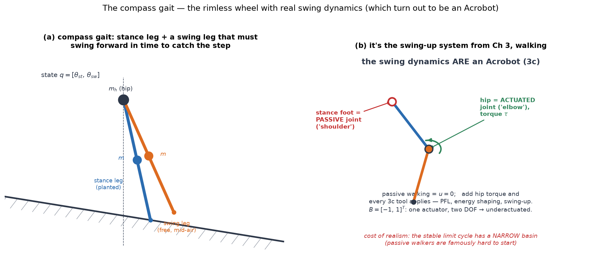
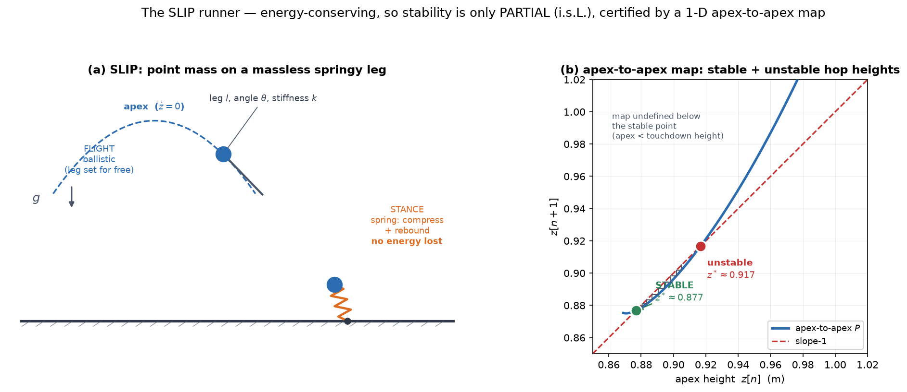

# 04b — Compass Gait, Kneed Walker, and the SLIP Runner

*Underactuated Robotics, Ch. 4, §4.2.2–4.3.* Second pass at walking. `4a` gave
the toolkit (limit cycles, Poincaré maps, hybrid dynamics) on the simplest walker.
Now we add **real swing dynamics** (the compass gait — which turns out to be an
Acrobot), **more hybrid modes** (the kneed walker), and cross over to **running**
(the SLIP model), where the intellectual spine of the whole chapter comes into
focus:

> **Dissipative walkers get their stability *from* collision losses. The
> energy-conserving runner can't — so it's only *partially* stable.**

---

## 1. The compass gait — the rimless wheel grows a swing leg

The rimless wheel cheated: it *assumed* a spoke was always waiting at the moment
of collision. Real walking has to **swing a leg forward, in time, to catch the
next step.** Remove all but two spokes, pin them at a **hip**, and put a point
mass on each leg (plus one at the hip) — that's the **compass gait**.

- State is now **4-D**: `q = [θ_st, θ_sw]` (stance and swing leg angles) plus their
  velocities. The swing leg has its *own* dynamics that must be timed right.
- Manipulator form `M(q)q̈ + C(q,q̇)q̇ = τ_g(q) + Bu`, with `B = [−1, 1]ᵀ`.



### The payoff from Ch 3: the swing dynamics *are* an Acrobot

Here's the connection that makes the compass gait feel familiar. With a hip
torque, the two-link swing dynamics are **exactly an Acrobot** (3c) — a two-link
pendulum with:

- the **stance foot** = the **passive** joint (the Acrobot's "shoulder"), and
- the **hip** = the **actuated** joint (the Acrobot's "elbow").

`B = [−1, 1]ᵀ` is rank 1 → one actuator, two DOF → **underactuated**, just like the
Acrobot. So **every tool from 3c applies**: PFL, energy shaping, swing-up. Passive
walking is simply the `u = 0` case. This is why the whole `3` block was worth the
effort — the canonical underactuated system *is* a walking robot in disguise.

### The collision reset is the matrix version of `cos 2α`

The heel-strike is the same physics as the rimless wheel's collision — angular
momentum conserved about the impact point — but for a *multi-link* body, so `cos 2α`
becomes a **matrix**:

```
q̇⁺ = [ I − M_fb⁻¹ Jᵀ (J M_fb⁻¹ Jᵀ)⁻¹ J ] q̇⁻
```

This looked terrifying in `4a`; now you can read every piece (see the `4a` FAQ on
`M`). `M_fb` is the **mass matrix** with a floating base added (the multi-DOF
moment of inertia); `J = ∂φ/∂q` is the **contact Jacobian** of the swing toe
(MR Ch 5, `∂position/∂q`); and the bracket **projects the pre-impact velocity onto
the subspace where the new foot is pinned** (`Jq̇⁺ = 0`). It's `L = Iω` conservation
with `I → M` and geometry `→ J`. For a single point mass it collapses back to
`cos 2α`. *(Add a "floating base," compute `M_fb`, project, then relabel stance↔swing
— the book's four-step recipe.)*

### The cost of realism: a narrow basin

The rimless wheel's extra spokes were free insurance — a spoke was *always* ready.
The compass gait must swing its leg into position *by its own dynamics*, and if the
timing is off, it falls. Consequence:

> **The stable limit cycle has a *narrow* basin of attraction** — a thin band of
> states around the steady gait. Passive compass walkers are famously finicky to
> start (it "took some work to find initial conditions that walk stably"). More
> realistic than the wheel, much less robust.

This is the M4-relevant lesson in miniature: **realistic legged systems have small
basins**, which is exactly why they need active control (and why RL policies spend
so much of their reward budget on staying inside the basin).

---

## 2. The kneed walker — more modes, more anthropomorphic

Add a **knee** to each leg (two links per leg, point masses), for better foot
clearance and a human-like gait. Now a full step cycles through **more hybrid
modes**:

1. **Three-link pendulum** (ballistic-walker dynamics) — stance leg + a swing leg
   whose knee is *unlocked* and bends forward.
2. **Knee-strike** — when the swing shank straightens and aligns with the thigh, an
   inelastic collision *locks the knee.* (Angular momentum conserved, velocities
   jump.)
3. **Two-link pendulum** (compass-gait dynamics) — knee now locked, swing to
   touchdown.
4. **Heel-strike** — the other inelastic collision; legs swap; back to mode 1.

So a single stride is **two continuous dynamics stitched by two collision resets.**
Same `4a` machinery — flow + guards + reset maps — just more of them. Everything is
still a Poincaré fixed point; the return map just integrates through a richer hybrid
sequence.

> **Curved feet** widen the basin considerably (rolling contact instead of a sharp
> heel-strike softens the collision). This is a recurring theme: *mechanical design
> choices — foot shape, mass distribution, compliance — do real control work.* The
> passive-dynamics thesis (Ch 1) again: shape the body so the dynamics help you.

*(The famous physical realizations — McGeer's kneed walker, the Cornell/Delft/MIT
"Toddler" bipeds that add a tiny bit of actuation to walk on the flat, and Theo
Jansen's wind-powered Strandbeest — are all this model made real.)*

---

## 3. The SLIP runner — and why energy-conserving changes everything

Running, historically, came *before* good walking robots — Raibert's hopping
machines (MIT Leg Lab, 1980s) threw themselves through the air with flair while
walkers were still shuffling. The model that captures them, and that turned out to
describe running animals from **cockroach to horse**, is the **Spring-Loaded
Inverted Pendulum (SLIP)**.

- A **point mass** on a **massless, springy leg** (rest length `l₀`, stiffness `k`).
- **Two phases**, a hybrid system:
  - **Flight** — ballistic parabola (`ẍ = 0, z̈ = −g`). The leg is massless, so you
    can reposition it **for free, instantly** — take the touchdown angle `θ` as the
    control input.
  - **Stance** — the foot pins, the leg spring compresses and rebounds (polar
    dynamics about the foot). **Ballistic — no control during stance.**



### The crucial difference: no energy is lost

The rimless wheel and compass gait **dissipated** energy at every footfall, and
that dissipation is *what gave them stability* — the return map contracted because
each collision threw energy away, letting gravity's input balance it at a fixed
point.

**SLIP loses nothing.** A springy leg with a massless toe stores the impact energy
and gives it all back. The collision changes the *state space and dynamics* but
causes **no velocity jump** — it's **energy-conserving** ("piecewise-Hamiltonian").

This should worry you, and Tedrake makes you sit with it: *"Is there any chance for
a system that is energy-conserving to be stable?"*

### The apex-to-apex map, and "partial stability"

With more state variables, is graphical analysis dead? No — **energy conservation
rescues it.** Take the Poincaré section at the **hop apex** (`ż = 0`). There, height
`z` and horizontal speed `ẋ` are **linked** by the conserved energy:

```
E = ½ẋ² + gz    ⟹    knowing z gives ẋ (up to sign)
```

So the apex state collapses to **one number** — apex height — and the
**apex-to-apex map `z[n] → z[n+1]`** is 1-D and staircase-able again.

Panel (b) is that map, from a **real simulation** (I reproduced the book's
parameters `k̃=10.7, Ẽ=1.61, θ=30°`): a **stable** fixed point at `z* ≈ 0.877 m`
and an **unstable** one at `z* ≈ 0.917 m`. The map is undefined below the stable
point (the apex would be lower than the touchdown height). *A running gait,
certified as a stable fixed point of a 1-D map — same as the wheel.*

**But there's an asterisk, and it's the whole point:**

> Because we used **energy conservation** to collapse `(z, ẋ)` to just `z`, the map
> can only certify **partial stability** — stable *along the energy surface*
> (i.s.L. / asymptotic *within* constant-energy states). It says **nothing about
> disturbances that change the total energy.** Kick the runner harder and you jump
> to a different energy surface entirely; this analysis can't see it.

That's the price of no dissipation. The dissipative walkers were *fully* stable
because collisions actively pulled energy back to the fixed value. SLIP has no such
mechanism, so its stability is conditional on energy being preserved. (Real
runners, of course, *do* inject and dissipate energy actively — which is the
control problem below.)

### Deadbeat control — the elegant once-per-step trick

The massless leg gives a beautiful control structure. Because you set the touchdown
angle *once per hop*, the apex-to-apex map is a **discrete control system**:

```
z[n+1] = P(z[n], u[n]),     u[n] = touchdown angle for hop n
```

You *could* just linearize this and apply **discrete-time LQR** (3b, now on a
return map). But SLIP admits something sharper. Since touchdown-angle ↔ next-apex-
height is an **invertible** relationship, you can pick the angle that lands you
**exactly on the desired fixed point in a single hop** — a **deadbeat controller**.

This is a genuinely discrete-time phenomenon worth appreciating:

> In *continuous* time, zero control cost → unbounded or bang-bang inputs. In
> *discrete* time, you can often reach the target in a **finite number of steps
> with bounded input** — here, **one step.** Perfect convergence per hop.

And the punchline result: the deadbeat touchdown angle is a *smooth* function of
desired speed, so you can sweep the leg through an **open-loop angle trajectory**
(timed only from the apex) such that **whenever the foot happens to hit the ground,
it's already at the right angle.** The consequence — Tedrake's favorite phrasing —
is **blind, deadbeat, rough-terrain running**: no terrain sensing at all, yet
stable over bumps, because the leg is always swept to meet the ground correctly.
(This may even explain the biomechanics of "ground-speed matching" — how animals
actively swing the leg to match the ground at touchdown.)

---

## 4. The math you need here

### Everything is `4a`, reused

No genuinely new machinery — that's the point of doing `4a` first. Limit cycles,
Poincaré sections, `|λ|<1` stability, hybrid flow+reset. What changes:

- **The mass matrix `M` and contact Jacobian `J`** appear in the compass gait's
  collision reset — but they're just the multi-DOF `L = Iω` (the `4a` FAQ) and
  MR Ch 5's `∂position/∂q`. The bracket `[I − M⁻¹Jᵀ(JM⁻¹Jᵀ)⁻¹J]` is a **projection**
  onto the "new foot pinned" subspace.
- **Energy conservation as a dimension-reducer** (SLIP): the conserved `E` links
  `z` and `ẋ`, collapsing the apex section to 1-D. A *constraint* doing the work a
  *surface of section* did for the wheel.
- **Discrete-time control on a return map** (deadbeat / discrete LQR): the Poincaré
  map isn't just for *analysis* — parameterize it by an input `u[n]` and it's a
  control system you stabilize.

### Projection matrices (the collision bracket)

`P = I − M⁻¹Jᵀ(JM⁻¹Jᵀ)⁻¹J` is a **projector**: it takes the pre-impact velocity and
removes exactly the component that would violate the new contact constraint
`Jq̇⁺ = 0`, keeping the rest. (Geometrically: project onto the null space of the
constraint, in the metric set by `M`.) You've met this shape before — it's the
same **`M`-weighted pseudoinverse** structure as operational-space control and the
redundant-arm `J†` from MR Ch 5–6. Contact resets, redundancy resolution, and
impedance projection are all this one object.

---

## 5. Gotchas

**The compass gait's swing leg is an Acrobot — that's not an analogy, it's the same
equations.** Passive walking is `u = 0`; the moment you actuate the hip, 3c's PFL
and energy-shaping are your tools. Don't re-derive; reuse.

**Dissipation is a *feature* for stability.** Counterintuitive but central: the
walkers are fully stable *because* they lose energy at impact (it lets a fixed
energy be an attractor). SLIP's losslessness is why it's only *partially* stable.
"Efficient" (lossless) and "self-stabilizing" pull in opposite directions.

**"Partial stability" is a real caveat, not a technicality.** SLIP's 1-D apex map
looks just like the wheel's, but it only certifies stability *on the energy
surface.* An energy-changing disturbance is invisible to it. Always ask what your
reduced coordinates threw away.

**Deadbeat control is a discrete-time gift.** One-step convergence with bounded
input has *no* continuous-time analog (there it'd need infinite/bang-bang effort).
It works here because control enters once per step and the step map is invertible.

**Massless-leg is a modeling choice that modern hardware *engineers toward*.**
Light legs + point feet (Mini-Cheetah, Spot) make the SLIP abstraction
approximately true on real robots — the model informs the *mechanical design*, not
just the analysis.

---

## 6. North-star connections (M4 and beyond)

- **The compass gait = Acrobot = the underactuated core of a humanoid leg.** The
  swing phase of a real biped is this system with more links. Every 3c tool (PFL,
  energy shaping, LQR balance) is load-bearing for legged control, and the narrow
  basin is exactly why humanoids need active, learned control rather than pure
  passive dynamics.
- **SLIP is the reduced model under modern locomotion.** Template-and-anchor
  control, MPC on the "SLIP template," and Raibert-style hopping heuristics all sit
  on this model. When a quadruped controller reasons about "leg angle at
  touchdown," it's doing SLIP control.
- **Deadbeat / once-per-step control is the classical cousin of step-level RL.** A
  locomotion policy that outputs footstep targets *is* choosing `u[n]` in
  `z[n+1] = P(z[n], u[n])`. Blind rough-terrain running via an open-loop leg sweep
  is the hand-designed version of what a robust learned policy discovers — and a
  reminder that **good mechanical + feedforward design can make the feedback
  problem easy.**
- **Dissipation-for-stability reframes reward design.** Cost-of-transport rewards
  push toward efficient (lossless) gaits; stability wants some dissipation. Real
  locomotion RL is implicitly trading these off — the same tension SLIP-vs-walkers
  makes explicit.

---

## 7. Ch 4 recap — the whole walking/running arc

| model | new idea | stability comes from |
|---|---|---|
| rimless wheel (4a) | hybrid dynamics, Poincaré map | collision dissipation, energy balance |
| compass gait (4b) | real swing leg = **Acrobot**; matrix reset | dissipation; **narrow** basin |
| kneed walker (4b) | more hybrid modes (knee + heel strike) | dissipation; curved feet widen basin |
| SLIP runner (4b) | **energy-conserving**; apex-to-apex map; deadbeat | **partial only** (energy surface); active control |

The one-sentence arc: **a gait is a stable limit cycle**, analyzed by a **Poincaré
return map**; *dissipative* walkers are made stable by their collisions, while the
*conservative* runner trades that away for efficiency and gets only partial
stability back — recovered actively via **once-per-step (deadbeat / discrete-LQR)
control.** And the passive two-link walker *is* the Acrobot, so all of Ch 3 was
secretly about walking.

---

## 8. Where next

Ch 4 is the *foundation* for M4 but the *classical* view. The modern legged stack —
massively-parallel RL in Isaac, sim-to-real, MPC on centroidal/SLIP templates — is
the augmentation note `05b_modern_locomotion.md` (see `00b_sota_augmentation.md`).
Immediate options in the book:

- **Ch 5 (highly-articulated legged robots)** — centroidal dynamics, ZMP,
  whole-body control. The classical humanoid stack (with the ZMP-is-history caveat
  from the overview).
- **Ch 7–10 optimal-control block** — the "specify a cost, get a controller"
  machinery. Arguably higher leverage than Ch 5, and it's what modern locomotion
  actually runs on.

---

## 9. FAQ

*(To be filled in from discussion.)*
