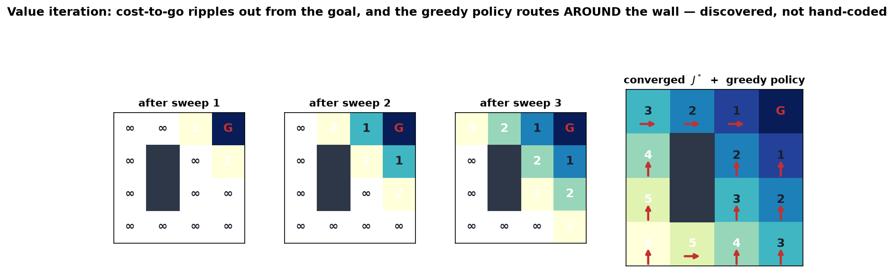

# 07 — Dynamic Programming: cost-to-go, Bellman, value iteration, HJB

*Underactuated Robotics, Ch. 7.* The start of the **optimal-control block** (Ch 7–11).
Everything before this — energy shaping, PFL, LQR-about-a-point — was *you* inventing
a control strategy and hoping it was good. Dynamic programming flips the whole game:

> **You specify only *what you want* — a cost function. DP computes the *globally
> optimal* controller: the best possible action from *every* state, with no
> cleverness required.**

This is the "specify a cost, get a controller" machinery the `04b` note kept teasing.
It's also, quite literally, **where reinforcement learning comes from** — PPO/SAC/DQN
are all approximating the one equation in this note (see `07b_rl_bridge.md`). Get this
chapter and RL stops being a black box.

---

## 1. The big picture — one magic object: the cost-to-go

Fix a **running cost** `g(x, u)` — what you pay, per step, for being in state `x` and
applying action `u`. (E.g. "distance from the goal, plus a little for effort.") The
total cost of a whole trajectory is the sum of `g` along it. We want the controller
that **minimizes total cost from every starting state**.

The entire theory hangs on a single object:

> **The cost-to-go (a.k.a. value function) `J*(x)`** = the total cost you will incur
> if you start at state `x` and **act optimally forever after.**

Picture it as a **landscape over state space** — a terrain whose height at `x` is
"how much trouble am I in here, if I play perfectly from now on." Low near the goal,
high in bad states. This scalar field is *the* thing DP computes.

**Why it's magic — the Principle of Optimality.** Once you know `J*`, the optimal
action is *trivial* to read off. From `x`, just pick the `u` that minimizes

```
  (cost I pay right now)  +  (cost-to-go of wherever that lands me)
       g(x, u)            +        J*( f(x, u) )
```

You do **not** have to plan the whole future. `J*` has already *summarized the entire
infinite future into one number per state.* An infinite-horizon planning problem
collapses into a **one-step greedy choice**. Geometrically: **the optimal policy is
"flow downhill on the cost-to-go landscape,"** steered by what the dynamics `f` will
actually let you do.

That compression — infinite lookahead → one-step greedy — is the whole idea. The rest
is (a) an equation `J*` must satisfy, and (b) how to compute it.

---

## 2. The core idea — the Bellman equation

`J*` is defined self-referentially: the best-from-here cost = the best immediate cost
plus the best-from-the-next-state cost. Written out, that's the **Bellman optimality
equation**:

```
  J*(x)  =  min over u  [  g(x, u)  +  J*( f(x, u) )  ]
```

Read it in English: *"The true cost-to-go at `x` equals the immediate cost of the
best action, plus the cost-to-go of where that best action sends you."* It's a
**fixed-point / self-consistency** condition — `J*` appears on both sides. Any `J`
satisfying this everywhere *is* the optimal cost-to-go, and the `u` achieving the
`min` *is* the optimal policy `π*(x)`.

- The **`min` over `u`** is the heart of it — and the *only* nonlinear part. It's what
  makes DP powerful (it optimizes) and also what makes `J*` generally **non-smooth**
  (landscapes get ridges/kinks where the best action switches).
- The **goal state** anchors it: there `J* = 0` (you're already done, no more cost).
  Everything else is measured *relative to* the goal, and value "fills in" outward
  from it.

---

## 3. Computing it — value iteration

You don't know `J*` up front. **Value iteration** finds it by turning the Bellman
equation into an **assignment you repeat until nothing changes**:

```
  start:   J(goal) = 0,   J(everything else) = ∞   (or any guess)
  repeat:  for every state x:
               J(x)  ←  min over u [ g(x, u) + J(next state) ]
  until J stops changing.     Then read off  π*(x) = argmin.
```

Each sweep lets the "true" values leak **one step further out from the goal.** After
`k` sweeps, every state within `k` steps of the goal knows its exact cost-to-go. It
provably converges to `J*`. Then the controller is just: at run time, look up / greedily
minimize — cheap.

This is a **global, offline** computation: you grind out the whole landscape *once*,
and get an optimal feedback policy valid *everywhere* — not a single trajectory, not a
local linearization. That's the payoff, and (spoiler, §6) the curse.

---

## 4. The linear algebra / math you need here

This chapter is lighter on matrix mechanics than Ch 3–5 and heavier on one idea — a
**scalar field over state space** — plus two connections worth drawing carefully.

### (a) The value function *is* a landscape (a scalar field)

`J*: state space → ℝ`. To each point `x` it assigns one number (height). "Gradient
descent on `J*`" isn't a metaphor — the greedy policy literally moves you toward lower
`J*`, as far as the dynamics permit. Everything visual about DP is reading this terrain.

### (b) HJB — the same equation in continuous time

In continuous time the Bellman equation becomes a PDE, the **Hamilton–Jacobi–Bellman**
equation:

```
  0  =  min over u  [  g(x, u)  +  (∂J*/∂x) · f(x, u)  ]
```

Don't derive it — read its *shape*. `∂J*/∂x` is the **gradient of the cost-to-go**
(which way the terrain rises); `f(x,u)` is the **velocity** the dynamics give you;
their dot product `(∂J*/∂x)·f` is **the rate your cost-to-go changes as you flow.**
The equation says the optimal action balances *"cost I burn per second" (`g`)* against
*"how fast I'm descending the cost-to-go terrain" (`∂J*/∂x · f`)* so they sum to zero.
Optimal = descend the landscape exactly as fast as you're paying to move.

> The dot product `∂J*/∂x · f` is the one LA object here: **project the dynamics
> velocity onto the cost-to-go gradient** → the component of your motion that's
> actually buying down future cost.

### (c) LQR **is** DP — the one case with a closed form (ties back to 3b)

Here's the connection that makes DP feel like home rather than a new planet. Take the
*special* case: **linear dynamics** `ẋ = Ax + Bu` and **quadratic cost**
`g = xᵀQx + uᵀRu`. Then the cost-to-go comes out **exactly quadratic**:

```
  J*(x) = xᵀ S x        (a bowl centered at the goal)
```

and plugging that into HJB collapses it to the **algebraic Riccati equation** for the
matrix `S` — *the exact equation you solved in 3b for LQR.* So:

- The **LQR you already did is dynamic programming**, specialized to the one setting
  (linear + quadratic) where the value landscape is a perfect **quadratic bowl** and
  has a clean formula.
- `S` is symmetric positive-definite — **the shape of the bowl**: its eigenvectors are
  the bowl's principal axes, its eigenvalues how steeply it climbs along each (your
  eigenvalue intuition from 3b, reused). `∂J*/∂x = 2Sx` is linear → the optimal policy
  `u = −Kx` is linear. That linearity is *why* LQR is easy; general DP is hard precisely
  because `J*` is **not** a nice quadratic — it can have ridges and flats.

So DP is "LQR without the training wheels": drop linear-and-quadratic, and you lose the
closed form but keep the exact same principle — solve for the cost-to-go, act greedily.

---

## 5. A small worked example — value iteration on a grid

The cleanest first contact: a 4×4 grid, move up/down/left/right, **each move costs 1**,
a **wall** you can't enter, goal at the top-right. `g = 1` per move → total cost =
number of steps → `J*` = **shortest-path length to the goal.** Watch it fill in.

```
   grid (▓ = wall, G = goal)          final cost-to-go J*(x)
   . . . G      r=3                    3  2  1  0
   . ▓ . .      r=2                    4  ▓  2  1
   . ▓ . .      r=1                    5  ▓  3  2
   . . . .      r=0                    6  5  4  3
   c=0 1 2 3
```

**The update in action.** Start `J(G)=0`, everything else `∞`.

- *Sweep 1:* only the goal's neighbors can improve. `J(3,2) = 1 + J(3,3) = 1`,
  `J(2,3) = 1 + 0 = 1`. Value has leaked one ring out.
- *Sweep 2:* their neighbors update. `J(2,2) = 1 + min(J(2,3), J(3,2)) = 1 + 1 = 2`,
  `J(3,1) = 1 + J(3,2) = 2`, `J(1,3) = 1 + J(2,3) = 2`. Another ring.
- …keep sweeping. Value keeps rippling outward from the goal until the whole grid is
  filled — the right-hand table above.

**Read the answer.** Look at the **left column** (`J = 6, 5, 4, 3` bottom-to-top): those
are *big* because the wall `(1,1),(2,1)` blocks the direct route, forcing a detour up
and around. **The cost-to-go landscape has already discovered "go around the wall"** —
you never told it to. The optimal policy is then just **step to your lowest-`J` neighbor**
every time; those arrows flow downhill, around the wall, into the goal. (Figure below.)



*This tiny discrete grid is the honest miniature of everything:* swap the grid for a
mesh over `(θ, θ̇)` and you can value-iterate **pendulum swing-up** — the cost-to-go
becomes a smooth-ish terrain over the phase plane and the greedy policy *is* the
swing-up controller, discovered rather than hand-designed.

---

## 6. Gotchas / intuition checks

**The curse of dimensionality — why we can't just do this for everything.** Value
iteration grids the **whole state space**. A pendulum (2-D state) → a 2-D mesh, easy. A
quadruped or humanoid (20–40-D state) → a mesh with *exponentially* many cells:
`(points per axis)^(dimension)` — astronomically infeasible. This single wall is why
the field moved to **function approximation**: represent `J*` (or the policy) with a
**neural network** instead of a mesh (§7.4.4, "neural fitted value iteration"), and
estimate the Bellman update from **samples**. That's the bridge to deep RL — the whole
point of `07b_rl_bridge.md`. DP is the *exact* thing; RL is DP made *scalable and
model-free.*

**DP needs a model.** The Bellman update uses `f(x,u)` (where does action `u` send me?)
and `g`. If you don't have `f` — you only get to *try things and see* — you're in
**model-free RL**: replace `J*(f(x,u))` with sampled experience (Q-learning is exactly
this). Same equation, estimated from data.

**`J*` is generally non-smooth.** The `min` creates ridges where the optimal action
switches (e.g. bang-bang "switching surfaces"). Don't expect the nice quadratic bowl —
that's the LQR special case only.

**Global & offline vs. local & online.** DP computes the *entire* feedback policy once,
valid everywhere (great), at the cost of solving the whole state space (brutal). Contrast:
**LQR** = local (one linearization about a point), **trajectory optimization** (Ch 10) =
one trajectory from one start. Different points on the "how much of state space do I
solve" spectrum.

**Cost design is the new controller design.** DP gives the *optimal* controller *for the
cost you wrote* — so getting the behavior you want is now about **choosing `g`**. A badly
shaped cost → a perfectly-optimal controller doing something you didn't intend. In RL
this exact issue is called **reward shaping**, and it's where much of the real
engineering effort goes.

---

## 7. Where this sits

- **Backward** to 3b: **LQR is this chapter's one solvable case** (linear+quadratic →
  quadratic cost-to-go → Riccati). You already did DP, in disguise.
- **Forward** to Ch 8 (LQR proper / TVLQR), Ch 10 (trajectory optimization —
  solve *one* trajectory instead of the whole landscape when the state space is too big
  to grid), and especially `07b_rl_bridge.md`: **value iteration → Q-learning → DQN →
  actor-critic → PPO/SAC.** Every one of those is chasing the same `J*` (or a policy
  greedy w.r.t. it) with a function approximator when the mesh is hopeless.
- **North star:** an RL locomotion/manipulation policy is *exactly* "a network that has
  absorbed `J*` (a critic) and/or the greedy policy (an actor)" for a cost you designed.
  This note is the ground truth those methods approximate.

---

## 8. FAQ

### Q: Isn't `f(x,u)` just `ẋ` — the velocity when `u` is applied?

**Yes and no — `f` is overloaded, and this note uses it *both* ways.** It means
two different things in discrete vs. continuous time:

- **Continuous time:** `ẋ = f(x,u)` → `f` is the **velocity** (rate of change).
  This is the one your instinct names, and it's what sits in **HJB**:
  `∂J*/∂x · f` = "cost-to-go gradient · velocity" = rate the cost-to-go changes as
  you flow (§4b). There `f` *is* `ẋ`.
- **Discrete time:** `x[n+1] = f(x,u)` → `f` is the **next-state map**: apply `u`,
  take one step, land *here*. This is the one inside the **Bellman equation**
  `J*(x) = min_u[g + J*(f(x,u))]` (§2) — `J*` needs the *state* you land in, not a
  velocity (feeding it `ẋ` would be a type error, velocity ≠ state).

They're the same physics, related by **discretizing time** (integrate one step):

```
  x[n+1] = x + ∫ ẋ dt  ≈  x + f_cont(x,u)·Δt      (Euler; exactly, the one-step flow)
           └──────────── this whole thing is f_discrete(x,u) ───────┘
```

So the next-state map is just "current state, pushed forward by the velocity for
one tick." Value iteration is inherently step-to-step, so DP is written with the
**next-state** form even though the robot's real dynamics are the continuous
`ẋ = f`. In the §5 grid it's the pure discrete form: `f(x, 'move right')` = the
cell to your right — a next state, no derivative.

|  | `f` symbol | returns | used in |
|---|---|---|---|
| continuous | `ẋ = f(x,u)` | **velocity** | HJB (`∂J*/∂x · f`) |
| discrete | `x_next = f(x,u)` | **next state** | Bellman / value iteration |

### Q: If RL can solve all of this, where does traditional MPC come in?

**Because "RL solves it" is the *ideal* (DP), not the reality — and MPC is a
different, often better, way to cash in the same DP when you have a model and need
guarantees.** DP is the exact thing; **RL and MPC are two different practical
approximations of it, and they differ mainly in *where and when* you pay the
compute:**

- **RL ≈ solve the *global* policy/value function *offline*** (once, expensively,
  over all of state space), then run a cheap network forward at deploy. Pays the
  curse of dimensionality up front; needs a good model *or* millions of samples;
  no hard constraint guarantees; brittle to distribution shift.
- **MPC ≈ solve a *short-horizon* optimal control problem *online*, from your
  current state, and re-solve every timestep** (receding horizon). Only ever
  optimizes the tiny slice of state space you're actually in, right now.

**The bridge to this chapter:** MPC is literally **finite-horizon DP solved online**
— optimize the next `H` steps, then add a **terminal cost that approximates `J*`**
for the tail. Truncate the infinite horizon, only from here, redo constantly. (And
"terminal cost ≈ `J*`" is exactly where the two *fuse* — see below.)

**Where MPC wins even if RL "works":**
- **Hard constraints & safety, explicitly guaranteed.** Joint/torque limits,
  obstacles, friction cone, contact — MPC enforces them in the optimizer and can
  *prove* feasibility/stability (terminal-set theory). RL bakes them softly into
  reward and *can* violate them. On real hardware, a violated constraint = broken
  robot.
- **Change the goal/model at runtime, no retraining.** New target, new obstacle,
  heavier payload → just edit the online problem. An RL policy trained for a fixed
  reward must be *retrained*. MPC is effectively zero-shot to new objectives within
  its model.
- **No training run, no data.** If you *have* a model (and MuJoCo/Isaac *are*
  models), MPC just runs. RL needs the whole sample-hungry training pipeline + a
  sim-to-real gap.
- **Interpretable & tunable.** Behavior traces to an explicit cost + model +
  constraints you can read and adjust; the RL policy is a black box you debug by
  retraining.

**Where RL wins (so it's not one-sided):**
- **No good model / contact-rich / from pixels.** RL learns messy or unmodelable
  dynamics and can map raw sensors (even language) → action. MPC needs a model
  *and* a state estimate in that model's coordinates. For the north-star VLA/pixels
  path, learning dominates.
- **Cheap, fast runtime.** RL is one forward pass; MPC solves an optimization every
  tick — can be too slow for very high-DOF or fast loops (GPU solvers like cuRobo
  narrow this).
- **Global horizon.** A global `J*` "sees around corners"; short-horizon MPC can
  stick in local minima (unless its terminal cost is a *learned* `J*` — next point).

**The modern answer is "both," fused through `J*`:**
- **MPC with a learned value function as terminal cost** — RL supplies the global
  tail (`J*`), MPC supplies the short horizon + hard constraints. Global foresight
  *and* constraint satisfaction. This is the state of the art in legged control.
- **MPC as the expert that generates demos / warm-starts** for imitation learning
  (the trajopt→demos hook), or as the **low-level controller a learned policy sits
  on top of** (the CLAUDE.md "policy on top of a controller" stack; MPC on
  centroidal/SLIP templates is exactly this for locomotion).

**One-liner:** DP is the ideal; **RL cashes it out globally-offline (great when you
lack a model or need pixel/fast policies), MPC cashes it out locally-online (great
when you have a model and need constraints, guarantees, and runtime flexibility)** —
and they increasingly meet in the middle, with a learned `J*` as MPC's terminal
cost.

### Q: Isn't this just the navigation stack — MPC = local planner, RL = global planner?

**Yes — and it's not a loose analogy, it's literally the standard nav architecture**
(MPC is one of the stock *local planners*, alongside DWA/TEB). The correspondence
holds on every axis:

| | **Global planner** ↔ RL / value fn `J*` | **Local planner** ↔ MPC |
|---|---|---|
| horizon | whole map, start→goal | next few m / s |
| produces | a cost-to-go **field** (≈ a navigation function) | feasible velocity/torque **commands** |
| constraints/dynamics | coarse, mostly ignored | **exact** (obstacles, kinematics, limits) |
| runs | slow / offline / infrequent | **fast**, control-rate |
| prevents | local minima (sees around corners) | collisions / infeasible commands |

The value-function role is *especially* tight: classical **value-iteration-on-the-
costmap / wavefront** planners already compute a cost-to-go over the grid; RL's `J*`
is the **learned** version of exactly that.

**Why both stacks split the same way — the same computational bargain twice:**
*long-horizon global foresight is expensive → precompute/learn it once; short-horizon
constraint-satisfaction is cheap enough → run it fast, reactively.* You can't run a
fine dynamic optimizer over the whole map, and you can't get global foresight from a
short-horizon local one (local minima).

**The seam is literal:** the global cost-to-go **is** MPC's **terminal cost** — that's
how you wire a global planner to a local planner *and* the "learned `J*` as MPC
terminal cost" fusion, the same interface. `global (RL value) → terminal cost →
local (MPC) → feasible commands descending it`.

**Refinements:** (1) the global slot is really "the *learned long-horizon* layer" —
for **semantic** nav it's a **VLN / learned semantic costmap** ("go to the kitchen"),
with RL one occupant. (2) There's often a *third* layer under MPC — the
torque/impedance controller. So the north-star mobile-manipulator stack is
`language goal → [VLN / learned value = GLOBAL] → [MPC = LOCAL] → [base+arm
low-level = CONTROL]`. This mapping *is* the semantic-nav system to build (cross-ref
`13d_sota_slam_navigation`). Caveat: not the only design — end-to-end RL (one net,
no explicit MPC) or all-MPC also exist; the hierarchical split is a popular, standard
design point because it puts foresight where learning shines and constraints where
optimization shines.
