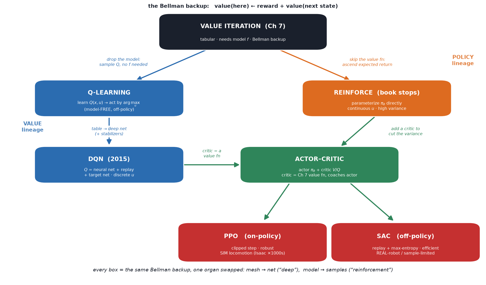

# 07b — From value iteration to modern deep RL

*Augmentation note (patches Ch 7 Dynamic Programming; also Ch 11/20 Policy Search).*
Written **after** `07_dynamic_programming.md` — you need the exact thing (DP, the
Bellman backup) in hand before seeing what RL approximates. The book stops at
**REINFORCE** (~2010 vintage): no DQN, PPO, SAC, actor-critic, replay buffers, or
GAE anywhere in 337 pages. This note fills **value iteration → Q-learning → DQN →
actor-critic → PPO/SAC**, and keeps everything nailed to the one equation from Ch 7
so RL never becomes magic.

> **The whole slogan:** *RL is dynamic programming with two organs replaced —
> a neural net where the mesh was, and sampled experience where the model was.*
> Everything below is a variation on which organ you swap and how.

You've *built* the imitation-learning side (ACT, diffusion/flow policies for
pick-place). RL is the **other** way to get a policy — from **reward** instead of
**demos** — and this note is its spine. §6 ties the two together.

---

## 1. The big picture — why tabular DP had to die, and what replaced it

Ch 7 gave the exact answer: compute the cost-to-go `J*` by value iteration, act
greedily. Two things kill it in practice, and each has exactly one fix. **Every RL
algorithm is a choice of the two fixes.**

| DP's fatal problem | the fix | the buzzword |
|---|---|---|
| **Curse of dimensionality** — a mesh over a 30-D humanoid state is astronomically large (§7.6) | represent `J`/`Q`/`π` with a **neural network** instead of a table; it *interpolates* over states you never visited | **"deep"** (function approximation) |
| **You may not have the model `f`** — can't compute `J*(f(x,u))` if you don't know where `u` sends you | **sample** it: try actions, observe transitions, estimate the Bellman backup from data | **"reinforcement"** (model-free) |

So the RL zoo is a 2×2 of design choices:
- **what do you approximate?** the **value** (critic: `J` or `Q`), the **policy**
  (actor: `π`), or **both**;
- **how do you get data?** **on-policy** (learn only from the policy you're currently
  running) or **off-policy** (reuse old data / a replay buffer).

Name any algorithm and you're just filling in those blanks. That's the whole map.

---

## 2. The lineage, each step anchored to the Bellman backup

Recall the Ch 7 backup (the *only* idea): **`value(here) ← immediate cost/reward +
value(next state)`.** (RL flips the sign: maximize **reward** `r` instead of
minimize cost `g`, and calls the value-to-go the **return**. Same equation.)



**① Value iteration** *(Ch 7 — tabular, model-based).* Apply the backup to `J` over
a mesh until convergence. Needs `f`; dies past ~4-D. The ground truth everything
else chases.

**② Q-learning** *(tabular, model-**free**).* Trick: learn the **action-value**
`Q(x,u)` = "value of doing `u` here, then playing optimally." Why `Q` not `J`? Because
then acting greedily is `argmax_u Q(x,u)` — **no model needed** (with `J` you'd need
`f` to see where each `u` lands). The backup becomes
`Q(x,u) ← r + max_{u'} Q(x', u')`, estimated from **sampled** transitions `(x,u,r,x')`.
This is the Bellman backup, model-free. **Off-policy** (the `max` learns about the
*greedy* policy while you explore with a different one).

**③ DQN** *(2015 — `Q` as a neural net).* Just Q-learning with `Q` a deep net → the
first thing that ate Atari from pixels. But naïvely plugging a net into the backup
**diverges** (§5, the "deadly triad"), so DQN adds two stabilizers you'll see
everywhere: a **replay buffer** (store old transitions, resample — decorrelates data,
reuses it) and a **target network** (a slow copy of `Q` for the backup target, so
you're not chasing a moving goal). **Discrete actions only** (the `argmax` is a
lookup) — a problem for torque-controlled robots.

**④ Policy gradient / REINFORCE** *(where the book stops — the actor line).* Skip the
value function; **parameterize the policy `π_θ(u|x)` directly** and do gradient
ascent on expected return. Handles **continuous actions** natively (crucial for
robots). But estimating the gradient from sampled returns is **high-variance** — and
that variance is exactly what the next step kills.

**⑤ Actor-critic** *(the synthesis — DP meets policy search).* Run **both**: an
**actor** `π_θ` (policy gradient, continuous actions) *and* a **critic** `V`/`Q` (a
value function, learned by the **Bellman backup**). The critic tells the actor "was
that action better or worse than expected?" (the **advantage** `A = Q − V`), which
**slashes the policy-gradient variance**. This is the template for everything modern:
the Ch 7 value function comes *back* — not to act greedily, but to **coach** the
policy.

**⑥ PPO & SAC** — the two workhorses, both actor-critic, differing on the 2×2 axes:

- **PPO** *(on-policy).* Take a policy-gradient step but **clip** it so the new policy
  can't move too far from the old — cheap, robust, hard to destabilize. On-policy →
  needs fresh data each update, but that's fine when you have a **simulator you can run
  massively in parallel**. **Dominates sim locomotion** (Isaac Gym: thousands of robots
  at once → oceans of on-policy data). What your `04b`/`05b` legged policies are trained
  with.
- **SAC** *(off-policy, max-entropy).* Actor-critic with a **replay buffer** (reuse
  every transition many times) and an entropy bonus (stay exploratory). **Sample-
  efficient** → **dominates real-robot / sample-limited** settings where each rollout
  is expensive. When you can't spawn 4096 envs, SAC squeezes more from each episode.

The on/off-policy split *is* the sim/real split: **infinite cheap sim data → on-policy
PPO; scarce expensive real data → off-policy SAC.**

---

## 3. What "deep" actually buys (§7.4.4 taken seriously)

The mesh in Ch 7 stores `J` at each node independently — visiting cell A tells you
**nothing** about neighbor B. A neural `J_θ`/`π_θ` **generalizes**: one gradient step
on states you *did* visit moves the estimate on a whole neighborhood of states you
**didn't**. That's the *only* reason RL scales to a humanoid — you never enumerate the
state space; the network **interpolates the cost-to-go landscape** from a sparse set of
sampled trajectories. "Deep RL" = "value iteration where the table is a function
approximator, updated from samples." Nothing more exotic than that.

---

## 4. The linear algebra / math you actually need here

Lighter than Ch 3–5; three ideas:

- **The value function is still the §7 landscape** — now a **neural network's output
  surface** over state space instead of a lookup table. The critic *is* `J*` (or `Q*`),
  approximated. Same object as Ch 7, different container.
- **The policy gradient is an expectation you estimate by averaging** — "nudge `θ` to
  make high-return actions more likely." The critic's **advantage** `A = Q − V`
  ("how much better than average was this action?") is the low-variance signal that
  makes that average usable. `V` is the baseline you subtract; subtracting a baseline
  doesn't bias the gradient but shrinks its variance — the single most important trick
  in the actor line.
- **Bootstrapping** — using your *own current estimate* `V(x')` as part of the target
  for `V(x)`. It's what makes the Bellman backup efficient (learn from one step, not a
  whole episode) and *also* what makes deep RL unstable (§5). Same double-edge as value
  iteration's sweeps, now with a function approximator in the loop.

---

## 5. Gotchas / intuition checks

**The deadly triad.** Function approximation **+** bootstrapping **+** off-policy data,
together, can make the Bellman backup **diverge** (tabular DP was guaranteed to
converge; the net breaks that guarantee). Nearly every "trick" in deep RL —
DQN's target network & replay, PPO's clipping, SAC's twin critics — exists to tame this
triad. Knowing *why* the tricks exist (they're patching the broken convergence proof of
value iteration) is exactly the point of learning DP first.

**Reward design is the new cost design.** Straight from the `07` FAQ: RL gives the
optimal policy *for the reward you wrote*. Misshapen reward → a perfectly-optimal robot
doing something dumb. "Reward shaping / reward hacking" is where much of the real
engineering (and pain) lives.

**On-policy vs off-policy is a data-reuse tradeoff.** Off-policy (replay) reuses every
sample many times → efficient but less stable. On-policy uses each batch once → stable
but data-hungry. The choice follows your data economics (sim vs real), not ideology.

**Sample efficiency & sim-to-real.** RL needs *far* more interaction than IL, so it
lives in simulation, which reopens the sim-to-real gap (domain randomization, etc.) that
IL-from-real-demos sidesteps. This is the central practical cost of going the RL route.

**Model-based RL exists too.** Learn `f` from data, then plan/DP against it (Dreamer,
MBPO, MuZero). It sits between "given model → MPC/DP" (`07` FAQ) and "no model → PPO/SAC":
learn the model, get sample efficiency back. A third organ-swap.

---

## 6. Where this sits — RL vs. your imitation-learning stack

You've built **imitation learning** (ACT, diffusion/flow policies): copy an expert's
actions from demos. Put side by side with RL:

| | **Imitation (what you've built)** | **RL (this note)** |
|---|---|---|
| learns from | **demonstrations** | **reward** |
| Bellman backup? | **none** — no value function, just "match the expert" | **the whole engine** |
| needs | a demo dataset | a reward + (usually) a simulator |
| fails when | you have no demos / expert is suboptimal | reward is hard to specify / sim-to-real bites |
| horizon reasoning | implicit, copied | explicit, via `J*`/critic |

They're **complementary**, and the frontier fuses them: **IL to warm-start, RL to
fine-tune** (get a competent policy from demos cheaply, then let reward polish it);
**offline RL** (run the Bellman backup on a fixed dataset — DP on logged data, no new
sampling); and, for the north star, **VLA models are IL today with RL fine-tuning
emerging.** Your pick-place is the IL branch; if you ever add a simulator + reward, PPO/
SAC is the branch this note hands you — and now you know it's just value iteration
wearing a neural net.

**North-star payoff:** when a locomotion policy trains in Isaac with PPO, or a
manipulation policy is SAC-fine-tuned on hardware, you can read it as *the Ch 7 cost-to-go
landscape, approximated by a net, estimated from sampled rollouts, with an actor
descending it.* That's the sentence this whole note exists to earn.

---

## 7. FAQ

### Q: What is the "Bellman backup," and what's the difference between `V` and `Q`?

**Bellman backup = update a state's value by looking one step ahead and pulling
that value back.** ("Backup" = back up the future value to the present.) You think
`V(x)=10`; you take a step, get reward `r=2`, land in `x'` worth `V(x')=9`; your
better estimate is `r + V(x') = 11`, so you nudge `V(x)` toward 11:

```
   V(x)  ←  r  +  γ V(x')        (γ<1 discounts far-future reward; drop it for intuition)
```

That single operation *is* the backup. **Ch 7's value iteration was just this backup
repeated everywhere until convergence; RL does the identical backup but with `r, x'`
from sampled experience instead of a known model.**

**`V` vs `Q` — same "goodness," different question:**

| | answers | granularity |
|---|---|---|
| `V(x)` — *state*-value | "how good to **be in `x`** (then act normally)?" | per **state** |
| `Q(x,u)` — *action*-value | "how good to be in `x` **and take `u`** (then act normally)?" | per **(state, action)** |

`V` = value of a *state*; `Q` = value of a *state once you commit to a first action*.
`Q` is `V` broken out per action. Linked by Bellman backups both ways:
`Q(x,u) = r + V(x')` and `V(x) = Q(x, action taken)`. **Why `Q`?** you can act by
`argmax_u Q(x,u)` with **no model**; with only `V` you'd need the model to see where
each action lands (§2②).

### Q: How does the critic actually "coach" the actor? (advantage / TD error)

The **advantage** is the gap between them:
`A(x,u) = Q(x,u) − V(x)` = *"was this action better or worse than the state's
default?"* `A>0` → make `u` more likely; `A<0` → less likely.

**Why subtract `V`?** to separate "was the **action** good" from "was the **state**
good anyway." Example: `V(x)=10`, and `u₁` gives `Q=13`, `u₂` gives `Q=8`. Raw
returns (13, 8) are *both positive* → naïve REINFORCE reinforces **both**. Advantages
(`+3`, `−2`) correctly push **toward** `u₁` and **away from** `u₂`. The baseline gives
the signal a **sign**, which is what "slashes the variance."

**One quantity does both jobs** — the TD error (the surprise):

```
   δ  =  r + γV(x')  −  V(x)      = (what happened) − (what I expected)
```

The **critic** updates itself with `δ` (that's the backup); the **actor** uses the
*same* `δ` as its advantage estimate. "Critic tells the actor better/worse than
expected" = **positive surprise → do more of that action.**

### Q: So are `Q`, `V`, and `π` three separate networks you train?

**No — almost never all three.** `V` and `Q` are **redundant** (two views of the same
value, `Q(x,u)=r+γV(x')`, `V(x)=avg of Q over actions`), so you pick **one** as your
critic. And the policy is sometimes just `argmax Q` (no net). What you train:

| method | policy | critic | # nets |
|---|---|---|---|
| Q-learning / DQN | *implicit* `argmax_u Q` | **Q** | **1** (Q) |
| REINFORCE | `π_θ` | none | **1** (π) |
| PPO / A2C | `π_θ` | **V** | **2** (π, V) |
| SAC / TD3 | `π_θ` | **Q** (twin) | **2 fns** (π, Q + targets) |

- **Value-based:** 1 net (`Q`); policy = argmax, `V = max Q` if ever needed.
- **Actor-critic:** 2 — actor + **one** critic; never both `V` *and* `Q` as separate
  trained nets.

**Which critic follows the algorithm:** **PPO uses `V`** (on-policy → only scores the
actions actually taken along trajectories); **SAC uses `Q`** (off-policy → must score
*arbitrary* `(x,u)` from a replay buffer, and updates the actor toward high-`Q`
actions). Footnotes: actor & critic often **share a backbone** (1 trunk, 2 heads);
**target nets** are slow *copies*, not separately trained.

**Tie to IL:** your ACT policy is **just `π`** — no critic (imitation has no value
function). RL-fine-tuning with PPO *adds* a `V`; with SAC, adds a `Q`. That's the
"IL warm-start → RL fine-tune" move (§6): bolt a critic onto the policy you already
have.
