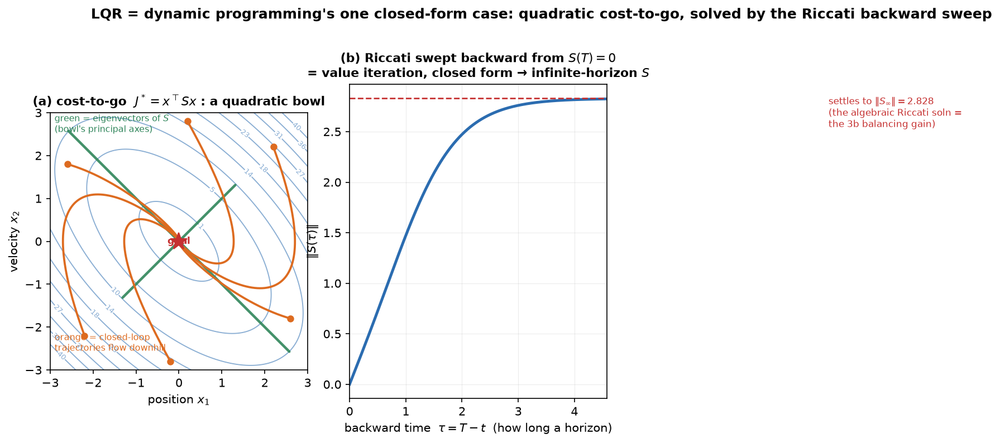

# 08 — LQR: opening the black box, and stabilizing trajectories

*Underactuated Robotics, Ch. 8.* You already **used** LQR in `03b`: you handed a
solver `Q` and `R`, it returned a gain `K`, and `u = −Kx` balanced the cart-pole —
with the Riccati equation deferred to "Ch 8." This is Ch 8. Two jobs:

1. **Open the black box.** *Why* does LQR work, what is that `K`, and what is the
   Riccati equation really? Answer (and it's the whole point): **LQR is dynamic
   programming's one case with a closed-form solution** (the promise from `07` §4c,
   now cashed). The cost-to-go is a **quadratic bowl**, and Riccati is the Bellman
   equation for that bowl.
2. **Generalize from a *point* to a *trajectory*.** `03b` LQR held *one* equilibrium.
   **Time-varying LQR (TVLQR)** stabilizes an entire *moving* trajectory — the
   **bridge to trajectory optimization and MPC** (Ch 10), and the tool that
   stabilizes the swing-up and limit-cycle trajectories from Ch 3–4.

> **One-sentence arc:** *LQR = "descend a quadratic cost-to-go bowl," computed by the
> Riccati backward sweep; slide the bowl along a trajectory and you get TVLQR.*

---

## 1. The setup (30-second recap from 03b)

Linear dynamics, quadratic cost:

```
   ẋ = A x + B u ,        cost = ∫ ( xᵀQ x  +  uᵀR u ) dt
```

`Q ⪰ 0` penalizes **state error** (how much you care about each state being off),
`R ≻ 0` penalizes **effort** (fuel/torque). LQR returns the linear feedback
`u = −Kx` that minimizes that total cost. `Q` vs `R` is the whole tuning knob (big
`Q` → aggressive, big `R` → gentle) — covered in `03b §7`, not repeated here.

---

## 2. Opening the box: the cost-to-go is a quadratic bowl

From `07`: the **cost-to-go `J*(x)`** = total future cost if you act optimally from
`x`, and the optimal policy is "**flow downhill** on `J*`." For a *general* system
`J*` is some ugly landscape you can only grid. **The magic of the LQ case:** linear
dynamics + quadratic cost force `J*` to be **exactly quadratic**:

```
   J*(x) = xᵀ S x            S = a symmetric positive-definite matrix
```

That's it — the whole landscape is one **bowl**, and the entire controller is encoded
in the single matrix `S`. Everything else follows:

- The optimal action "descend the bowl" works out to a **linear** law
  `u = −Kx` with `K = R⁻¹Bᵀ S`. (Linear because the bowl's gradient `∂J*/∂x = 2Sx`
  is linear — contrast the kinked landscapes of general DP.)
- `S` is found by the **algebraic Riccati equation (ARE)**:
  ```
     AᵀS + S A − S B R⁻¹ Bᵀ S + Q = 0
  ```
  Don't derive it — **read what it is:** this is the **Bellman equation `07 §2`
  specialized to a quadratic bowl.** "Self-consistent cost-to-go" becomes "self-
  consistent bowl-matrix `S`." Same equation as Ch 7, one algebraic condition instead
  of a sweep over a mesh, *because* the answer is known to be quadratic.

### The linear algebra: what `S` *is*, geometrically

`S` symmetric positive-definite means `J* = xᵀSx > 0` everywhere except the goal — a
genuine bowl with its bottom at the origin. And (the LA you're weak on, made visual):

- **`S`'s eigenvectors are the bowl's principal axes**; its **eigenvalues are how
  steeply it climbs** along each axis. Big eigenvalue = steep wall = "the controller
  cares a lot about deviations in that direction." A contour `xᵀSx = c` is an
  **ellipse** whose axes are those eigenvectors (green lines in the figure).
- The controller `u = −Kx` **pushes the state down the steepest useful direction of
  the bowl**, as far as `B` (which directions you can actually push) allows.

This is *exactly* the Ch 7 picture — cost-to-go landscape, greedy = downhill — except
the landscape is now a clean quadratic bowl you can write in one matrix instead of
storing on a grid.



---

## 3. Finite horizon: Riccati is value iteration run backward

The ARE above is the **infinite-horizon** case (steady `K`, the `03b` balancer). The
**finite-horizon** version exposes the DP connection even more literally. Over a finite
time `[0, T]` the bowl **changes with time**, `J*(x, t) = xᵀ S(t) x`, and `S(t)` obeys
the **Riccati differential equation**, integrated **backward** from the terminal cost
`S(T)`:

```
   −Ṡ = AᵀS + S A − S B R⁻¹ Bᵀ S + Q ,     given S(T),   sweep t: T → 0
```

**This backward sweep *is* value iteration (`07 §3`) in closed form.** Start from the
terminal cost (the goal), and roll the cost-to-go **backward in time**, one closed-form
Riccati step per instant, instead of one `min`-over-a-mesh per sweep. Panel (b): starting
from `S(T)=0` and sweeping backward, `‖S‖` **rises and settles** to a steady value — and
that steady `S` is exactly the **infinite-horizon ARE solution** (the `03b` gain).

> **Infinite-horizon LQR = the fixed point of the backward Riccati sweep.** "Plan over
> a longer and longer horizon" → the cost-to-go stops changing → you've recovered the
> steady balancer. Same "value iteration converges to `J*`" story from Ch 7, now you can
> *watch* it converge (panel b).

*(Worked numbers, double integrator `ẋ₁=x₂, ẋ₂=u`, `Q=I`, `R=1`: the sweep converges to
`S = [[√3, 1],[1, √3]]`, giving `K = [1, √3]` and closed-loop poles `−0.87 ± 0.5j` — a
well-damped slide to the goal. These are the orange trajectories in panel (a).)*

---

## 4. The new idea: TVLQR — stabilizing a *trajectory*, not a point

`03b` LQR linearized about a **fixed** equilibrium and held it. But most of what we want
robots to do is **follow a moving plan**: a swing-up trajectory, a walking limit cycle, a
reach-and-grasp path. **Time-varying LQR (TVLQR)** stabilizes an entire nominal
trajectory `x*(t), u*(t)`.

The idea is a direct extension, and it reuses `03a`'s "linearize about a *trajectory*"
(Case 3):

1. **Linearize along the nominal path.** At each instant the deviation
   `x̄ = x − x*(t)` obeys a **time-varying** linear system `x̄̇ = A(t) x̄ + B(t) ū`
   (`A(t), B(t)` are the Jacobians evaluated *at each point of the trajectory* — they
   change as the robot moves).
2. **Run the finite-horizon Riccati backward along the trajectory** → a **time-varying
   gain `K(t)`**.
3. **The controller** is feedforward + feedback:
   ```
       u(t) = u*(t)  −  K(t) ( x(t) − x*(t) )
              └ nominal ┘   └ LQR correction on the deviation ┘
   ```
   Play the planned `u*(t)`, and whenever you drift off the plan, an LQR gain (tuned to
   the local dynamics *at that point of the path*) pulls you back.

Geometrically: TVLQR wraps the nominal trajectory in a **"funnel"** — a tube of nearby
states that all get sucked back onto the path. (Region-of-attraction/funnel analysis is
Ch 9's Lyapunov material; here just hold the picture: *a moving bowl whose bottom rides
along `x*(t)`*.)

**Why this is the pivotal chapter for what's next:**

- **Trajectory optimization (Ch 10)** *designs* the nominal `x*(t), u*(t)` (open-loop);
  it's fragile to disturbances on its own. **TVLQR is what makes an optimized trajectory
  actually trackable** on a real, noisy robot. Trajopt + TVLQR is a standard pairing.
- **MPC (Ch 10)** is the online cousin: instead of precomputing `K(t)` for one fixed
  trajectory, MPC *re-solves* a short-horizon problem every timestep. **Linear MPC =
  finite-horizon LQR + inequality constraints**, solved as a QP online. So this chapter
  is literally MPC's engine (you asked where MPC lives — it's Ch 10, running *this*).
- **Poincaré / discrete-LQR** from the `4b` walking discussion is this same machinery on
  a *return map* instead of continuous time.

---

## 5. Gotchas / intuition checks

**LQR is local — it's DP's answer only for the *linearized* system.** `A, B` are a
linearization about a point (or trajectory), so `u=−Kx` is trusted only in a
neighborhood. Far from the operating point the quadratic bowl is a lie (the true `J*`
isn't quadratic). That neighborhood is the **basin**; leaving it is why you needed
*swing-up* (`03c`) to get *into* LQR's basin in the first place.

**`S` is the cost-to-go, and that's why LQR is the RL bridge.** `S` (equivalently the
quadratic `V(x)=xᵀSx`) is a **critic** — the exact object PPO/SAC approximate with a net
(`07b`). LQR is "the critic and actor you can solve in closed form because everything is
linear-quadratic." When a learned value function looks roughly bowl-shaped near a goal,
it's rediscovering `S`.

**Finite vs infinite horizon.** Infinite-horizon → constant `K` (a steady balancer, `03b`).
Finite-horizon / trajectory → time-varying `K(t)` (TVLQR). Same Riccati; one has settled to
its fixed point, the other is still sweeping.

**Controllability is the precondition.** From `03b`: LQR only stabilizes what's
**controllable** (or at least stabilizable). The Riccati solution `S` exists and is
stabilizing exactly when `(A,B)` is stabilizable and `(A, √Q)` observable — i.e. every
unstable mode is both *reachable by `u`* and *seen by the cost*.

**`Q, R` are a hand-designed reward.** LQR is optimal *for the cost you wrote* — same
"cost design is the real design" caveat as Ch 7/RL. Tuning `Q, R` is choosing what
"good" means.

---

## 6. Where this sits

- **Backward:** `07` (LQR = DP's quadratic case — Riccati **is** Bellman), `03b` (the
  balancing gain, controllability), `03a` (linearizing about a point *or trajectory* —
  Case 3 powers TVLQR).
- **Forward:** `09` Lyapunov (funnels / regions of attraction — *proving* how big the
  TVLQR basin is), and especially **`10` Trajectory Optimization → MPC** (design `x*(t)`,
  then TVLQR/MPC tracks it; **linear MPC = constrained finite-horizon LQR**).
- **North star:** TVLQR/MPC is the **local, model-based controller a learned policy sits
  on top of** (the CLAUDE.md "policy → controller" stack, and the `07` nav-mapping FAQ:
  MPC = local planner). And `S` = the closed-form **critic** — LQR is the one corner of
  RL you can solve exactly, which is why it's the sanity check every learned controller is
  measured against.

---

## 7. FAQ

### Q: In the backward Riccati sweep (§3), what's *known* vs *found*?

Same known/found split as value iteration (`07`), time instead of space:

| | value iteration (Ch 7) | backward Riccati (Ch 8) |
|---|---|---|
| **known** — model | `f(x,u)` | `A, B` |
| **known** — cost | `g(x,u)` | `Q, R` |
| **known** — boundary | `J=0` at the **goal** | `S(T)` (terminal cost) |
| **found** — cost-to-go | `J*(x)` per **state** | `S(t)` per **time** |
| **found** — policy | `π*=argmin` | `K(t)=R⁻¹BᵀS(t)` |
| propagates | outward from goal | backward from `t=T` |

Unifying idea: **you know the cost-to-go where it's trivial (the boundary — the
goal, or the terminal time with no future left) and back up from there.** On the
figure, panel (b) starts at `‖S‖=0` (the known `S(T)=0`, at `τ=0` i.e. `t=T`) and
the sweep *finds* `S(t)` at earlier times, settling to the infinite-horizon `S`.

### Q: Where do `A` and `B` come from? (and beware two different `B`s)

From the **manipulator equation** `M(q)q̈ + C q̇ + G(q) = B_act u`. Solve for
acceleration → `q̈ = M⁻¹(B_act u − Cq̇ − G)`, stack into `ẋ = f(x,u)` with
`x=[q;q̇]`, then `A = ∂f/∂x|*`, `B = ∂f/∂u|*` (Jacobians at the operating point).
At a static equilibrium (`q̇*=0`) the blocks are clean:

```
        ⎡  0          I  ⎤            ⎡    0      ⎤
   A ≈  ⎢                ⎥       B =  ⎢           ⎥
        ⎣ −M⁻¹∂G/∂q  ≈0  ⎦            ⎣ M⁻¹ B_act ⎦
```

So state-space **`B = M⁻¹ B_act`** (actuation, inertia-weighted) and `A`'s active
block is **`−M⁻¹∂G/∂q`**, the *gravity stiffness* — the thing that makes the upright
unstable (the cart-pole's `+√2` from `03b`). ⚠️ **Notation clash:** the `B` in the
manipulator equation (`B_act`, e.g. `[−1,1]ᵀ`) is **not** the `B` in `ẋ=Ax+Bu`;
they're related by `B_statespace = [0; M⁻¹B_act]`.

### Q: But `M, G, B_act` are functions of `x` — how can `A, B` be constant?

Because `A, B` are the Jacobian **evaluated at one frozen point `x*`** — the **flat
tangent plane** to the curved `f` at `x*`. Taking the derivative *uses* the
`x`-dependence (`∂G/∂q ≠ 0` *because* `G(q)` varies — that's what creates the
instability); evaluating at `x*` freezes it to numbers. **Linearization keeps the
`x`-dependence to first order (the slope at `x*`) and discards the rest** (how the
slope itself curves away). That discarded curvature *is* the linearization error →
why LQR is **local** (a basin where `M(q)≈M(q*)`, `G` hasn't curved off).

And it's exactly **why TVLQR is time-varying:** re-linearizing along `x*(t)` gives
`A(t)=∂f/∂x|_{x*(t)}`, `B(t)=∂f/∂u|_{x*(t)}` — their time-variation *is* `M(q),
G(q), B_act(q)` re-sampled as the trajectory drags `x` through configurations.
Constant `A,B` = "I froze the configuration"; `A(t),B(t)` = "I let it move and kept
re-freezing." (MuJoCo/Isaac keep the full nonlinear `M(q),G(q)`; LQR uses a snapshot;
MPC re-linearizes online every step.)

### Q: Does following `x*, u*` only work if `u*` actually leads to `x*`?

**Yes — the nominal must be dynamically *feasible*:** `ẋ*(t) = f(x*(t), u*(t))`.
`u*` is the **feedforward that keeps you on the path**; the feedback `−K(x−x*)` only
handles **deviations**. If `u*` doesn't produce `x*`, you drift off even with zero
disturbance, and the feedback fights a phantom error. Formally the deviation obeys

```
   x̄̇ ≈ [ f(x*,u*) − ẋ* ] + A x̄ + B ū
        └ feasibility residual ┘
```

feasible → bracket `=0` → the clean `x̄̇=Ax̄+Bū` TVLQR assumes; infeasible → a
constant **drift** the controller can't fix. Producing a feasible `(x*,u*)` pair is
exactly **trajectory optimization**'s job (Ch 10: optimize state *and* input together
with `ẋ=f(x,u)` a hard constraint) — which is why **trajopt designs the plan, TVLQR
stabilizes it.**

Same idea unifies the fixed-point case: to *hold* `x*` you need `u*` with
`f(x*,u*)=0` (an equilibrium input). Cart-pole upright: `u*=0` works (zero-input
equilibrium). Arm against gravity: `u*=0` sags — you need `u*=G(q*)` (gravity
compensation) or LQR fights gravity with a steady error. And feasibility still isn't
enough alone: open-loop `u*` is fragile, so you *also* need the feedback. **Feasibility
makes the feedforward meaningful; feedback makes the feasible plan robust.**

### Q: The ARE and the backward Riccati ODE look identical — doesn't that force `Ṡ=0`?

**Yes — and that's the point: the ARE *is* the Riccati ODE with `Ṡ` set to zero, its
fixed point.**

```
   Riccati ODE:   −Ṡ = AᵀS + SA − SBR⁻¹BᵀS + Q
   set Ṡ = 0:      0 = AᵀS + SA − SBR⁻¹BᵀS + Q     ← the ARE
```

That's literally why it's *algebraic*: kill the derivative and the differential
equation collapses to an algebraic one. But `Ṡ=0` is the **limit**, not true along the
whole sweep:

- **Near terminal `T` (finite horizon):** `Ṡ≠0` — `S(t)` genuinely changing (the
  *rising* part of figure panel b; short remaining horizon → less accumulated cost).
- **Far back (long/infinite horizon):** `S` settles, `Ṡ→0`, solving the ARE (the
  *flat* part, `‖S∞‖=2.828`). One more second of horizon changes nothing.

So the backward sweep is the journey **from `Ṡ≠0` to `Ṡ=0`.** This is the DP story
exactly: **ARE : Riccati ODE :: Bellman equation : value iteration** — the fixed-point
condition vs. the iteration converging to it (`07` §2–3). Usage: infinite-horizon
LQR (`03b` balancer) sits at `Ṡ=0` → **constant `K`**; finite-horizon / TVLQR lives in
the `Ṡ≠0` transient → **time-varying `K(t)`**.

### Q: How are `M, C, G` actually computed in practice? (Newton–Euler & tooling)

**Yes — via Newton–Euler**, specifically the **Recursive Newton–Euler Algorithm
(RNEA)**: forward pass (base→tip) propagates velocity/acceleration, backward pass
(tip→base) propagates forces, giving **inverse dynamics** `τ=ID(q,q̇,q̈)` in O(n).
(The other route is Lagrangian/energy — clean symbolically, hopeless by hand past a
few links.) Extract the pieces with clever RNEA calls:

- `G(q) = RNEA(q, q̇=0, q̈=0)` — only gravity survives.
- bias `h = C q̇ + G = RNEA(q, q̇, q̈=0)` — one call; subtract `G` for `Cq̇`.
- `M(q)`: column `i` = `RNEA(q, 0, q̈=eᵢ)` (gravity off); in practice a dedicated
  **CRBA** does it in O(n²).

The **"big three"** (Featherstone): **RNEA** (inverse dyn → `G`, bias), **CRBA**
(mass matrix `M`), **ABA** (forward dyn `q̈=FD(q,q̇,τ)` → what simulators step).

**In practice nobody hand-derives.** Write a **URDF/MJCF** (per-link mass, CoM,
inertia tensor + joint tree) and call a library/engine:

- **MuJoCo** (your build): `mj_fullM`→`M(q)`; **`data.qfrc_bias`**→`C q̇ + G`,
  computed by `mj_rne` (RNEA). *Your gravcomp-fix `qfrc_bias` **is** the manipulator
  `Cq̇+G`.* See [[mujoco-gravcomp-noop-finding]].
- **Pinocchio** (research std): `crba`/`rnea`/`aba` + **analytical derivatives**.
- **Drake** (Ch 8/10 tool): `CalcMassMatrix`, `CalcBiasTerm`,
  `CalcGravityGeneralizedForces`.

**For the `A,B` Jacobians:** **autodiff through `f`** is the modern default — **JAX
sims (MJX/Brax)** and **Drake `AutoDiffXd`** give `A,B` for free; Pinocchio/Drake also
give **analytical** derivatives; or **finite differences** (simplest, noisier).
**Catch:** URDF inertias are often wrong → **system identification** fits them from
`(q,q̇,q̈,τ)` data, which is a **linear least-squares** problem (the dynamics are
*linear in the inertial parameters*).
