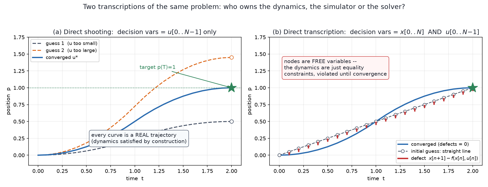
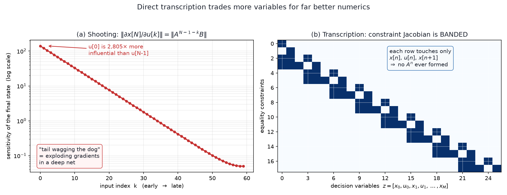
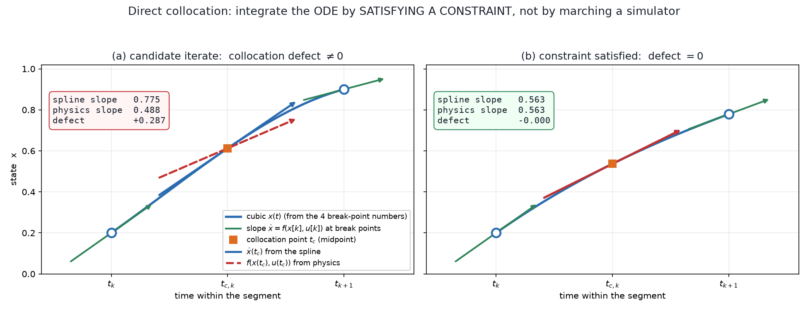

# 10a — Trajectory Optimization: turning a trajectory into a list of numbers

*Underactuated Robotics, Ch. 10 §10.1–10.4.* This is the chapter where optimal
control stops being a blackboard exercise and becomes the thing that actually runs
on robots. It's also the direct prerequisite for **MPC** (§10.5), which is `10b`.

> **Why now.** `07` gave you dynamic programming: the *right* answer — a globally
> optimal **policy** `u = π(x)` for every state — but computed on a mesh over state
> space, so it dies past ~4–5 dimensions. `08` gave you LQR: fast, closed-form,
> scales to any dimension — but only valid in the neighborhood where your
> linearization holds. Neither one gets a 30-DOF robot from A to B through
> clutter.
>
> Ch 10's move is a **deliberate retreat**: stop asking for a policy over all of
> state space. Ask for **one trajectory, from one initial condition.** That single
> concession buys you everything — and §10.5 will show you how to win the policy
> back by just re-solving the trajectory 100× per second.

---

## 1. The big picture: discretize *time*, not *state*

This is the whole idea of the chapter, and it's worth sitting with for a minute.

**Value iteration (`07`)** parameterized the answer over **state space**. To store
`J*(x)` for a 6-D state at 50 bins/dim you need 50⁶ ≈ 1.6×10¹⁰ cells. Add a
dimension, multiply by 50. That's the curse of dimensionality, and it is fatal.

**Trajectory optimization** parameterizes the answer over **time**. A 3-second
trajectory at 100 steps for that same 6-D robot with 6 actuators is
`100 × (6 + 6) = 1200` numbers. Add a state dimension → you add **100 numbers**,
not a factor of 50.

```
   value iteration:   #params  ~  (bins)^(state dim)      exponential   💀
   trajectory opt:    #params  ~  (time steps) × (state dim + input dim)   linear   ✅
```

And discretizing *time* is a solved craft — three hundred years of numerical
integration, error control, splines. Discretizing *state space* is not.

The price: you get a **feedforward plan** `u₀(t)` valid from **one** `x₀`, not a
feedback policy. Nudge the robot and the plan is wrong. §10.5 (→ `10b`) pays that
back two ways: wrap the plan in TVLQR feedback, or re-solve it every tick (MPC).

| | `07` DP | `08` LQR | `10` trajopt |
|---|---|---|---|
| answer is a… | policy over all `x` | policy (linear) near one `x*` | **one trajectory** from one `x₀` |
| dynamics | any | **linear only** | **any** (nonlinear, hybrid, contact) |
| constraints (`u` limits, obstacles) | awkward | ✗ (LQR can't) | ✅ **first-class** |
| scales to 30 DOF? | ✗ | ✅ | ✅ |
| global optimum? | ✅ | ✅ | only if convex (§5); otherwise **local** |

That third row is the one people underrate. **LQR structurally cannot express
"|τ| ≤ 20 N·m" or "don't hit the table."** Trajectory optimization is the first
tool in this book where limits and obstacles are just… constraints you write down.

---

## 2. The problem we're solving (§10.1)

Same additive cost as always, now over a **finite** interval `[t₀, t_f]`:

```
   min    ℓ_f(x(t_f))  +  ∫  ℓ(x(t), u(t)) dt
   u(·)                 t₀

   subject to    ẋ(t) = f(x(t), u(t))     ∀t ∈ [t₀, t_f]     ← the dynamics
                 x(t₀) = x₀                                   ← where we start
                 (+ u_min ≤ u ≤ u_max, obstacle constraints, x(t_f) = x_goal, …)
```

Two symbols to name:

- **`ℓ(x,u)`** — the **running cost** (per unit time). Same as `07`/`08`.
- **`ℓ_f(x(t_f))`** — the **terminal cost**, new here. It's the price of where you
  *end up*. Infinite-horizon problems didn't need one (there is no "end"); every
  finite-horizon problem does, and it's usually where "…and please be at the goal"
  lives. Note the alternative: a hard **terminal constraint** `x(t_f) = x_goal`.
  Soft (cost) vs hard (constraint) is a real design decision — hard constraints can
  make a problem infeasible; soft ones can be quietly ignored by the solver if the
  weight is too low.

> Both symbols get a fuller treatment in the **FAQ (§12)**: what `ℓ` actually is,
> how it relates to LQR's `Q`/`R` and to RL's reward, and why `ℓ_f` is really a
> stand-in for `07`'s cost-to-go.

**This is still infinite-dimensional.** `u(·)` is a *function* — uncountably many
numbers. No computer can optimize over that. So:

---

## 3. Transcription: the trajectory becomes one big vector

> **Transcription** = choosing a finite set of numbers that stands in for the
> continuous trajectory, plus the constraints those numbers must satisfy.

Everything in this chapter is a different answer to "which numbers?" The two
classical answers are **direct transcription** and **direct shooting**.

### The linear algebra you need here: a trajectory is a *point*

This is the mental flip that makes the whole chapter click, and it's pure linear
algebra intuition.

You are used to a trajectory being a **curve** — a wiggly line drawn through state
space over time. Stop picturing that for a second. Instead: stack all the numbers
that define it into one tall column vector

```
   z  =  [ x[0]ᵀ  u[0]ᵀ  x[1]ᵀ  u[1]ᵀ  …  x[N]ᵀ ]ᵀ   ∈ ℝᴹ
```

Now **the entire trajectory is a single point `z` in an M-dimensional space**
(`M` ≈ 1200 for our 6-DOF example). The cost `J` is a scalar function on that
space — a landscape, exactly like the cost-to-go landscapes of `07`, but now the
"terrain" is over *trajectory space* rather than state space. The dynamics
`x[n+1] = f(x[n],u[n])` are **equations relating coordinates of `z`** — i.e. a
**surface** carved out inside ℝᴹ, and "physically possible trajectories" = "points
lying on that surface."

So:

- **optimizing over trajectories** = walking downhill on a landscape in ℝᴹ,
- **the dynamics** = a constraint surface you must stay on,
- **torque limits** = a box you must stay inside,
- **obstacles** = forbidden regions carved out of ℝᴹ.

Every algorithm below is a different choice of *which coordinates go into `z`* and
*which relationships are enforced as constraints vs. baked in for free.*

---

## 4. The two transcriptions (§10.2.1–10.2.2)



### Direct transcription — the solver owns the dynamics

Put **both** `x[·]` and `u[·]` in `z`, and hand the dynamics to the solver as
equality constraints:

```
                    N−1
   min   ℓ_f(x[N]) +  Σ  ℓ(x[n], u[n])
  x[·],u[·]         n=0

   s.t.  x[n+1] = f(x[n], u[n]),   ∀n ∈ [0, N−1]      ← N·(state dim) equality constraints
         x[0] = x₀
         + additional constraints
```

The key thing to internalize (right panel of the figure): **the `x[n]` are free
variables.** Early in the solve they are *not* a real trajectory — the nodes sit
wherever your initial guess put them, and each one has a **defect**

```
   d[n]  =  x[n+1] − f(x[n], u[n])      ("how badly does node n+1 disagree with physics?")
```

The optimizer's job is to squeeze all the defects to zero *while* lowering cost. A
mid-solve iterate is a physically impossible trajectory that gradually becomes
possible. That feels wrong the first time you see it, and it's exactly the source
of the method's power (§4.3 below).

### Direct shooting — the simulator owns the dynamics

Note that `x[·]` is *redundant*: given `x[0]` and `u[·]`, you can just **simulate
forward**. So drop the states from `z` and keep only `u[·]`:

```
   x[1] = A x[0] + B u[0]
   x[2] = A(A x[0] + B u[0]) + B u[1]
   ⋮
                    n−1
   x[n] = Aⁿ x[0]  +  Σ  A^(n−1−k) B u[k]
                    k=0
```

For linear systems this is *still linear in `u`* — so the cost stays quadratic, and
you've turned a **constrained** problem into an **unconstrained** one with far
fewer variables. Every candidate `z` is automatically a genuine trajectory (left
panel).

### So which? (§10.2.3 — three real reasons transcription often wins)

Shooting looks strictly better: fewer variables, no constraints, always feasible.
Tedrake says no, and gives three reasons. The first is the interesting one.



**(1) Numerical conditioning — and this is literally the exploding-gradient
problem.** In shooting, the sensitivity of the final state to an early input is

```
   ∂x[N] / ∂u[k]  =  A^(N−1−k) B
```

**LA aside — what `Aⁿ` does, geometrically.** Write `A`'s eigendecomposition
`A = V Λ V⁻¹` (eigenvectors as columns of `V`, eigenvalues down the diagonal of
`Λ`). Then `Aⁿ = V Λⁿ V⁻¹` — *the eigenvectors never move, only the eigenvalues get
raised to the n-th power.* An eigenvalue of `1.157` after 60 steps is `1.157⁶⁰ ≈ 6200`;
an eigenvalue of `0.843` becomes `0.843⁶⁰ ≈ 0.00004`. Repeated matrix multiplication
**stretches one direction exponentially and crushes another exponentially**. That's
all `Aⁿ` ever does.

The left panel is exactly that for a linearized inverted pendulum (unstable,
continuous eigenvalues ±3.13): **`u[0]` is ~2800× more influential on the final
state than `u[N−1]`**. One optimization problem with coefficients spanning 3½
orders of magnitude is badly conditioned — solvers crawl or diverge.

If you've trained an RNN, you have met this exact matrix: a rollout **is** a deep
network with the same weight matrix at every layer, and `∂x[N]/∂u[k] = A^(N−1−k)B`
**is** backpropagation through time. "Tail wagging the dog" (controls) = "exploding
/ vanishing gradients" (deep learning). Same `Aⁿ`, same pathology. And Tedrake's
point is sharp: **this is not an artifact of the transcription, it's a true property
of the problem** — `u[0]` really does matter more. Transcription doesn't remove the
difficulty; it *spreads it out* over N well-scaled constraint rows instead of
concentrating it in one gradient.

**(2) State constraints are easy.** "Stay 5 cm above the table at every step" is
one line per node when `x[n]` is a variable. In shooting you'd have to unroll
`Aⁿ` into every such constraint.

**(3) Parallelization.** Each transcription constraint starts from an `x[n]` that
is *already given*, so all N dynamics evaluations run **in parallel**. Shooting is
inherently serial — you can't compute step 50 until you've done step 49. On a GPU
that difference is enormous.

**Bonus: sparsity.** The right panel is the constraint Jacobian
(`∂constraints/∂z`) of direct transcription. Each row touches only
`x[n], u[n], x[n+1]` → a **banded** matrix. Banded matrices are solved in `O(N)`
rather than `O(N³)`, so transcription's "extra" variables cost almost nothing.

> **Nice connection:** that banded structure is *the same structure the Riccati
> recursion exploits* (`08`). Riccati's backward sweep is what you get when you
> solve this banded linear system by block elimination from the end. Exercise 10.1
> in the book makes you rediscover exactly this. LQR is not a different world from
> trajectory optimization — it's the banded solve of the unconstrained case.

---

## 5. Convexity: why this is fast enough to be a controller (§10.2)

Here's the payoff that makes `10b` possible.

If the system is **linear**, the cost is **quadratic**, and the extra constraints
are **linear inequalities**, then the transcribed problem is a **quadratic program
(QP)** — and QPs are **convex**, solvable to *global* optimality in milliseconds by
mature solvers. That's the technical fact behind "solve a trajectory optimization
inside a 100 Hz feedback loop."

### LA aside — what "convex" actually looks like

Two ingredients, both geometric:

**Convex set.** Take any two points in the set; the straight segment between them
stays inside. A disk: convex. A crescent moon: not. Now the key fact — a **linear
inequality** `aᵀz ≤ b` cuts ℝᴹ with a flat hyperplane and keeps one side (a
half-space, obviously convex), and **intersecting convex sets stays convex**. So a
pile of linear equalities and inequalities carves out a **polytope** — a
multi-dimensional convex polygon. Torque box `u_min ≤ u ≤ u_max`? Polytope. Dynamics
`x[n+1] = Ax[n] + Bu[n]`? Flat slabs. All still a polytope.

**Convex function.** A landscape with no local dips other than the global one —
a bowl. `zᵀQz` with `Q ⪰ 0` (the LQR bowl of `08 §2`, now over trajectory space)
is the canonical one.

**A QP = roll a marble down a bowl inside a polytope.** There is exactly one
bottom; local = global; a solver cannot get stuck. Contrast the general nonlinear
case: a bumpy landscape inside a weird region, where "the answer" depends on where
you started.

### The modeling power is larger than it looks

An objective like `ℓ = |x| + |u|` isn't quadratic, but it *is* convex, and it
converts to a **linear program** with the **slack-variable trick**: introduce
`s_x[n]`, minimize `Σ s_x[n]`, and constrain

```
   s_x[n] ≥  x[n],      s_x[n] ≥ −x[n]        ⇒  at the optimum s_x[n] = |x[n]|
```

Both constraints are linear; the minimization presses `s_x` down until it hits the
larger of `±x`, i.e. `|x|`. This kind of reformulation is a big part of the craft.
(Example 10.1: minimum-time and torque-limited double-integrator problems — the
**bang-bang** policies you couldn't get from LQR — fall out *exactly* from convex
optimization. Compare `07`'s gridded value iteration for the same problem: this is
exact, but only for one `x₀` at a time.)

### Where convexity dies

- **Nonlinear dynamics.** `x[n+1] = f(x[n],u[n])` with `f` nonlinear is a curved
  surface, not a slab. Nonconvex.
- **Obstacle avoidance.** "Go left OR right around the pillar" — the feasible set
  is two disconnected blobs. Fundamentally, unfixably nonconvex in `x`. (No amount
  of cleverness rescues this; §10.8.3's answer is mixed-integer optimization, which
  is basically "enumerate the discrete left/right choices.")

---

## 6. Nonconvex trajectory optimization (§10.3)

The formulations don't change — direct transcription and direct shooting are
written exactly the same way with `f` nonlinear. What changes is that you hand the
problem to a **nonlinear programming** solver (SNOPT — sequential quadratic
programming; IPOPT — interior point) and accept **local** optima.

The new decision is **how to approximate the integral**

```
                        t[n+1]
   x[n+1]  =  x[n]  +  ∫       f(x(t), u(t)) dt
                        t[n]
```

Forward Euler (`x[n] + h·f(x[n],u[n])`) is the crude default; RK4 is standard;
Drake ships a whole suite. One trick worth knowing: **make the time steps `t[·]`
decision variables too.** The optimizer can then stretch or squeeze intervals —
essential when you don't know the trajectory duration in advance (a swing-up: how
long *should* it take?). Constrain them (`h_min ≤ h[n] ≤ h_max`) or the solver will
happily collapse the whole trajectory to zero duration.

---

## 7. Direct collocation — the one you'll actually use (§10.3.2)



Numerical integrators are built to march **forward in time**. But direct
transcription doesn't need that — it's solving a big simultaneous system, so it can
enforce the ODE *anywhere, in any order*. **Collocation** exploits that.

**The representation.** Make `u(t)` **piecewise-linear** and `x(t)` **piecewise-cubic**
(this is the "sweet spot"). Sounds like you'd need spline coefficients as decision
variables. You don't — and this is the elegant bit:

- `u[k]`, `u[k+1]` → linear `u(t)` on the segment. ✅
- `x[k]`, `x[k+1]` give the cubic's **endpoint values**;
- the **dynamics give the endpoint slopes** for free: `ẋ[k] = f(x[k], u[k])`,
  `ẋ[k+1] = f(x[k+1], u[k+1])`.
- Value + slope at both ends = **exactly the 4 numbers that determine a cubic**
  (a cubic has 4 coefficients). Done.

So the decision variables are *just the break-point values* `x[k], u[k]` — same as
direct transcription. The spline comes along free.

**The constraint.** The cubic is now fully determined, but nothing yet forces it to
*solve the ODE* in the middle. So impose it at the **collocation point**, the
segment midpoint `t_c,k`:

```
   t_c,k = ½(t_k + t_k+1),        h_k = t_k+1 − t_k

   u(t_c,k) = ½( u[k] + u[k+1] )

   x(t_c,k) = ½( x[k] + x[k+1] )  +  (h/8)( ẋ[k] − ẋ[k+1] )        ← evaluate the cubic

   ẋ(t_c,k) = −(3/2h)( x[k] − x[k+1] )  −  ¼( ẋ[k] + ẋ[k+1] )      ← differentiate it

   constraint:     ẋ(t_c,k)  ==  f( x(t_c,k), u(t_c,k) )
```

Read the last line as the whole idea: **"the slope the spline actually has" must
equal "the slope physics demands."** The gap between those two is the collocation
defect — the two arrows in panel (a) of the figure, which the solver closes in
panel (b). Don't memorize the three formulas; they're just "evaluate and
differentiate the cubic Hermite at its midpoint."

**Why it's good:** third-order accurate integration at ~2 dynamics evaluations per
segment (`ẋ[k]` is shared between neighbouring intervals) — far better accuracy per
decision variable than Euler. And every constraint is written on `x` and `u` at
sample points, which is exactly where you naturally want to say "torque ≤ 20 N·m."

> This is the workhorse: Drake's `DirectCollocation` solves pendulum, Acrobot and
> cart-pole swing-up out of the box (Example 10.2), the same swing-ups we set up by
> hand with energy shaping in `02`/`03c`. Energy shaping needed *you* to find the
> trick; collocation just needs the model and a cost.

*(§10.3.3 **pseudo-spectral** methods are a cousin: same collocation idea, but with
a few global high-degree polynomials instead of many low-degree pieces. Converge by
raising the degree rather than adding segments. Know the name; skip the machinery.)*

---

## 8. Worked example — direct transcription vs shooting, by hand

Discrete double integrator (`h = 1` for clean arithmetic), `N = 3`:

```
   x = [p, v]ᵀ ,      A = [1  1]      B = [0.5]        x[0] = [0, 0]ᵀ
                          [0  1]          [ 1 ]        want  x[3] = [1, 0]ᵀ
   cost:  minimize  u[0]² + u[1]² + u[2]²        (pure effort, hard terminal constraint)
```

**Shooting form.** Roll out symbolically:

```
   A²B = [2.5]     AB = [1.5]     B = [0.5]
         [ 1 ]          [ 1 ]         [ 1 ]

   x[3] = A²B·u[0] + AB·u[1] + B·u[2]  =  [2.5 u₀ + 1.5 u₁ + 0.5 u₂]  =  [1]
                                          [   u₀ +    u₁ +    u₂  ]     [0]
```

Three unknowns, two linear equations, minimize `‖u‖²` → this is the **minimum-norm
solution of an underdetermined linear system**, `u* = Mᵀ(MMᵀ)⁻¹ b`:

```
   M = [2.5  1.5  0.5]        b = [1]
       [ 1    1    1 ]            [0]

   MMᵀ = [8.75  4.5]      (MMᵀ)⁻¹b = [ 0.5 ]      u* = Mᵀ[0.5, −0.75]ᵀ
         [ 4.5   3 ]                  [−0.75]
```

```
   u*  =  ( 0.5,  0.0,  −0.5 )        cost = 0.5
```

Accelerate, coast, brake — symmetric, and exactly what you'd have guessed.
Check by rolling forward: `x[1] = [0.25, 0.5]`, `x[2] = [0.75, 0.5]`,
`x[3] = [1, 0]` ✓.

*(LA note: `Mᵀ(MMᵀ)⁻¹` is the **right pseudo-inverse**. Geometrically: the solution
set of `Mu = b` is a line in ℝ³ (3 unknowns − 2 equations = 1 free dimension); the
minimum-norm point on it is the foot of the perpendicular from the origin. That's
the same least-squares/pseudo-inverse geometry as the Jacobian pseudo-inverse in
MR Ch 5–6 — there it picked the smallest joint velocity achieving a desired EE
velocity; here it picks the smallest input sequence achieving a desired final
state. Identical linear algebra, different label.)*

**Transcription form.** Same problem, different bookkeeping:

```
   z = [ x[0](2)  u[0]  x[1](2)  u[1]  x[2](2)  u[2]  x[3](2) ]    → 11 variables
   constraints:  x[0] = [0,0]              (2)
                 x[n+1] = A x[n] + B u[n]  (6)     ← the banded block
                 x[3] = [1,0]              (2)
                                          ─────
                                           10 equality constraints
```

11 variables, 10 constraints → 1 free dimension, and the quadratic cost picks the
same point: `u* = (0.5, 0, −0.5)`.

**The comparison in one line:** shooting used **3 variables / 2 constraints**;
transcription used **11 variables / 10 constraints** — for the identical answer.
That's the trade: transcription is a bigger but *sparser, better-conditioned,
parallelizable, constraint-friendly* problem. On a 3-step double integrator,
shooting obviously wins. On a 100-step humanoid with contact, it doesn't.

---

## 9. Solving it (§10.4) — the parts worth knowing

- **§10.4.2 The adjoint method.** For unconstrained shooting there's a beautiful
  recipe: (1) simulate forward to get `x[·]`; (2) sweep a costate `λ[n]` **backward**
  from `λ[N−1] = ∂ℓ_f/∂x[N]`; (3) read off `∂J/∂u[n]`. Tedrake says it outright:
  **this is backpropagation** — reverse-mode autodiff, discovered independently in
  control theory. `λ[n] = ∂J/∂x[n+1]` is the "sensitivity of total future cost to
  the state here," which is the gradient of the cost-to-go — the same object as `07`'s
  `∂J*/∂x` and `08`'s `2Sx`. **The costate is the value gradient.** Naively
  computing every `∂x[n]/∂u[k]` instead (forward mode) costs
  `(state dim)×(input dim)×N` terms; the adjoint gets it in one backward pass.

- **§10.4.3 Augmented Lagrangian.** Constrained → unconstrained by adding penalty
  terms, but with the penalty weights **scheduled automatically** rather than
  hand-tuned. Hand-tuned penalties are the classic trap: too large → ill-conditioned,
  too small → the constraint is violated. This is what modern fast trajopt solvers
  (ALTRO, etc.) use.

- **§10.4.4 Zero-order methods — read this one twice.** **CEM** (cross-entropy
  method) and **MPPI** (model-predictive path integral) throw away gradients
  entirely: sample thousands of random input sequences, roll them all out,
  reweight toward the good ones, repeat. They dominate **model-based RL** with
  learned dynamics models, and Tedrake's explanation of why is the honest one:
  *not* because gradients are unavailable (autodiff gives them), but because
  (a) they escape local minima, (b) learned neural dynamics are locally bumpy so
  their gradients are unreliable, and (c) **10,000 parallel rollouts on a GPU cost
  about what 1 costs.** This is the direct line from Ch 10 to your north star —
  MPPI over a learned model is a live technique in the literature. It comes back
  in `10b`.

- **§10.4.5 Getting good solutions in practice.** Two honest warnings: you cannot
  distinguish "infeasible" from "stuck in a local minimum," and the fix is almost
  always a **better initial guess**, not cost-function tuning. Note the asymmetry
  this creates: shooting only lets you seed `u(·)`; transcription/collocation let
  you seed `x(·)` too. Tedrake reports that for Acrobot and cart-pole swing-up,
  seeding `x(·)` with a **straight line from start to goal** was not just helpful
  but *necessary*. (That's the grey dashed line in the first figure — the world's
  dumbest initial guess, and it works.)

---

## 10. Gotchas / intuition checks

1. **"Direct" means what?** It means we optimize the trajectory parameters
   *directly* with a nonlinear program. (The contrast is *indirect* methods, which
   solve the Pontryagin optimality conditions of §10.7 as a boundary-value problem.
   Modern robotics is essentially all direct.)

2. **A mid-solve transcription iterate is physically fake.** The nodes don't obey
   the dynamics until the defects hit zero. If you plot an unconverged iterate and
   it looks impossible — it is. That's normal.

3. **Feasible ≠ stable.** The output `x₀(t), u₀(t)` is *open-loop*. Playing `u₀(t)`
   back on the real system diverges — the trajopt integration tolerance is looser
   than the simulator's, and constraints are only met to ~10⁻⁶. This isn't a bug in
   your solve, it's the nature of the object, and it's why §10.5 exists. (`08 §FAQ`
   said the same thing about swing-up: feasibility makes the feedforward meaningful;
   feedback makes it robust.)

4. **Local minima are the default.** For nonlinear `f` you get *a* good trajectory,
   not *the* best one. Two different initial guesses legitimately give two different
   answers. Don't debug this; seed it better.

5. **Terminal constraint vs terminal cost.** Hard `x[N] = x_goal` can make the
   problem infeasible (can't reach in N steps with those torque limits). Soft
   `ℓ_f = ‖x[N] − x_goal‖²_Q_f` always returns *something*, possibly something that
   doesn't reach the goal. Start soft, harden once it works.

6. **`Aⁿ` is the villain everywhere.** Shooting conditioning, RNN gradients,
   long-horizon rollout drift in learned world models — same eigenvalue-to-the-n-th
   phenomenon. Once you see it you'll keep seeing it.

---

## 11. Where this is going

`10b` (Ch 10 §10.5, §10.8):

- **MPC** — the recipe that converts all of the above from a *plan* into a
  *policy*: measure `x`, solve a trajopt from it, execute `u[0]`, throw the rest
  away, repeat. Plus **receding horizon**, **recursive feasibility** (why the
  solver won't suddenly cry "infeasible" three seconds in), and the Lyapunov
  argument that makes it a legitimate stabilizing controller.
- **TVLQR trajectory stabilization** — the other way to close the loop (`08` built
  this already; here it gets used).
- **iLQR / DDP** — linearize around the current guess, run a Riccati backward pass,
  forward-simulate, repeat. The bridge between `08` and this chapter, and the
  algorithm inside a lot of real robot stacks.
- **MPPI / CEM** — the sampling-based, GPU-native branch, and the one that meets
  learned dynamics models.
- **Differential flatness** — the quadrotor trick that turns a nonconvex trajopt
  back into a convex one.

*(§10.6 the perching-glider case study and §10.7 Pontryagin are worth reading in
the book but don't need their own note; §10.7's main takeaway — the costate `λ` is
the value gradient `∂J/∂x`, and the Hamiltonian `H = ℓ + λᵀf` is the thing you
minimize pointwise — is already flagged in §9 above.)*

---

## 12. FAQ

### Q: What is the `ℓ` function?

**`ℓ(x,u)` is the running cost** — the price per unit time of being in state `x`
while applying input `u`. A scalar function `ℝⁿ × ℝᵐ → ℝ` that **you choose**.

```
                       N−1
   J  =  ℓ_f(x[N])  +   Σ   ℓ(x[n], u[n])
         └ terminal ┘   n=0  └── running ──┘
```

Two arguments, two jobs: the **`x` part** says *where you want to be*, the **`u`
part** says *what acting costs*.

**You've already used it.** LQR's `Q` and `R` **are** `ℓ`:

```
   ℓ(x,u) = xᵀQx + uᵀRu
```

So "tuning Q vs R" (`03b §7`) was never an LQR ritual — it's choosing `ℓ`, and
picking the one shape with a closed-form answer.

| Task | `ℓ(x,u)` | reads as |
|---|---|---|
| regulation / LQR | `xᵀQx + uᵀRu` | "be near zero, gently" |
| **minimum time** | `1` | every second costs 1 → minimize duration |
| minimum fuel | `\|u\|` | total impulse (→ an LP via §5's slack trick) |
| pendulum swing-up | `5·wrap(θ−π)² + 0.2·θ̇² + 0.02·u²` | "get upright, don't thrash" |
| grasping | `‖p_grip − p_obj‖² + 𝟙[collision]·1000` | non-differentiable → needs MPPI |

Stare at the min-time row: `ℓ = 1` looks vacuous, but summing 1 along the trajectory
**is** the elapsed time. That's where Example 10.1's bang-bang solutions come from.

Three things worth knowing:

1. **`ℓ` is the task specification.** `f` is handed to you by physics; `ℓ` is entirely
   your invention. That's Ch 10's opening promise — don't write a walking controller,
   write a cost. It's also the trap (§9's "cost-function tuning is a slippery slope").
2. **`ℓ = −reward.`** RL maximizes `Σ r`; control minimizes `Σ ℓ`. Same object,
   opposite sign, hence `J*` (cost-to-go) `= −V` (value function). That sign flip is
   most of the notational gap between `07`/`08`/`10` and `07b`'s RL literature.
3. **The cost is additive over time, and that is a real assumption.** Bellman's
   equation exists *because* total cost splits into "cost now + cost of the rest." A
   non-decomposable cost (e.g. "penalize the variance of θ over the trajectory")
   would break DP, LQR, and iLQR all at once.

*Notation:* `ℓ` is a script *L*, inherited from the **Lagrangian** of the calculus of
variations (other texts: `L`, `g`, `c`; RL: `r`, sign-flipped). And it is a **rate** —
cost per second — which is why it lives inside `∫ … dt`, and why §7's collocation
objective reads `Σ hₙ·ℓ(x[n],u[n])`: the segment length `hₙ` converts a rate into an
amount. With equal-length segments people absorb `h` into the weights and drop it.

### Q: And what is `ℓ_f`?

**The terminal cost** — the price of where you *end up*, charged once. It takes only
`x`, not `u`, because after the last step there's no input left to apply (decision
variables run `u[0..N−1]`, states run `x[0..N]`).

Typical forms: `ℓ_f = (x − x_goal)ᵀ Q_f (x − x_goal)` with `Q_f` much larger than `Q`
("please actually arrive"), or `ℓ_f = 0` paired with a hard `x[N] = x*`.

**The thing actually worth understanding: `ℓ_f` is a stand-in for the cost-to-go of
everything after the horizon.** Your real objective usually runs past step `N`; you
truncate for compute; `ℓ_f` is what you charge for the tail. So the *ideal* terminal
cost is the true optimal cost-to-go:

```
   ℓ_f(x)  =  J*(x)          ← 07's cost-to-go
```

If you had that, **a horizon of `N = 1` would already be optimal** — because "one step
of cost plus the optimal cost-to-go of where you land" *is* the Bellman equation. The
only reason you need `N = 50` is that your `ℓ_f` is a guess.

That reframing explains a lot at once:

- **Short-horizon MPC works iff `ℓ_f` is good.** Horizon length and terminal-cost
  quality trade directly against each other (`10b §10.1`).
- **The principled choice on a linear system** is `ℓ_f = xᵀSx` with `S` from the
  **algebraic Riccati equation** (`08 §2`) — literally the infinite-horizon LQR
  cost-to-go, so near the goal you're charging the exact true price for the tail.
- **TD-MPC** (`10b §7`) is the same idea with the guess *learned*: `ℓ_f = V_φ(x[H])`
  bolted onto a 5-step rollout. Not a hack — the correct object, approximated.
- **A hard terminal constraint `x[N] = x*`** is the degenerate case: `ℓ_f = 0`, and the
  tail costs nothing because you've forced yourself onto a zero-cost equilibrium.
  That is exactly what makes `10b §3`'s recursive-feasibility argument work.

**Soft vs hard, practically:** a hard constraint can make the problem *infeasible*
(unreachable in `N` steps under those torque limits); a soft cost always returns
something, possibly something that never reaches the goal. Start soft, harden once it
works. (Same point as §10 gotcha 5.)

### Q: This is just an optimization problem — couldn't OR-Tools solve it?

**Yes, it's literally a mathematical program — but OR-Tools lives in the *discrete*
corner, which is only one part of this chapter.**

OR-Tools is a **combinatorial** toolkit: CP-SAT (SAT-based constraint programming
over integers), the routing/VRP library, GLOP (LP simplex), PDLP, and an MPSolver
wrapper around MIP backends (SCIP, CBC, Gurobi). It has **no NLP solver and no QP
solver**. So it maps onto Ch 10 like this:

| Ch 10 problem class | Solver family | OR-Tools? |
|---|---|---|
| linear dyn + **quadratic** cost + linear constraints → **QP** (the MPC workhorse) | OSQP, HPIPM, qpOASES, acados, Clarabel | ❌ no QP support |
| linear dyn + **L1 / min-time** cost → **LP** (§5's slack trick, Example 10.1 bang-bang) | GLOP, HiGHS | ✅ genuinely fine |
| **nonlinear** dynamics → **NLP** (collocation on a pendulum/Acrobot) | IPOPT, SNOPT, via CasADi / Drake | ❌ no smooth nonlinear constraints |
| obstacles, left-or-right, contact mode sequences → **MIP** (§10.8.3) | SCIP, Gurobi, Mosek | ✅ **its actual home here** |

So OR-Tools is the right family for the **nonconvex-because-discrete** part —
"which side of the pillar," "which foot contacts when" — i.e. §10.8.3 mixed-integer
convex optimization, ancestor of Tedrake's GCS work. It's the wrong family for the
smooth continuous part, which is most of the chapter.

Two reasons it stays wrong for MPC specifically:

1. **Latency.** MPC needs a 1–10 ms solve, **warm-started** from the previous
   solution (horizon shifted by one). OSQP/HPIPM/acados are built for exactly that:
   warm start, fixed sparsity pattern, no allocation, embeddable C. CP-SAT's design
   — search, restarts, clause learning — is anytime-but-unpredictable, which is
   fatal in a control loop.
2. **It can't see the band.** From §4.3: transcription's Jacobian is banded, so the
   QP solves in **O(N)** by Riccati-style block elimination. A general MIP/CP solver
   treats it as generic sparse and pays much more. The specialized solvers *are*
   Riccati wearing a solver's clothes — which is why `08` and `10` are the same
   computation.

**What you'd actually reach for:** Drake (`DirectCollocation`) or CasADi+IPOPT for
prototyping; **OSQP or acados** for MPC on a robot; MPPI for learned models on a GPU
(no solver at all).

**The keeper:** the *shape of the constraints* tells you which solver world you're
in, and many of Ch 10's design decisions (transcription vs shooting, hard vs soft
terminal constraint, convex vs not) are really about **staying in a cheap solver
world**.

### Q: Can MPPI work with any `f` — even a learned one?

**Yes; that's the point of it.** MPPI only ever *calls* `f`: given `(x,u)` return
`x'`. No Jacobians, no smoothness, no analytic form, not even determinism. So `f`
can be an ODE, MuJoCo's contact solver, a learned one-step net, a learned *latent*
model, or physics + a learned residual (§18.2.5).

The catch isn't differentiability, it's **compounded** accuracy over `N` steps —
model error propagates through `∂f/∂x` and the unstable eigendirections amplify it
exponentially. **That's `Aⁿ` again** (§4.3), third appearance. Hence learned-model
planning uses short horizons (5–20 steps) and bootstraps the tail with a learned
value function `V_φ(x[H])` — i.e. **TD-MPC**, which is structurally `07`'s
cost-to-go spliced onto a short `10a` trajectory optimization.

The second catch is **model exploitation**: MPPI is an optimizer actively searching
10,000 candidates for whichever one your model scores best, which is an adversarial
search for the model's errors. More samples = harder exploitation. Standard fixes:
probabilistic **ensembles** (PETS), uncertainty/pessimism penalties, short horizons,
and iterative data collection. Full treatment in `10b §7`.
