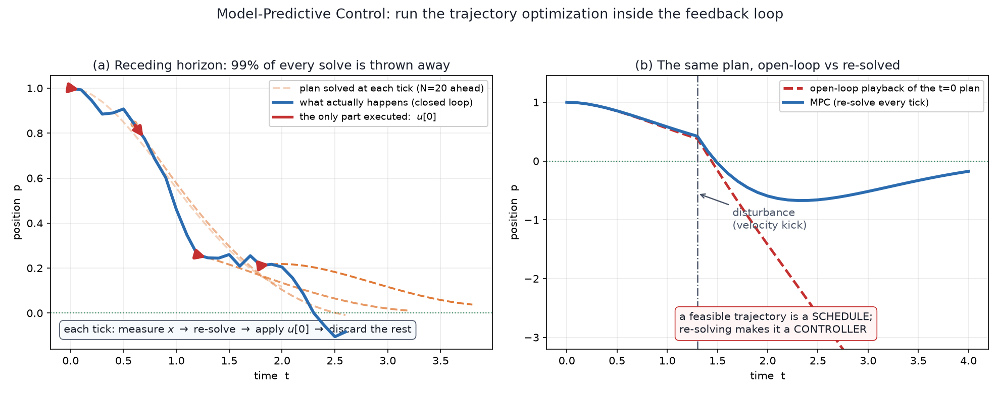
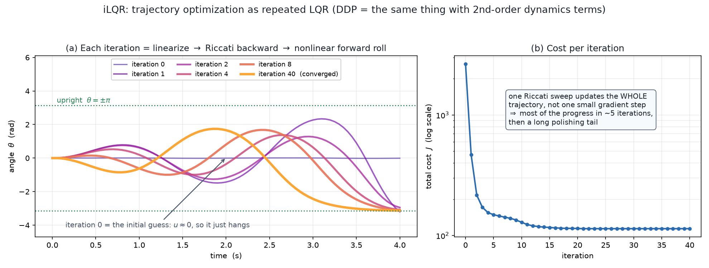
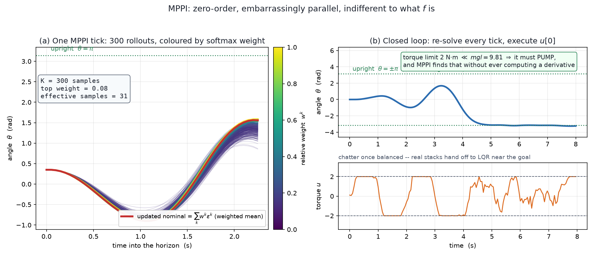

# 10b — Closing the loop: MPC, iLQR, and MPPI

*Underactuated Robotics, Ch. 10 §10.5–10.8.* `10a` ended on a complaint: trajectory
optimization returns `x₀(t), u₀(t)` — an **open-loop plan**, a schedule. Play it back
on a real robot and it drifts, because the integration tolerance was loose, the
constraints were only met to ~10⁻⁶, and the world pushes back. A feasible trajectory
is not a controller.

This note is the four answers to "so how do I actually close the loop?"

```
   1. TVLQR          wrap the plan in time-varying linear feedback        (§10.5.1)
   2. MPC            throw the plan away and re-solve it every tick       (§10.5.2)  ← the big one
   3. iLQR / DDP     make the re-solve cheap by reusing Riccati           (§10.8.2)
   4. MPPI / CEM     make the re-solve gradient-free and GPU-parallel     (§10.4.4)
```

> **One-sentence arc:** *`10a` computed a trajectory; `10b` turns that computation
> into a policy — either by wrapping it in feedback (TVLQR) or by running it inside
> the feedback loop itself (MPC), with iLQR and MPPI as the two ways to make the
> inner solve fast enough.*

---

## 1. Option 1: TVLQR — wrap the plan in feedback (§10.5.1)

You already built this in `08`. Given the nominal `x₀(t), u₀(t)`, define **error
coordinates**

```
   x̄(t) = x(t) − x₀(t) ,     ū(t) = u(t) − u₀(t)
```

and linearize the dynamics *along the trajectory*: `x̄̇ = A(t) x̄ + B(t) ū`. Then run
finite-horizon LQR on that time-varying linear system to get gains `K(t)`, and
execute

```
   u(t)  =  u₀(t)  −  K(t) ( x(t) − x₀(t) )
             ↑                  ↑
        feedforward        feedback correction
```

**Why Tedrake likes it:** you get a *closed-form* controller (no online
optimization), and the Riccati sweep hands you `S(t)` for free — a time-varying
quadratic cost-to-go you can reuse as a **Lyapunov function** to certify a "funnel"
of initial conditions that provably stay near the plan.

**A useful detail:** `A(t), B(t)` are *the same Jacobians the trajectory optimizer
already computed*. TVLQR is nearly free once you've done the trajopt.

**Limits:** valid only near the nominal trajectory, and — the `08` complaint again —
**LQR cannot express constraints.** It will happily command 200 N·m from a 20 N·m
motor.

> **The perching case study (§10.6) is the advertisement for this option.** Tedrake's
> group flew a flat-plate glider into post-stall flight to land on a perch — wildly
> nonlinear, badly modeled aerodynamics. He expected linear feedback to fail. It
> didn't: TVLQR took "highly nontrivial corrective actions — dipping down early to
> gain kinetic energy, tipping up to dump energy." His explanation is the keeper:
> *even as the linearization of the vector field degraded, the **direction** the
> controller needed to push stayed right.* Linear feedback is more robust than its
> derivation suggests.

---

## 2. Option 2: MPC — run the optimizer inside the loop (§10.5.2)



Here's the idea, and it's almost embarrassingly simple:

```
   every control tick:
     1. MEASURE   the current state x
     2. SOLVE     an N-step trajectory optimization starting from x
     3. EXECUTE   only u[0]   — the first action
     4. DISCARD   the rest;  let the world evolve one step;  go to 1
```

That's **model-predictive control**. Step 4 is the part that surprises people: you
compute a 50-step plan and throw away 49 steps of it, then compute another one
20 ms later. It sounds wasteful. It's the entire trick.

> **MPC is an architecture, not an algorithm.** Notice that step 2 says "solve a
> trajectory optimization" without saying *how*. That box is swappable: a QP (§2), an
> NLP, iLQR (§5), or a sampler (§6) — and the choice is what determines whether you
> need `f` differentiable at all. See the FAQ in §12.

**Why it's a policy.** A policy is a map from state to action. MPC gives you one —
`π(x) = ` (first element of `argmin` of a trajectory optimization from `x`). There's
no formula for it; it's defined **implicitly, as the output of an optimizer**. That's
a genuinely different kind of object from `u = −Kx`, and it's why MPC needed its own
theory.

**Why it's feedback.** Because step 1 re-measures. If the robot got kicked, the next
solve starts from where it *actually is*, and the plan re-aims. Panel (b) makes the
contrast concrete: the same plan, replayed open-loop, never recovers from a
disturbance; re-solved every tick, it rejects it. **Re-solving is the feedback.**

**Why it's affordable.** Two reasons, both from `10a`:

- If the problem is a **convex QP** (`10a §5`), you get a globally optimal solve in
  milliseconds, reliably, with no local minima to worry about.
- Consecutive solves are nearly identical — the horizon just shifted by one step. So
  you **warm start** from the previous solution and the solver converges in a handful
  of iterations. This is why specialized solvers (OSQP, HPIPM, acados) beat
  general-purpose ones by so much.

> Tedrake's framing: **linear MPC is "the de-facto generalization of LQR for
> controlling a linear system subject to constraints."** That's exactly the hole
> `10a §1`'s table pointed at. Same LQR problem, plus `u_min ≤ u ≤ u_max`, solved
> online instead of offline.

### Receding horizon

Your true objective might be infinite-horizon, but you always optimize `N` steps
ahead. Each tick the window slides forward one step — it **recedes**. So the finite
horizon is a *computational* truncation, not a statement about the task.

This creates a real problem, which is what the next two sections are about.

---

## 3. Recursive feasibility — the idea practitioners must understand

Every tick you introduce **new** costs and constraints — the ones for time `k+N+1`,
which the previous solve never looked at. So you could be humming along fine and
then, at tick 300, the solver returns **"infeasible."** On a robot, that means your
controller has no output. That is a very bad failure mode.

> **Recursive feasibility** = a guarantee that *if a feasible solution exists at
> step `k`, one is guaranteed to exist at step `k+1`.*

**The simplest mechanism, and it's a lovely argument.** Add a **terminal constraint**
to every solve: `x[N] = x*` (the goal / equilibrium). Then:

```
   At step k you found a feasible plan:   x[k], …, x[k+N]   with  x[k+N] = x*
   At step k+1 you must plan:             x[k+1], …, x[k+N+1]

   Take the old plan, drop its first step, and append  x[k+N+1] = x*,  u[k+N] = u*.
   Since x* is an equilibrium, staying there is feasible.
   ⇒ a feasible solution for step k+1 EXISTS.                                    ∎
```

You've *constructed* a feasible point for the next problem out of the current one.
The solver is then free to find something better — and it usually can, because the
terminal constraint has moved one step further into the future, loosening the
problem. Induction does the rest: feasible once ⇒ feasible forever.

This is a **shifted-solution** argument, and it's the skeleton of essentially all MPC
theory. (More sophisticated versions replace the hard terminal constraint with a
**terminal set** plus a known local controller, and there are versions robust to
modeling error and disturbances.)

## 4. MPC as a Lyapunov argument

Even though `π(x)` has no closed form, you can still prove it stabilizes. The trick:
use **the optimal cost of the trajectory optimization itself** as the certificate.

> **Aside — what a Lyapunov function is** (Ch 9, which we're taking lightly). It's a
> scalar "energy-like" function `V(x) ≥ 0`, zero only at the goal, that **decreases
> along every trajectory of the closed-loop system**. If you can exhibit one, the
> system must converge to the goal — because it cannot keep decreasing a
> non-negative quantity forever without reaching the bottom. Geometrically: you've
> shown the state always flows downhill on a landscape with a single basin. You've
> already met one — `08`'s cost-to-go bowl `xᵀSx` is the Lyapunov function for LQR.

For MPC, let `J*(x, k)` be the optimal cost of the trajectory optimization solved
from state `x` at tick `k`. If the cost *added* at the new end of the horizon is
`≤` the cost *removed* from the front, then

```
   J*( f(x, u*), k+1 )   ≤   J*( x, k )
```

— the optimal cost decreases every tick, so **`J*` is a Lyapunov function** and the
MPC loop is stabilizing. The easy way to satisfy the condition is (again) the
terminal constraint: land on an equilibrium that costs zero, so nothing is added.

**The catch, worth knowing:** unlike `08`'s clean `xᵀS(t)x`, this Lyapunov function
has **no compact representation** — it's "whatever the optimizer returns." You can't
write it down, can't feed it to sums-of-squares tooling. Characterizing it is the
subject of **explicit MPC** (§8 below).

---

## 5. Option 3: iLQR / DDP — make the solve cheap by reusing Riccati (§10.8.2)



If the dynamics are nonlinear, the inner solve isn't a QP any more and a general NLP
solver may be too slow for a control loop. **Iterative LQR** exploits the structure
you already know:

```
   repeat until converged:
     1. LINEARIZE   the dynamics and QUADRATIZE the cost about the current guess
                    → A[n] = ∂f/∂x,  B[n] = ∂f/∂u  along the trajectory
     2. BACKWARD    run 08's finite-horizon Riccati sweep on that local LQ problem
                    → feedforward k[n]  and  feedback gains K[n]
     3. FORWARD     roll out the REAL nonlinear dynamics with
                       u[n] = ū[n] + α·k[n] + K[n]·(x[n] − x̄[n])
                    with a line search on α ∈ (0,1]; accept if the cost dropped
```

**Read step 2–3 together:** iLQR is *"solve `08` repeatedly in the neighbourhood of
wherever you currently are."* That's the whole algorithm, and it's why this chapter
and the LQR chapter are the same material.

**Why it converges so fast** (panel b: cost 2650 → 114, most of it in ~5 iterations):
the Riccati sweep produces a **whole-trajectory update**, not a single small gradient
step. It's using the curvature of the problem, so it behaves like a second-order
method — that's the appeal over plain gradient descent on the shooting objective.

**Why the forward pass uses the real dynamics** — this is a subtle and important
detail. You could roll out with the *linearized* dynamics; you don't, because the
linearization is only good nearby. Rolling out the true `f` keeps every iterate a
genuinely feasible trajectory (it's a **shooting** method, `10a §4`), and the line
search on `α` protects you when the local model over-promises.

**The real limitation: iLQR cannot enforce hard constraints.** The Riccati recursion
has no notion of `|u| ≤ u_max` — the figure's converged solution peaks at 6.9 N·m and
nothing stopped it. The two fixes:
- push constraints into the cost via **penalties / augmented Lagrangian** (§10.4.3) —
  the common choice in robotics today (ALTRO and friends), or
- replace the Riccati solve with a **QP** — at which point you have converged onto
  SQP, i.e. you've reinvented what IPOPT/SNOPT do.

**iLQR vs DDP.** DDP additionally uses a **second-order** expansion of the *dynamics*
(a tensor `∂²f/∂x²`); iLQR keeps only the first-order (linear) one. Everything else
is identical. Conventional wisdom: the extra derivatives usually aren't worth their
cost. Tedrake's aside is worth repeating — the distinction is unambiguous and
uncontroversial, and **papers still routinely say "DDP" when they implemented iLQR.**

---

## 6. Option 4: MPPI — sample instead of differentiate (§10.4.4)



**First, a correction to how §1–5 were framed.** MPC is an *architecture* — measure,
solve, execute `u[0]`, repeat — and it needs `f` only to be **evaluable**. What needs
`∂f/∂x` is the **solver you drop into the "solve" box**, and that is a separate,
swappable choice (see the FAQ entry in §12). MPPI is not an alternative to MPC;
**MPPI *is* MPC** — that is what the "MP" stands for — with the inner solver
swapped from a gradient method to a sampler. The right axis is:

```
   MPC (the loop)  ×  { gradient-based inner solver | sampling-based inner solver }
```

With that said: the *gradient-based* options above (TVLQR, QP/NLP, iLQR) all need
`∂f/∂x`. MPPI needs nothing but the ability to **call** `f`.

You maintain a nominal action sequence `U = (u[0], …, u[N−1])`. Each tick:

```
   1. SAMPLE    for k = 1..K:   ε^k[t] ~ N(0, Σ)          # K noise sequences
                                v^k[t] = u[t] + ε^k[t]

   2. ROLLOUT   for k = 1..K:   simulate from the measured x under v^k
                                S^k = Σ_t ℓ(x[t], v^k[t]) + ℓ_f(x[N])

   3. WEIGHT    w^k = exp( −(1/λ)(S^k − S_min) ) ,  then normalize   # softmax

   4. UPDATE    u[t] ← u[t] + Σ_k w^k ε^k[t]              # weighted mean of perturbations

   5. EXECUTE   apply u[0]; shift U left by one; repeat   # ← receding horizon again
```

Step 5 is exactly §2's MPC recipe. **MPPI = shooting + sampling + MPC.**

### The knobs

- **`K`** — samples. 300 in the figure; 1k–10k on a GPU.
- **`Σ`** — how boldly you explore.
- **`λ` — the temperature, and the only conceptually deep knob.** `λ → 0` puts all
  the weight on the single best sample (that degenerate limit is called **predictive
  sampling**, and MuJoCo MPC ships it as its simplest planner). `λ → ∞` weights every
  sample equally and the update vanishes. In the figure `λ = 20` gives a top weight
  of 0.08 and ~31 *effective* samples out of 300 — a real average, not a max.

**Where `exp(−S/λ)` comes from.** Not a heuristic. For stochastic dynamics with a
quadratic control cost, the *optimal* control distribution provably has density
proportional to `exp(−S/λ)` times the uncontrolled dynamics; MPPI is **importance
sampling** of that distribution, with your Gaussian as the proposal. That's the
"path integral" in the name. Know that it's derived; skip the free-energy algebra.

### Why it wins in exactly your corner of robotics

1. **Non-differentiable dynamics are fine** — contact, friction, impacts. MuJoCo is
   full of kinks; IPOPT hates that, MPPI never notices.
2. **Non-differentiable *costs* are fine too** — "is the object in the gripper: 0/1",
   collision booleans, `if` statements. You cannot put those in a gradient solver.
3. **Trivially parallel** — K independent rollouts. 10,000 on a GPU ≈ the cost of 1.
   MJX / Brax / Isaac exist to make that literally true.
4. **It's how you plan through a learned model** (§7).
5. **Constraints are easy-ish** — clip the samples (the figure's `|u| ≤ 2` is one
   `np.clip`) or reject infeasible ones.

### The gotchas, which are what actually bite

- **Correlated noise is not optional.** i.i.d. per-step Gaussian noise gives white
  jitter that mostly averages to nothing. Real implementations smooth it — filtered
  / colored noise, or (the standard trick) parameterize `u(t)` by a **spline** and
  sample the knots. MuJoCo MPC does the spline version. The figure convolves the
  noise with a 7-step box filter, and it stops working if you remove that.
- **Action dimension is the wall.** 20 actuators × 50 steps = random search in 1000
  dimensions. Smoothness rescues it in practice, but this is the real scaling limit —
  hence MPPI's popularity on cars and quadrupeds over high-DOF whole-body problems.
- **No feasibility or stability guarantees.** Nothing like §3's recursive
  feasibility. It's a heuristic that works well.
- **It chatters.** Bottom-right panel: once balanced, MPPI keeps re-sampling and
  never exactly converges. Real stacks hand off to LQR near the goal, or filter the
  command.

### Family placement

Same "perturb → evaluate → weighted-average" skeleton as:

- **CEM** — identical idea with a *hard* cutoff: keep the top ~10% elites, refit a
  Gaussian. MPPI's exponential weighting is the soft version.
- **Evolution strategies** (CMA-ES, OpenAI-ES) — same pattern applied to *policy
  parameters* rather than an action sequence.
- **REINFORCE / policy gradient** (`07b`) — the MPPI update **is** a zeroth-order
  gradient estimate. The difference is what you optimize: a network's weights (once,
  offline) vs. this instant's plan (every tick, online).

> **The sharpest way to hold it:** *RL amortizes the optimization into a network.
> MPC/MPPI just redoes the optimization every 20 ms.* Which is right depends on
> whether you have a good model (→ MPPI) or lots of interaction data (→ RL). The
> current frontier does both.

---

## 7. Planning through a *learned* `f`

MPPI's only requirement is that `f` be callable, so `f` can be a neural network.
That's the model-based-RL branch, and it's the closest thing in this chapter to your
north star. Two things go wrong, both worth knowing by name:

**Compounding error.** A 1% one-step model error is not 1% at step 50. It propagates
through `∂f/∂x` each step and the unstable eigendirections amplify it exponentially —
**`Aⁿ` again** (`10a §4.3`), now applied to model error instead of gradients. Hence
learned-model planning uses **short horizons** (5–20 steps) and bootstraps the tail
with a learned value function:

```
   S^k  =  Σ_{t=0}^{H−1} ℓ(x[t], v^k[t])   +   V_φ(x[H])
           └── trust the model here ──┘        └─ learned cost-to-go ─┘
```

That's **TD-MPC / TD-MPC2**, roughly the state of the art. Look at what it is
structurally: **`07`'s cost-to-go, learned by TD instead of gridded, spliced onto a
short `10a` trajectory optimization.** Chapters 7 and 10 in one loss function.

**Model exploitation.** MPPI is an optimizer searching K candidates for whichever one
the model scores best — i.e. an *adversarial search for your model's errors*. It will
find the action sequence where the net hallucinates that the block levitates. More
samples makes it worse, not better. Standard mitigations: probabilistic **ensembles**
scored pessimistically (**PETS**), explicit uncertainty penalties, short horizons,
and iterative data collection so the model stays valid where you actually plan.

---

## 8. Two more things from §10.8

### Differential flatness — turning nonconvex back into convex (§10.8.1)

Sometimes a change of variables makes the whole problem easy. The idea is the mirror
image of **partial feedback linearization** (`03c`): with `m` actuators you control
exactly `m` quantities — so pick `m` **output** coordinates such that *specifying
them specifies everything else.*

**Planar quadrotor** (3 DOF `x, y, θ`; 2 actuators). Claim: give me `x(t)` and `y(t)`
alone and I can recover `θ(t)` *and* `u(t)`. From the equations of motion:

```
   m ẍ = −(u₁+u₂) sin θ                −m ẍ            
   m ÿ =  (u₁+u₂) cos θ − mg     ⇒   ────────  =  tan θ
                                      m ÿ + mg
```

So `θ(t)` falls straight out of `ẍ, ÿ`. Differentiate twice more for `θ̈`, then the
rotational equation gives `u₁, u₂`. The whole state and input trajectory is
determined by a **2-dimensional** curve.

**Why that's a big deal:** if *any* sufficiently smooth `x(t), y(t)` is dynamically
feasible, then trajectory design collapses to "find a smooth 2-D curve that misses
the obstacles" — and optimizing piecewise polynomials subject to convex constraints
is a **QP**. A nonconvex trajopt became convex. This is the trick behind the famous
aggressive-quadrotor videos (the 3D quadrotor is flat in `{x, y, z, θ_yaw}`).

**The fine print:** (a) you need the output trajectory differentiable ~4×, since `u`
depends on `d⁴x/dt⁴`; (b) it only *designs* trajectories — you still need feedback to
*stabilize* them; (c) obstacles are still nonconvex, so you must hard-code
left-or-right in advance; (d) there's no recipe for *finding* flat outputs — it's
mechanical intuition plus algebra, per system.

### Explicit MPC — what the constrained-LQR policy actually looks like (§10.8.4)

For the inequality-constrained LQR problem, the optimal policy is known exactly: it's
**piecewise-linear and continuous**, with each piece defined over a **polytope** of
state space, and the optimal cost-to-go is **piecewise-quadratic** on those same
polytopes.

That's a satisfying picture — compare `08`'s single quadratic bowl and single linear
gain. Constraints shatter the bowl into polytopal facets: "in this region the torque
limit is saturated on joint 2, so the gain is *this*."

**Why nobody uses it:** the number of pieces grows **exponentially** with the number
of constraints and the horizon. Computing them offline is hopeless beyond toy
problems, which is precisely why we solve the QP online instead. (Approximate
explicit MPC — including "fit a network to the MPC policy" — is an active area, and
is basically imitation learning applied to a controller.)

### Pontryagin, in one box (§10.7)

The chapter's necessary conditions for optimality. Define the **Hamiltonian**
`H(x,u,λ) = ℓ(x,u) + λᵀf(x,u)`. Then an optimal trajectory must satisfy

```
   ẋ* = f(x*, u*),              x*(0) = x₀              ← forward, dynamics
   −λ̇* = ∂ℓ/∂x ᵀ + (∂f/∂x)ᵀ λ*,   λ*(T) = ∂ℓ_f/∂x ᵀ      ← backward, the ADJOINT
   u*  = argmin_{u ∈ U}  H(x*, u, λ*)                    ← pointwise minimization
```

**The one thing to keep:** `λ` is the **costate**, and `λ = ∂J/∂x` — *the gradient of
the cost-to-go.* So this is `07`'s HJB written along a single trajectory rather than
over all of state space, and the backward `λ` sweep is `10a §9`'s adjoint method,
which is backpropagation. Same object, four notations: `∂J*/∂x` (Ch 7), `2Sx`
(Ch 8), `λ` (Pontryagin), `grad` (backprop).

---

## 9. So which one do I use?

| | needs gradients? | hard constraints? | nonlinear `f`? | guarantees? | where it shines |
|---|---|---|---|---|---|
| **TVLQR** | yes (once) | ✗ | linearized only | Lyapunov / funnels | stabilizing a known plan; cheap online |
| **Linear MPC (QP)** | no (it's linear) | ✅ native | ✗ | recursive feasibility, Lyapunov | flat-ground legged/wheeled, drones, process control |
| **iLQR / DDP** | ✅ needs `∂f/∂x` | ✗ (penalties only) | ✅ | none as such | smooth nonlinear, fast onboard solve |
| **NLP collocation** | ✅ | ✅ | ✅ | local optimum | offline planning, hardest problems |
| **MPPI / CEM** | ✗ | soft / clipping | ✅ any `f` | none | contact, non-smooth costs, learned models, GPUs |

**For your builds specifically:**

- **Wheeled-legged base on flat terrain** → linearize about the nominal, and this is
  a **convex QP**. Use OSQP-style linear MPC. You get constraints, warm starting,
  guarantees, and millisecond solves. Do not reach for MPPI here.
- **Steps, curbs, contact switching** → the dynamics go hybrid and non-smooth. That's
  MPPI's home turf, and it's the natural thing to try *before* reaching for RL.
- **Pick-place in MuJoCo** → you have the true model, so MPPI is an **oracle
  planner**. That is immediately useful for a reason unrelated to control: it
  generates demonstration trajectories without teleop, which you then distill into
  ACT/diffusion. Plan with privileged physics, imitate from pixels.

---

## 10. Gotchas / intuition checks

1. **MPC's horizon `N` is a compute knob, not a task parameter.** Too short and the
   controller is myopic (drives into a wall it can't see yet); too long and you blow
   the time budget. The terminal cost/constraint is what lets a short horizon behave
   like a long one — it's a stand-in for "everything after `N`," which is exactly
   `07`'s cost-to-go. **A good terminal cost is a value function.** (Worked through
   in `10a §12 FAQ`: with the *true* `ℓ_f = J*`, a horizon of `N = 1` would already
   be optimal — that's just the Bellman equation.)
2. **"Infeasible" is a controller outage.** Design for recursive feasibility, and
   always have a fallback (last known good plan, or a safety controller).
3. **Warm starting is not an optimization detail — it's what makes MPC real.** Cold
   starting every tick can be 10× slower and much less predictable.
4. **iLQR's feedback gains are free and worth keeping.** The backward pass gives you
   `K[n]` whether or not you use them. If you run iLQR at 10 Hz, use `K[n]` to
   interpolate between solves at 1 kHz. That's iLQR-MPC in practice.
5. **MPPI without smoothed noise doesn't work.** See §6.
6. **Every method here is still *local*.** Nonconvexity didn't go away; MPC re-solves
   a nonconvex problem repeatedly and can hop between local minima tick to tick,
   which shows up as jittery, indecisive behaviour. Warm starting suppresses it (and
   also biases you toward the previous minimum — the same mechanism, cutting both
   ways).

---

## 11. Where this connects

**Backwards:** `07` (cost-to-go = the terminal cost you should be using), `08` (the
Riccati sweep, reused directly inside iLQR and TVLQR), `10a` (the transcription being
re-solved).

**Forwards:** **Ch 16** stabilizes limit cycles rather than trajectories — the version
of §1 you need for gaits. **Ch 17** planning-and-control through contact is where the
non-smooth `f` of §6 becomes the main event.

**Beyond the book,** and squarely on the north star: MPPI-over-a-learned-model
(TD-MPC), MPC as a *demonstration generator* for imitation learning, and the general
pattern of **distilling an expensive planner into a fast network** — which is what
explicit MPC (§8) is doing by hand, and what every VLA is doing by gradient descent.

---

## 12. FAQ

> Symbol and solver questions (`ℓ`, `ℓ_f`, "why not OR-Tools", "can MPPI use a
> learned `f`") live in **`10a §12`**, since those objects are introduced there.

### Q: Does MPC require `f` to be differentiable?

**No. MPC requires `f` to be *evaluable*. Differentiability is a requirement of the
*inner solver*, not of the architecture.**

MPC is a loop — measure `x`, solve a trajectory optimization from `x`, execute
`u[0]`, repeat. Nothing in that loop mentions derivatives. What goes in the "solve"
box is a swappable choice:

| Inner solver | needs `f` differentiable? | why |
|---|---|---|
| **QP** (linear model) | you already *have* the derivative | for a linear system `A = ∂f/∂x` exactly — it **is** the Jacobian, whether you differentiated for it or were handed it |
| **SQP / interior point** (IPOPT, SNOPT) | **yes** | needs constraint Jacobians. You needn't *supply* them (solvers fall back to finite differences, `10a §9`) — but FD on a non-smooth `f` returns garbage, so `f` must genuinely be smooth |
| **iLQR / DDP** | **yes**, explicitly | the backward pass is built from `A[n], B[n]` |
| **MPPI / CEM / predictive sampling** | **no** | only ever calls `f` |

So the axis is not "MPC vs MPPI" — **MPPI *is* MPC** (that's the "MP"), with a
sampler in the solve box instead of a gradient method.

**What you give up going sampling-based is not the architecture — it's the
guarantees.** §3's recursive feasibility and §4's Lyapunov argument both assume you
can find near-optimal, constraint-satisfying solutions. MPPI offers neither:
constraints become clipping or penalties, and there is no optimality claim.

```
   gradient-based MPC  →  provable recursive feasibility + stability;  needs smoothness
   sampling-based MPC  →  handles contact and 0/1 costs;  no guarantees;  needs a fast sim
```

That trade is the actual decision. It's why flat-terrain wheeled-legged control
should be a QP (the guarantees are available — take them) while curb-climbing
probably can't be.

**One nuance:** "differentiable" isn't binary in practice. **MuJoCo's contact model
is deliberately softened** — a convex, smoothed constraint formulation — precisely so
gradients exist, which is what makes MJX autodiff and differentiable-sim MPC viable
at all. But that smoothing is model bias, and gradients through long contact
sequences behave badly even where they formally exist. **"Gradients exist" and
"gradients are useful" are different claims**, and the gap between them is much of
why sampling wins on contact-rich problems.

### Q: I'm still not clear on iLQR. Walk it through again.

**One sentence: iLQR is Newton's method on a trajectory.** Build a *local model* of
the hard nonlinear problem that you can solve exactly, solve it, take the step,
rebuild the model, repeat. The only thing that makes it "iLQR" rather than generic
Newton is that for a trajectory problem, **"solve the local model exactly" *is* the
Riccati sweep of `08`.**

**What's free.** It's a **shooting** method (`10a §4`): the decision variables are
only the inputs `U = (u[0], …, u[N−1])`; the states are whatever the simulator
returns. So it's an *unconstrained* minimization of `J(U)`.

You could just run gradient descent here — the adjoint method (`10a §9`) hands you
`∂J/∂u[n]` cheaply. It works, and it's slow: first-order, tiny steps, badly
conditioned for the usual `Aⁿ` reason. iLQR is the upgrade.

#### Step 1 — make the world locally LQR

Around the **current guess trajectory** `x̄[·], ū[·]` (a whole trajectory, not a
point), define deviations `δx[n] = x[n] − x̄[n]`, `δu[n] = u[n] − ū[n]`, and expand:

```
   dynamics:   δx[n+1] ≈ A[n] δx[n] + B[n] δu[n]     A[n]=∂f/∂x, B[n]=∂f/∂u at (x̄[n],ū[n])
   cost:       ℓ       ≈ quadratic in (δx, δu)
```

Linear time-varying dynamics + quadratic cost = **exactly `08`'s finite-horizon LQR
problem**, written in deviation coordinates. Closed-form, one backward sweep.

#### Step 2 — the backward pass, and the crux

Sweeping backward, at each step you form the **Q-function**: the cost of applying
`δu` now and behaving optimally afterwards.

```
   Q(δx, δu)  =  [cost of this step]  +  [optimal cost-to-go from where you land]
```

`Q` is quadratic in `δu`, so minimizing is "set the derivative to zero," and the
minimizer is **affine in `δx`**:

```
   δu*[n]  =  k[n]  +  K[n] · δx[n]
              ↑          ↑
        FEEDFORWARD   FEEDBACK
```

**This split is the thing to internalize** — two objects, two different jobs:

- **`k[n]` (feedforward).** Set `δx = 0`: you're sitting exactly on the nominal, so
  you'd think there's nothing to do. But `k ≠ 0`, because **the nominal trajectory
  isn't optimal yet.** `k` answers *"how should I change the plan?"* — it's the
  improvement direction, and it **shrinks to zero as iLQR converges.**
- **`K[n]` (feedback).** A different question entirely: *"if I've drifted off the
  nominal by `δx`, how do I correct?"* Same kind of object as `08`'s LQR gain. It
  does **not** vanish at convergence — when `k → 0`, what's left is your **TVLQR
  controller (§1), delivered for free.**

Substituting `δu*` back into `Q` gives the optimal cost-to-go at step `n`, which is
again quadratic — the recursion closes, which is why *one* sweep suffices. Same
mechanism as `08`'s Riccati equation; in fact **Riccati is this recursion with the
feedforward term absent**, because there the nominal already is optimal.

##### Where exactly does `k` come from? (`K` is Riccati — but `k`?)

**`K` comes from the *curvature* of `Q`; `k` comes from its *gradient*.** Both fall
out of one minimization. Expand `Q` to second order and set the `δu`-derivative to
zero:

```
   Q(δx, δu) ≈ Q₀ + Q_xᵀδx + Q_uᵀδu + ½ [δx]ᵀ[Q_xx  Q_xu][δx]
                                        [δu] [Q_ux  Q_uu][δu]

   ∂Q/∂δu = Q_u + Q_uu δu + Q_ux δx = 0

   ⇒  δu* = −Q_uu⁻¹( Q_u + Q_ux δx ) = −Q_uu⁻¹Q_u  +  (−Q_uu⁻¹Q_ux) δx
                                        └─── k ───┘    └────── K ─────┘
```

**One equation, split by "does this term depend on `δx`?"** No → feedforward.
Yes → feedback. `k` is the piece riding on `Q_u`, the *linear* term of the expansion.

**Why `08` has no `k`.** LQR expands around `x=0, u=0` with cost `½xᵀQx + ½uᵀRu` —
exactly quadratic, minimized *at* the origin, so the gradient there is zero:
`Q_u = 0 ⇒ k = 0` automatically. The feedforward isn't missing from LQR, it's
**zero**, because LQR's nominal is optimal by construction. iLQR's nominal is a guess,
so `Q_u ≠ 0`.

**What `Q_u` is.** In the backward pass,

```
   Q_u  =  ℓ_u   +   Bᵀ V_x′
           └┬─┘      └──┬───┘
   "input costs me    "the state I land in has cost-to-go gradient V_x′,
    directly, now"     and B maps my input into that state"
```

so `Q_u` is the **total derivative of (cost from here to the end) w.r.t. `u[n]`** —
which makes it *exactly* the adjoint gradient `∂J/∂u[n]` of `10a §9`, with `V_x′`
playing the costate `λ[n+1]`. Same object from the other direction. Hence:

```
   gradient descent:  δu = −α · Q_u           raw gradient, tiny steps
   iLQR feedforward:  k  = −Q_uu⁻¹ · Q_u      same gradient, Newton-scaled
```

**`k` is the Newton step** — inverse-curvature times gradient. That is the precise
sense in which iLQR is Newton's method on a trajectory; `K` is the bonus that comes
free because the local model happens to be an LQR problem.

**Structurally: two recursions, not one.** In deviation coordinates the value function
carries both a linear and a quadratic term:

```
   V(δx) = V₀ + V_xᵀ δx + ½ δxᵀ V_xx δx
                └──┬──┘      └────┬────┘
             feeds k next    feeds K next  ← this recursion IS Riccati
```

The backward pass sweeps **both** back together. `08` only needs the second because
`V_x ≡ 0` when you already sit at the optimum.

**On the figure.** Iteration 0, `ū ≡ 0`, pendulum hanging: `ℓ_u = 2Rū = 0` (no torque
spent), but `V_x′ ≠ 0` (you're far from upright and the cost-to-go gradient points
somewhere better). So `Q_u ≠ 0` purely through `BᵀV_x′` — *"torque here would reduce
future cost"* — and `k` converts that into applied torque. That's the 0 → 1 jump in
panel (a). At convergence `Q_u → 0` so `k → 0`, while `Q_uu, Q_ux` stay finite,
leaving `K`.

#### Step 3 — the forward pass, and why you must simulate

> **The backward pass does not hand you a new trajectory. It hands you a
> *controller*. You have to run it to find out where it takes you.**

That is what makes an iLQR step different from an ordinary optimizer step.

```
   x[0] = x₀
   for n = 0 … N−1:
       u[n]   = ū[n] + α·k[n] + K[n]·( x[n] − x̄[n] )
       x[n+1] = f( x[n], u[n] )        ← the REAL nonlinear dynamics, not A,B
```

Three things to notice:

1. **We roll out the true `f`.** The linearization was only used to *design* the
   step. Rolling out the truth keeps every iterate a genuinely feasible trajectory.
2. **The `K[n]·(x[n] − x̄[n])` term is not optional.** The moment you change `u[0]`,
   the real `x[1]` differs from `x̄[1]` — without feedback you'd be applying inputs
   designed for a state you are no longer in, and the update diverges for anything
   but a tiny step. **The gains are what make a *large* step safe.** That, more than
   the curvature, is why iLQR beats gradient descent.
3. **`α` is a line search on the feedforward only.** Try `α = 1`; if the true cost
   didn't drop, try `0.5, 0.25, …`. The quadratic model promised an improvement;
   reality gets a veto.

#### Why it's fast

`Q_uu` contains `BᵀV_xx B` — curvature accumulated backward through the *entire*
horizon, so the step knows how `u[3]` interacts with `u[47]`. A Newton step, not a
gradient step. Hence the figure: `J` 2650 → 114, most of it inside ~5 iterations.

#### Re-reading the figure

Panel (a): iteration 0 is `u ≈ 0`, so the pendulum just hangs. Each later curve is
*one backward sweep + one forward rollout*. Watch the trajectory reorganize
**globally** each iteration — that's the whole-trajectory update. By iteration 8 the
shape is right; 8 → 40 is polish, i.e. `k` shrinking toward zero.

#### A notation trap

`Q` is overloaded, and it shows up that way in most code including
`figures/gen_10b_ilqr.py`:

- **`Q`** = the state-cost matrix in `ℓ = xᵀQx + uᵀRu`
- **`Q(δx,δu)`, `Q_x`, `Q_u`, `Q_uu`, `Q_ux`** = the *Q-function* and its derivatives

Unrelated objects, same letter. (And note the third collision: RL's Q-function
`Q(s,a)` from `07b` is **the same object as this one** — "cost of this action, then
optimal thereafter." That one is not a coincidence.)

#### The two-line summary

```
   backward pass:  pretend the world is LQR, solve it perfectly  →  k[n], K[n]
   forward pass:   run that controller through the REAL dynamics →  new trajectory
```

### Q: Does MPC actually work for something contact-rich, like a quadruped on rough terrain?

**Yes — gait-scheduled MPC is the deployed state of the art on every production
quadruped. But it works by *routing around* the contact problem, not by solving it.**
Knowing which part it routes around tells you exactly where it stops working.

#### What contact does to the optimization

Two separate failures, and they are not equally bad:

1. **Non-smooth gradients.** Foot 1 mm above ground: `∂x[n+1]/∂u` says pushing down
   does nothing. Foot touching: the same derivative is enormous. The linearization is
   valid only in a hairline neighbourhood, so the iLQR/SQP step is a lie almost
   everywhere. Bad, but this is the *fixable* one — see the smoothing nuance in the
   differentiability FAQ above.
2. **Combinatorics.** *Which* feet are down over the next 0.5 s is a **discrete**
   decision. Four legs × 20 knots is a mixed-integer problem hiding inside your
   smooth NLP. This is the killer — not "hard nonlinear," a different complexity
   class.

Letting the optimizer choose contact itself (**contact-implicit** MPC, via
complementarity constraints `fᵢ ≥ 0`, `gapᵢ ≥ 0`, `fᵢ·gapᵢ = 0`) is exactly that
mixed-integer problem. Real, active research; not generally real-time.

#### The architecture that ships

Three moves, stacked:

**1. Delete the discrete decision — a gait scheduler, i.e. a clock.** It *declares*
foot 1 in stance from 0–0.15 s, foot 2 from 0.15–0.30 s. Trot at 2.5 Hz, 50% duty
factor. Nothing is optimized. **Inside a fixed mode sequence the dynamics are smooth
and every method in this note applies unchanged.** This is the load-bearing trick.

**2. Shrink the model — centroidal / single-rigid-body dynamics.** Don't optimize 18
DOF. One floating box with mass and inertia; legs are massless force vectors at known
points:

```
   m p̈   = Σ fᵢ + m g
   İ ω̇  = Σ (rᵢ × fᵢ)
```

State ≈ 13 numbers (CoM pos/vel, orientation, ω); **inputs are the contact forces
`fᵢ`**, constrained to friction cones, and pinned to `0` whenever the schedule says
that foot is in the air. Linearize the rotation and this is a **convex QP** — MIT
Cheetah 3's convex MPC — solved in ~1 ms.

**3. Push the 18-DOF problem down to a one-step QP.** A whole-body inverse-dynamics QP
at ~1 kHz converts the MPC's desired body acceleration + contact forces into joint
torques. No horizon, so contact non-smoothness never bites it.

```
   gait scheduler (a clock)     →  which feet are down, when
   Raibert heuristic + map      →  where they land
        ↓
   MPC on centroidal model      →  body trajectory + contact forces      50–100 Hz
        ↓
   swing spline (per air leg)   →  swing-foot trajectory
        ↓
   whole-body ID QP             →  joint torques                         ~1 kHz
```

Foothold *placement* is usually the **Raibert heuristic**, one line —
`p_foot ≈ p_hip + (T_stance/2)·v + k(v − v_des)`, "step to where your hip will be,
plus a velocity-error correction" — then snapped to a safe cell of the elevation map.

> **The punchline: the two genuinely hard decisions — contact *timing* and foothold
> choice — are made by a clock and a heuristic. MPC only ever sees the smooth
> continuous residue.** That is the entire reason it runs at 100 Hz.
>
> Note the asymmetry: foothold **position** *can* be folded into the MPC as an extra
> continuous variable and stays tractable. **Timing** cannot — it's integer. That
> asymmetry explains the whole architecture.

#### Where it genuinely fails

- **When the contact mode must be *discovered*.** A fixed schedule cannot invent
  "brace a shin on the step edge" or "hook a foot behind the rung." Anything where
  the plan *is* the contact sequence is out of reach → this is where RL wins
  (parkour), and MPC wins on stairs/rubble.
- **Model mismatch at the contact** — friction coefficient, soft ground, slip. The
  centroidal model assumes forces you request are forces you get.
- **Perception.** MPC needs a horizon-length elevation map; a bad map plants a
  confidently-planned foot in thin air. In practice a bigger failure source than the
  optimizer.
- **Flight phases / large angular momentum** — linearized-rotation convex MPC
  degrades; you need nonlinear MPC on the centroidal model and lose convexity.

**MPPI is the escape hatch** (§6): it never differentiates `f`, so it needs neither
the schedule nor the reduced model — MuJoCo MPC does whole-body contact-rich MPC by
sampling. The price is sample complexity, which is why it currently reads as more
compelling for contact-rich *manipulation* than for high-bandwidth locomotion.

#### For the wheeled-legged build

**Rolling contact is persistent and smooth** — no liftoff, no mode sequence, no
combinatorics. A wheeled-legged robot on flat ground is a genuinely *smooth* MPC
problem, which is why the QP-with-guarantees route is the right first target. The
moment you hit a curb, contact becomes discrete again, and that seam is exactly where
learning enters.

### Q: What exactly is the whole-body inverse-dynamics QP at the bottom of that stack?

The layer that actually touches the motors. It's where MR **Ch 5** (Jacobians) and
**Ch 8** (the manipulator equation) show up doing real work.

#### Start from the manipulator equation

```
   M(q) q̈  +  h(q, q̇)   =   Sᵀ τ   +   Σᵢ Jᵢᵀ fᵢ
   └───────┬─────────┘      └──┬──┘     └───┬────┘
     inertia + bias           motors      the ground
     (Coriolis, gravity)                 pushing back
```

**Counting `q` for a quadruped — 18:**

```
   q  =  [ base position (3) , base orientation (3) ,  12 joint angles ]
         └──────────── 6, the floating base ───────┘   └── 4 legs × 3 ──┘
```

> **Trap: foot positions are *not* coordinates.** They're outputs, `p_foot = FK(q)`.
> Counting them would double-count — fix the base pose and 12 joint angles and the
> feet are already determined. Generalized coordinates are the *minimum* set (MR Ch 2).

Three different "12"s coincide for a standard quadruped, which is why they're easy to
conflate:

| the twelve | what it is | lives where |
|---|---|---|
| 12 joint angles | independent coordinates | config space, part of `q` |
| 12 foot coordinates (4 × xyz) | determined by `q` via FK | task space |
| 12 contact force components | the QP's force variables | dual to task space |

They match because **3 joints per leg is exactly enough to place a point foot in a 3D
workspace and no more** — the leg Jacobian is 3×3, square, no redundancy. Change the
hardware and it breaks: a **flat foot** exerts a full 6-component wrench (→ ZMP /
centre-of-pressure machinery); **4 joints per leg** makes each leg redundant.

#### `S` is the selection matrix, and it's the whole story

`S = [0₁₂ₓ₆ | I₁₂]` — motors act on the 12 joint rows and on **none** of the 6 base
rows. Write out only those top 6:

```
   M_base q̈  +  h_base   =   Σᵢ J_base,ᵢᵀ fᵢ         ← no τ anywhere
```

**The only way to accelerate your body is to push on the ground.** That is the
underactuation of legged locomotion in one line — and it is precisely the constraint
the MPC layer above was already solving. Same physics, two layers, different
resolution.

#### Why an optimization and not a formula

Classical ID is a computation: pick `q̈_des`, get `τ = M q̈ + h`. Unique, done. Three
things break that here:

1. **Underactuation** — an arbitrary `q̈_des` may be unachievable by *any* `τ`. You
   need "as close as possible" — a cost, not an equation.
2. **Redundancy** — 12 force unknowns producing a 6-D body wrench. Infinitely many
   distributions give identical body motion; you must *choose*.
3. **Inequalities** — friction cones, `f_normal ≥ 0` (you can push the ground, never
   pull), torque limits. Equations can't express these.

Quadratic cost + linear constraints ⇒ **QP** (`10a §5`).

#### The problem

Decision variables `z = [ q̈ (18) ; f (12) ; τ (12) ]`, ~42 numbers, all appearing
**linearly** in the dynamics — which is why the dynamics can be an equality
constraint.

```
  min   w₁‖ body accel − a_des (from MPC) ‖²
      + w₂‖ f − f_MPC ‖²                          ← track the MPC's force plan
      + w₃‖ swing-foot accel − a_swing ‖²         ← the airborne legs
      + ε‖ τ ‖²                                    ← regularize, break ties

  s.t. (a)  M q̈ + h = Sᵀτ + Σ Jᵢᵀ fᵢ        dynamics, 18 equalities, exact
       (b)  J_c q̈ + J̇_c q̇ = 0                stance feet don't accelerate
       (c)  fᵢ in friction pyramid            no slipping
       (d)  τ_min ≤ τ ≤ τ_max                 motors are finite
```

Stance and swing legs are in **one** QP because they share the same `τ` and the same
18 dynamics rows — swinging a leg reacts on the body, so they can't be separated.

#### LA aside — why `Jᵀf`, and what (b) means

**`J` moves velocities forward; `Jᵀ` moves forces backward.** The reason is power:

```
   power at the foot  =  fᵀ v  =  fᵀ(J q̇)  =  (Jᵀ f)ᵀ q̇  =  power at the joints
```

Same physical power in two coordinate systems; `Jᵀ` is what makes them agree. Nothing
is inverted — `Jᵀ` always exists, even at singularities, even non-square.

**Constraint (b)** is just `v_foot = J_c q̇` differentiated once:
`a_foot = J_c q̈ + J̇_c q̇`, set to zero = "this foot is welded to the ground right
now." Contact enters as an *algebraic constraint*, not a simulated collision — which
is why the QP never sees a discontinuity: **the mode is given, so the constraint set
is fixed for this solve.**

**Friction pyramid.** True Coulomb friction `‖f_tangential‖ ≤ μ f_normal` is a literal
ice-cream cone in force space — a second-order cone, which would make this an SOCP.
Replacing it with an inscribed 4- or 6-sided pyramid gives linear inequalities and
keeps it a QP. Slightly conservative; universally done.

#### No horizon — and that's the point

**The ID QP optimizes a single instant.** No `n = 0…N`, no rollout, no dynamics
propagation — variables `q̈, f, τ` all live at time `t`. It's algebraic, not
predictive. Three reasons:

- **MPC already did the future.** Re-deriving it 1000×/s is pure waste.
- **A horizon costs time you don't have** at 1 kHz.
- **The instantaneous problem is already well-posed** — task accelerations and contact
  constraints are all instantaneous quantities.

The cost is that it's **greedy**: it will happily saturate a torque now in a way
that's unrecoverable in 200 ms, because it cannot see 200 ms. Preventing that is
exactly the MPC layer's job. **The horizon lives upstairs; the physics lives
downstairs.**

> Worth knowing the two layers are converging: **whole-body MPC** collapses them into
> one solve (next FAQ), and at the other extreme a pure QP + Raibert heuristic with no
> MPC at all is a working balance controller. The two-layer split is an engineering
> sweet spot, not a law.

#### One-liner

> **MPC decides what wrench the body needs. The ID QP decides how to produce that
> wrench with the legs you actually have, without slipping or blowing a torque limit.**

#### Bonus: a standing quadruped is a parallel robot

All four feet planted, constraint (b) is 12 scalar constraints on 18 coordinates:

```
   18 coordinates  −  12 contact constraints  =  6 remaining DOF
```

Those 6 are exactly the **body pose**. Move the trunk anywhere in SE(3) and each leg
has precisely 3 joints to meet its 3 constraints → unique IK per leg. So a quadruped
in quadruple stance is a **6-DOF parallel manipulator** — four 3-DOF legs carrying one
platform, structurally a Stewart platform and the same family as the delta robot
(MR Ch 7). Trunk = moving platform, ground = base.

And that closes the loop on the QP: **12 actuators driving a 6-DOF platform is
over-actuation by 6** — that surplus *is* the force-distribution redundancy of point
(2) above. Not an artifact of the formulation; it's the mechanism's kinematic
structure surfacing in the optimization.

Lift one leg and it becomes 9 constraints → 9 DOF: **a different mechanism.**
Locomotion is a machine that reconfigures its own kinematic structure several times a
second — another angle on why contact *timing* is the hard, discrete part.

### Q: What is whole-body MPC, and why is it the natural fit for wheeled-legged robots?

**It collapses the centroidal-MPC + WBC split into one solve over the full model.**
But the thing to get straight first: *whole-body* and *contact-implicit* are
**orthogonal axes**, and whole-body MPC still takes the gait schedule as given.

```
                     │ contact SCHEDULED (a clock)    │ contact IMPLICIT (optimized)
  ───────────────────┼────────────────────────────────┼─────────────────────────────
   REDUCED model     │ convex MPC (MIT Cheetah)       │ centroidal contact-implicit
   (centroidal/SRBD) │ ← the standard 2-layer stack   │ (research)
  ───────────────────┼────────────────────────────────┼─────────────────────────────
   WHOLE-BODY model  │ whole-body MPC                 │ MJPC / MPPI (sampling),
   (full q, 18+ DOF) │ OCS2, Crocoddyl                │ CI-MPC (research)
```

Whole-body MPC removes the **vertical** split, not the horizontal one. Contact timing
is still a clock, and that combinatorial problem is untouched — which is exactly why
whole-body MPC ships and contact-implicit MPC mostly doesn't.

**The solve.** State = full `q` (base pose + all joints) and `q̇`; inputs = joint
torques/accelerations + contact forces; horizon ~0.5–1 s; constraints = full dynamics,
friction cones, joint/kinematic limits, self-collision. Nonlinear and nonconvex, so
**not** a QP — solved with the iLQR/DDP family of §5 (SLQ, multiple-shooting DDP) at
~50–100 Hz.

**What it buys:**

- **Leg inertia is real.** SRBD assumes massless legs — fine for a Cheetah, wrong for
  heavy legs, and *very* wrong when the "foot" is a wheel with a motor and rotor
  inertia spinning at speed.
- **No feasibility mismatch.** Reduced MPC can request a wrench the legs can't
  produce; the WBC then does its best and silently fails. Whole-body MPC can't plan
  what the kinematics won't deliver, because the kinematics are *in* the model.
- **Swing-foot placement is optimized, not heuristic** — see below.

**Caveat on "replaces the WBC":** whole-body MPC runs at ~100 Hz, so something still
runs at 1 kHz — interpolation plus feedforward torque and a stabilizing gain (the
`K[n]` iLQR already hands you free, §5). It replaces the *WBC*, not the fast loop.

#### How foothold placement gets optimized

There is **no decision variable called "foothold."** The foot position *is* `FK(q)`,
already determined by the joint trajectory being optimized:

```
   optimizer picks joint trajectories over the horizon
        ↓  forward kinematics — already in the model
   the foot is somewhere specific at each instant
        ↓  the schedule says "foot 2 contacts at t = 0.15 s"
   the contact constraint activates there, wherever "there" turned out to be
```

Placement is optimized **implicitly**. (Reduced-model MPC needs explicit `pᵢ`
variables plus an *approximate* reachability constraint, because it threw the legs
away. Whole-body MPC gets reachability exactly and for free.)

What picks the spot is **running + terminal cost under constraints** — and the
**terminal cost dominates**, exactly as `07`/`08` predict: a foot planted badly now
surfaces as a bad body state at the end of the horizon. That's where "don't step
somewhere that leaves you unable to continue" lives, and why a terminal cost that
approximates the true cost-to-go matters so much.

> **The Raibert heuristic is approximately the closed-form solution to this same
> problem on a linear-inverted-pendulum model.** So whole-body MPC isn't doing
> something alien — it rediscovers Raibert, and departs from it precisely when the
> simplifications break (torque limits, terrain slope, heavy legs, an arm's mass on a
> wheeled base).

**Two honest limits:**

1. **Local refinement, not global foothold search.** The landscape over footholds is
   badly nonconvex — left of a rock and right of a rock are separate minima with a
   wall between. Being a Newton method on a trajectory (§5), the solver slides
   downhill from its initialization and will *not* discover the other side of a gap.
   Terrain-aware foothold *selection* stays upstream as search over the elevation map;
   MPC refines within that basin. The discrete decision escapes again.
2. **Swing shape still needs shaping.** Nothing in the model knows the ground between
   two contacts is solid, so the cheapest swing is often a straight line *through* it.
   You keep a swing-height reference or a clearance constraint. "Not splined" means
   the *destination* is optimized; the arc there is still guided.

#### Why wheels change the calculus

The canonical application (Bjelonic / Grandia / Hutter, wheeled ANYmal). Three reasons
specific to wheels:

1. **Contact is persistent.** Wheels stay down — no liftoff, no mode sequence. The
   hardest part of legged MPC largely evaporates and you sit in the smooth regime
   where horizon-based methods are at their best.
2. **The wheel constraint is fundamentally kinematic, and a centroidal model cannot
   express it.** A wheel rolls freely along one direction and must not slip sideways —
   a nonholonomic velocity constraint tied to the wheel's *orientation*, which depends
   on joint angles. A model that abstracted the legs into point force vectors has no
   way to say this. Whole-body MPC has the joint angles in the state, so it's writable.
3. **Driving and posture are strongly coupled.** Accelerating on wheels needs a body
   lean; an arm's mass shifts the effective CoM. One solve over full coordinates
   captures that; two layers must communicate it through a wrench, which is lossy.

Wheeled-legged is simultaneously where SRBD's assumptions fail worst (heavy spinning
wheels) and where its benefit is smallest (no flight phase to simplify) — so the
tradeoff swings decisively.

**For the build:** flat-ground wheeled-legged is close to the **easiest real MPC
problem in legged robotics** — persistent smooth contact, no combinatorics,
well-conditioned. Curbs and steps are where the wheel must leave the ground, the mode
sequence returns, and the case for learning begins.
